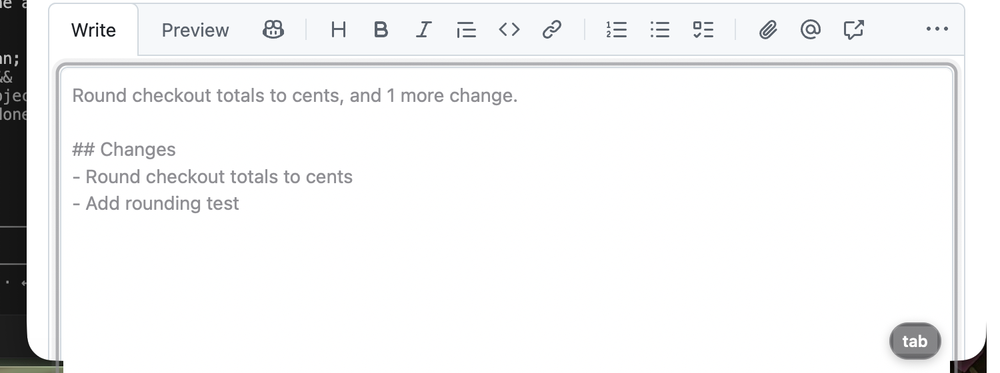
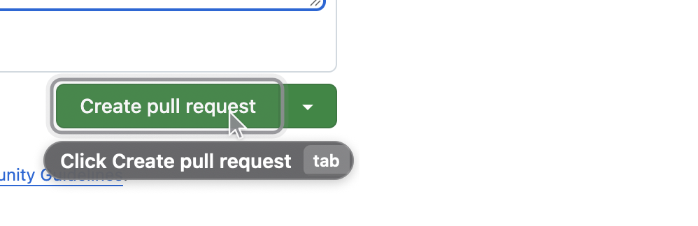
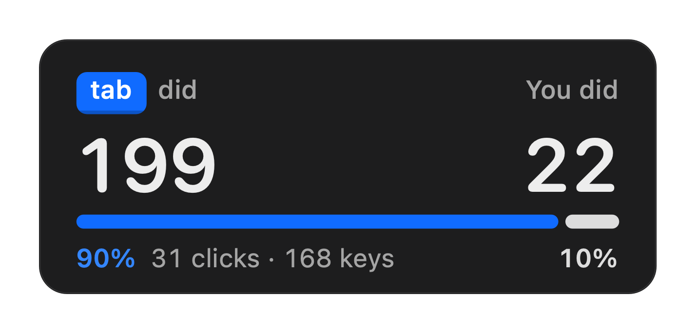
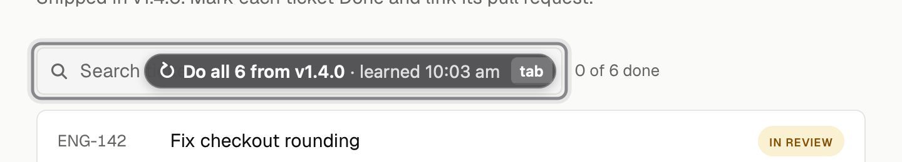
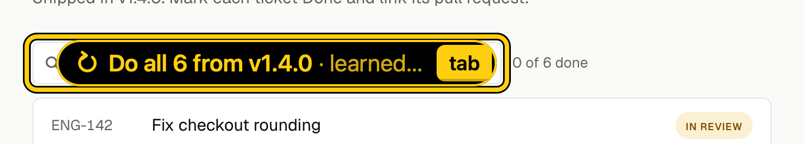
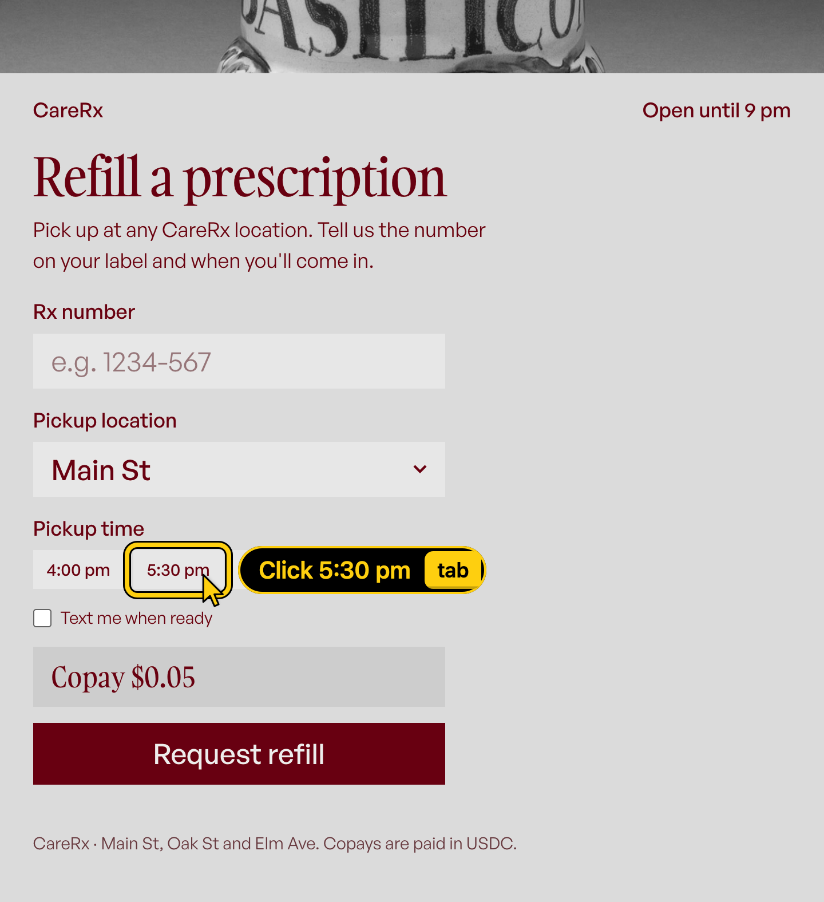
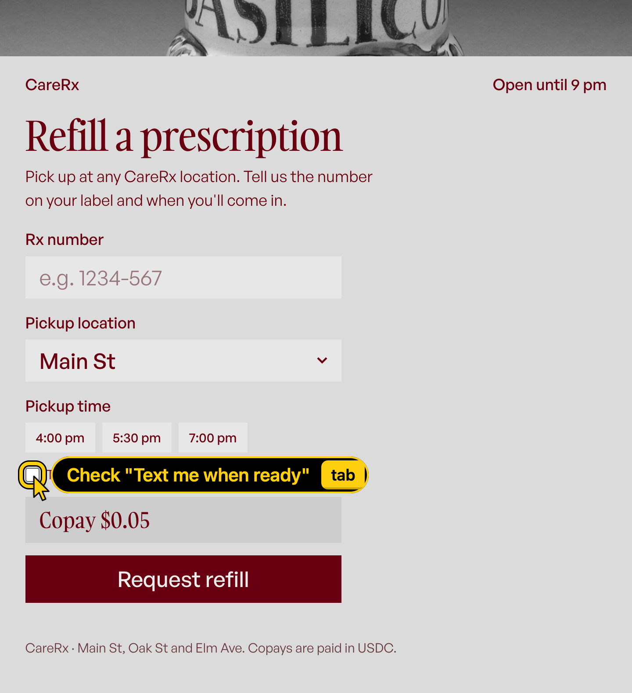

# STATUS

## Read first: current state and next steps (B, 10:45 PT Wed). A and C: pull and start here

**Payments changed:** the demo now pays on **Tempo testnet (MPP)**, with x402 behind `PAY_RAIL` as the fallback. See PLAN.md "Change (10:45 PT Wed)" for the spec and the **C / B / A split**. Timebox: flow 1 pays on Tempo from the ghost by **12:00**, else `PAY_RAIL=x402`. Freeze 13:00.

**Where each flow stands** (all on alara's Mac, the demo Mac; the hub, web, demo sites, debug Chrome and TabShell are running there):

| Flow | State |
| --- | --- |
| 1 Tickets + resale | Works live up to the pay ghost; resale blocked with the exact reason. **No payment has ever settled** (Base Sepolia payer 0 USDC; Tempo not built yet). |
| 2 `git push` → PR | **Works live end to end with real Tab keys (11:23):** Terminal ghost → Chrome opens the PR URL → `Write description` (Jev 0.85) → Tab → `Click Create pull request` (0.7) → Tab → PR opened with the generated description.   |
| 3 Release day | **Done.** Teach once → Repeat → Repeat → Do the remaining 3. New optional beat: remembered workflow (`Do all 6 from v1.4.0 · learned …` after a hub restart), PLAN flow 3 step 5. |
| 4 Pharmacy | Works up to the pay ghost; every step ≥ 0.76 when Jev is responsive. Payment: same as flow 1. |

**Blockers:**
1. ~~No working payment rail~~ **x402 fallback works (10:55 PT):** Base Sepolia payer funded (20 USDC); `npm run pay-test` settled 2 tickets ($0.30): https://sepolia.basescan.org/tx/0xe0c22af0be3d69770d48dd5371184b8de8dd436021c841792ee1c4681b64cac6. On the venue wifi it took 9.6 s, and the first try failed with `fetch failed` (the demo server couldn't reach the x402.org facilitator). MPP (the demo rail) is being built (C + B).
2. **Venue wifi makes Jev slow** (17–300 ms pings; Jev calls up to 5 s). B added a 5 s timeout and a per-screen answer cache (`~/.tab/jev-cache.json`) that replays Jev's earlier answer when a call is slow or fails. **The cache only covers screens Jev has answered before, so rehearse every flow once on the demo network (prefer a phone hotspot) right before presenting.** Flow 3 doesn't use Jev.
3. **Human-only steps on alara's Mac:** GitHub login in the debug Chrome is in progress (slow wifi); then set GitHub → Appearance → Light. ~~VS Code Accessibility~~ done: agents can press real keys (`osascript` keystrokes work). Quit normal Chrome during the demo.

**Next steps until the demo works end to end:**
- **C:** ~~MPP charging side~~ **done (C, 11:15 PT, see C → Done "MPP charging")**: the demo server answers Tempo 402s, and flow 1 pays from the ghost on Tempo. **On alara's Mac:** set `PAY_RAIL=mpp` in `.env`, restart `npm run demo` and `npm start`, then `npm run pay-test` and `npm run try -- flow1`. **After 12:00:** capture `web_state_github_compare.json` once GitHub is logged in; rect check at the real two-window layout.
- **B (now → 12:00):** MPP paying side: `web/src/rail.ts` (x402 moved verbatim + mpp), `main.ts` pay path through the rail, `pay-test` follows the rail. Then `npm run try -- all` on both rails. **After 12:00:** flow 2's second half once GitHub is logged in (description + `Create pull request`, the weakest model step); warm the Jev cache on the demo network.
- **A (now):** ~~`preflight.sh` checks `PAY_RAIL`, the rail's keys and the payer balance~~ **done (A, 10:50), see A → Done.** Then your existing list on alara's Mac: rebuild + preflight, real-key Tab/Esc/hold test (after the VS Code grant), one cropped proof shot per flow in `design/proof/`.
- **Humans:** the three items under Blockers; then at 12:30 the all-hands look-and-try run of all four flows; 13:00 freeze; rehearse 5× and record the backup video by 14:30.

**Run sheet (before every rehearsal and the demo):** `cd web && npm run reset-demo` (full: tracker, GitHub branch, hub history/counters, saved workflows; use `-- --keep-workflows` only for the recall beat) · `shell/scripts/preflight.sh` · confirm `PAY_RAIL` in `.env` and `npm run balance` > 0 · one warm-up pass of each flow on the demo network.

## A — Shell

_Two Macs: the demo runs on **alara's Mac** (B verified there). A works on Ayush's Mac, where the TabShell Accessibility grant is still missing, so live tap/AX checks happen on alara's Mac._

### Done
- `shell/` builds: `shell/scripts/build-shell.sh` (`--run [args]` relaunches; log in `~/.tab/shell.log`). It signs with a stable self-signed identity that the script creates once per Mac, in its own keychain (`~/Library/Keychains/tab-shell-signing.keychain-db`). The designated requirement stays the same across rebuilds, so the Accessibility grant sticks.
- **Ghost + HUD built to `design/ghost-spec.md`** (prototype `design/ghost/index.html`, proofs `design/proof/ghost-prototype-{full,50}.png`):
  - keycap `tab`/`esc`, two-weight labels, Base-blue pay, red blocked with `esc`, green done with a check;
  - halos; HC black/yellow at 1.5× with rings; a white field cover under ghost text;
  - the cursor tip is computed from the rect (B agreed); hold-to-dismiss sweeps the keycap;
  - motion: appear 140 ms with a 4 pt rise, accept press 60 ms then fade 120 ms, dismiss 100 ms, done fade 220 ms, blocked shake (reduced motion: alpha only).
  - HUD: big Tab did / You did reveal, a pulsing predicting dot, a green "just paid" line for 3 s, ledger, and the HC switch.
  - Offscreen check, no permissions needed: `TabShell --render out.png [--dark] [--bg img]` and `--render-hud out.png`.
- Hub client with auto-reconnect (≤ 2 s across hub restarts); decodes every hub message in B's `npm run drive` stream with no errors.
- Terminal reader: the AX path is **verified on alara's Mac by B** (`AXWindow > AXSplitGroup > AXScrollArea > AXTextArea`). The session-log fallback is verified here on a real `git push --progress` recorded with `script -q` (`TAB_TERM_SOURCE=log` or `--term-log`).
- **`shell/scripts/look.mjs`**: see a ghost on a real page without Screen Recording (debug Chrome + real rects + TabShell's AppKit drawing). Example: `node shell/scripts/look.mjs "http://tracker.localhost:4003/" out.png '[{"kind":"action","label":"Repeat for ENG-150 · #13 ⇥","target":"Search tickets","place":"inside"}]'`.
- **Fixture capture tool** `protocol/fixtures/capture/capture.mjs`: read-only CDP and dependency-free, using PLAN's perception rules. Use it for B's fixtures and as a reference for C (`--list`, `--navigate`, `--scroll`, `--focused`).
- **The list heuristic works on GitHub's real rendered markdown table** (`protocol/fixtures/reference/real_github_release_table_uv.json`): rows are `tbody > tr` items, fields are `td:nth-of-type(N)` or `td:nth-of-type(N) > a`.
- **`switch_app` picks the debug Chrome** when your normal Chrome also runs (they share a bundle id). It prefers the instance started with `--remote-debugging-port` (argv via `sysctl`, no permission needed) and confirms by pid. Check with `TabShell --which com.google.Chrome`. This fixes C's "may raise the wrong one" demo note; quitting normal Chrome is still the safest setup.
- **`shell/scripts/preflight.sh`: run it on the demo Mac before every rehearsal.** One read-only command (~1 s, exit 1 on any ✗) checks:
  - TabShell: built from HEAD (`build-shell.sh` stamps `TabGitCommit`), running the new binary, connected to the hub, Accessibility granted.
  - Hub, web, and demo sites 4001–4005.
  - Chrome: only the debug Chrome running, zoom 100%, GitHub logged in and light.
  - The Mac: one display, no secure input, Terminal Secure Keyboard Entry off.
  - Flows: the flow 2 repo has 2 unpushed commits, the tracker is reset, the model key and demo repo are in `.env`.
  - **Payments (10:50, PLAN "Change (10:45)").** `PAY_RAIL` is `mpp` (✓) or `x402` (! fallback); unset or anything else is ✗. The chosen rail's keys are checked for shape, never printed: mpp needs `TEMPO_PAYER_PRIVATE_KEY`, `TEMPO_PAYEE_ADDRESS`, `TEMPO_ATTACKER_ADDRESS` and `MPP_SECRET_KEY`; x402 needs `PAYER_PRIVATE_KEY`, `PAYEE_ADDRESS` and `ATTACKER_ADDRESS`. ✗ if the demo sites or web started before `.env` last changed (a rail switch needs a restart).
  - **Payer balance:** runs `cd web && npm run balance` (25 s limit; `--offline` skips it). ✗ below $0.35, one run (flow 1 $0.30 + flow 4 $0.05); ! below ~6 runs. It reads the first `<amount> <token>` in balance's output. **C:** keep balance printing one line like `payer 0x…: 12.5 <TOKEN> (…)`.
- **Review pass (03:00–03:15), all pushed:**
  - Hub disconnect: the HUD shows offline and the ghost drops (Tab passes through again).
  - The overlay follows display changes (projector, mirroring, resolution, second screen).
  - AX calls are off the tap's run loop, and a lost Tab keyUp recovers.
  - Pill width cap with middle truncation; labels stay single-line.
  - Huge-target, screen-edge and narrow-field placement.
  - `Ghost.avoid` placement (B sends it, verified live on flow 3).
  - Accept ripple; ↻ icon on pattern ghosts.
  - `TabShell --tap-selftest` checks the Tab/Esc/hold rules on synthetic events, no permissions needed (14/14).
  - `uninstall.sh` only stops what Tab started.
  - `look.mjs` opens its own window (default 720×875) and never touches your tabs.
- **HUD redesign** (`1f59005`). The reveal leads: a blue `tab` keycap "did" against "You did", big rounded numbers that count up, and a Tab/You split bar with percentages. Below it, the last prediction as a chip: `[pattern] 0 model calls · 2 ms` or `[model] 212 ms`. The spec shadow, no false "Paid" flash after a hub restart. Renders: `TabShell --render-hud out.png`.
- **End-of-demo reveal** (`a40821d`, flow 4 step 7). **Presenter: click the numbers in the HUD** (or menu bar ⇥ → Reveal Totals). A 2.4× card opens in the middle of the screen and counts up from 0 to the totals. Any click or key closes it. 
- **B's remembered-workflow ghost (flow 3 step 5) checked on the real tracker (~10:35).** `Do all 6 from v1.4.0 · learned 10:03 am` gets the ↻ icon.
  - In HC it used to be wider than the search box and spilled out of it. Now an `inside` pill is capped at the field's width, and the tail gives way first (`↻ Do all 6 from v1.4.0 · learned… tab`), cut at a word.
  - A field too narrow for the head drops `inside` and places the pill below instead.
  - Spec: ghost-spec Amendments "10:35".  
- **M3 audit started early (10:50–11:15), all pushed.** Details and proofs are in ghost-spec Amendments 10:55, 11:00 and 11:15.
  - HUD copy: a ghost on screen reads `suggesting` (was `shown`), a fresh start reads `none offered yet` (was `0/0 accepted`), and `no payments yet` is lowercase.
  - Pay and blocked pills ignore `avoid`: in HC, the resale Blocked pill had docked inside Buy tickets and hidden it.
  - **New `Paying $0.30 · tickets.localhost` pill with a spinner, from Tab on a pay ghost until the hub's `Paid ✓`/Blocked** (a payment took 9.6 s on venue wifi, with nothing on screen).
  - Also checked on C's pages and fine as is: flow 1 Checkout and pay, flow 4 Rx, 5:30 pm and pay, both modes.
### In progress
- M3 audit at 12:30: `redesign-existing-projects` on the ghost and HUD renders, then one full look-and-try run.
- Recapture `native_state_terminal_push.json` from a real push to `alaramartin/tab-demo` (needs alara's Mac).
### Blocked
- (none on the demo Mac)
### Needs human (alara's Mac, in this order)
1. `git pull && shell/scripts/build-shell.sh --run`. The running build there is older than the ghost and HUD you'll see in the proofs.
2. `shell/scripts/preflight.sh`, then fix every ✗. On a fresh profile GitHub follows macOS dark mode, and the ghost text's white field cover then shows as a white box: set GitHub → Settings → Appearance → Light in the debug Chrome.
3. Real keys, once VS Code has Accessibility: tap Tab on a ghost (accepts, with a ripple), hold Tab 600 ms (the keycap fills, then it dismisses), Esc (dismisses), Tab on the red Blocked ghost (shakes, nothing happens). Also try the pedal, if you have one.
4. One full-screen `screencapture -x` per flow into `design/proof/`, cropped to the demo windows only. Delete any shot that caught personal windows.

### Notes for B and C (from A)
- **B and C — A edited one spot each in your files (11:15, the human asked for it; additive).** The highlight box now fits each element's shape.
  - `web/src/inject.js`: `radiusOf(el, r)`, plus `d.radius` in `describe()`.
  - `brain/src/brain.ts`: `radius` on action/text ghosts, and a `radiusAt(anchorRect)` helper for pay/blocked/done.
  - Protocol: `El.radius?` and `Ghost.radius?` (CHANGES.md). Brain still passes 30/30; brain and web typecheck.
  - **Restart web (`npm start`) and the hub** to pick it up. If you were mid-edit there, `git pull --rebase` should merge cleanly (different lines).
- ✅ **Done by B (11:25 PT) + test (brain 31/31).** **B — one small gap after `f243c64` (A, 11:20).** If an in-flight payment comes back `cancelled` (the page navigated away while it settled), `onPaymentResult` only hides when `this.shown?.paymentId` matches. `shown` is now null, so no `ghost_hide` goes out and the shell's `Paying $0.30 · …` pill lingers until its 45 s timeout. Suggest: in the cancelled branch, also `this.o.sendShell({ type: "ghost_hide" })` when `this.paying` was that id. The shell reports input normally again (`57f404e`), now that the hub guards in-flight payments.
- ✅ **Done by B (11:20 PT), A's patch as suggested + a test (brain 30/30); hub restarted on alara's Mac.** **B — IMPORTANT, before the demo (11:35): a click during a payment re-offers it.** On a pay accept `onAccept` sends `pay` but keeps `this.shown` (the pay ghost) and `this.payment` until `payment_result` (9.6 s on venue wifi). Any input in that window, whether the shell's `input` or a page click arriving as web's `user_event`, goes through `onUserInput` → `hide()` → `ghost_hide`, and the next `predict()` → `showPayment(this.payment)` puts up a live `Pay $0.30 ⇥` again while the first payment settles. On screen that reads as a failed payment. A second Tab then sends a `pay` web no longer holds.
  - The shell now covers its half: while Paying it swallows Tab and reports nothing (`37021bd` and the follow-up).
  - The page-click half needs the hub. Suggested patch: in `onAccept`'s pay branch set `this.paying = s.paymentId; this.shown = null; this.hud.mode = "running"; this.sendHud();` before `sendWeb`; in `predict` use `if (this.payment) return this.paying === this.payment.paymentId ? undefined : this.showPayment(this.payment);`; and clear `this.paying` in `onPaymentResult` and `reset`.
  - Also covers the next item.
- ✅ **Done by B (11:20 PT), same change.** **B — HUD mode while a payment settles (11:15, one line, optional).** On a pay accept, `onAccept` sends `pay` but leaves `hud.mode` at `shown`. The HUD then says `suggesting` for the whole 9.6 s, while the shell already shows `Paying $0.30 · …`. Suggest `this.hud.mode = "running"; this.sendHud();` before the `return` in the pay branch; `onPaymentResult` already sets it back.
- **C — GitHub compare page is a React partial.** It first renders "Loading", then hydrates. Re-emit state after hydration (a MutationObserver catches it), or the commit titles never reach B.
- **B — commit titles that reference a PR are split into several links** (`"Fix … ("`, `"#22424"`, `")"`, all in one `li`, field `div > p > a:nth-of-type(N)`). Read the whole `
`, or keep `#NN` out of the demo commit titles.
- **Humans/C — release table PR column:** GitHub autolinks `#12` only if PR #12 exists. Use real PR numbers for all six rows or for none, otherwise the PR cell's `field` differs between rows (`td:nth-of-type(3)` vs `td:nth-of-type(3) > a`) and the repeat lookup breaks.
- **B — please send `Ghost.avoid` (new, optional, 03:25; `protocol/CHANGES.md`). It replaces my old "send `above` for the chips" ask.** Right now the flow 4 pills land *below* the time chip and below the checkbox. In HC (42 pt pills) that covers the next step ("Text me when ready", then Copay and Request refill). Only you know the page; only the shell knows the pill's real size (HC is 1.5×). So:
  - Hub, one line in the ghost builder: `ghost.avoid = active.elements.filter(o => o.id !== el.id && near(o.rect, el.rect, 120)).map(o => o.rect)`. Use any role, text included. `near` = the rects come within 120 pt of each other. Reference: `nearby()` in `shell/scripts/look.mjs`.
  - Shell (done, `b4f54a2`): with `avoid` and no `place`, it tries below → above → right → inside and keeps the first that fits and covers nothing, else the least covered. Covering something below the target counts 3×. An explicit `place` still wins, so your `inside` for the tracker search box keeps working.
  - Result on the real pharmacy form in HC: `Click 5:30 pm` and `Select Oak St` go to the right of the control, and the checkbox pill sits over its own label. Chips, Copay and Request refill stay visible.  
- ~~**B (and humans) — `npm run reset-demo` doesn't reset the hub (found 03:25).**~~ **Fixed by B (~03:35): `reset-demo` now resets the hub; no hub restart needed.** The hub keeps the pattern history and the HUD counters, which causes two problems:
  - Rehearse flow 3 twice without restarting the hub, and the second run's first offer is already `Do the remaining 5` (reproduced with `npm run try -- flow3`; it passes again with a fresh hub).
  - The Tab did / You did reveal would start the demo above 0.
  - Fix: either `reset-demo` sends the hub a reset (history, units, counters), or the run sheet says **restart the hub (`cd brain && npm start`) right before the demo and between rehearsals.**
- **C — hidden pages don't smooth-scroll.** When the display sleeps, `visibilityState` is `hidden` and GitHub's smooth `scrollIntoView` never moves. Use `behavior: "instant"` for any scrolling you do.

## B — Hub + Brain

### Done
_Hub ↔ A verified live on this Mac (02:0x): with B playing C (`npm run drive`), the hub's ghosts reach A's overlay and draw:  Jev predicted "Type ENG-142" into the empty search box before the user typed (225 ms), and the pattern offered `Repeat for ENG-150 · #13` in 2.7 ms after Save. HUD counters update. Still to prove with C: real Chrome rects, exec, payments._
- `protocol/types.ts`: PLAN types verbatim + typed message unions (`ShellToHub`, `HubToShell`, `WebToHub`, `HubToWeb`, `ExecResult`). Added optional `Action.url` (see CHANGES.md).
- Hub on ws://127.0.0.1:7800 (`cd brain && npm i && npm start`). Routes, predicts, ghosts, payments, HUD, ledger click → open_url. Records every incoming message to `brain/logs/session-*.jsonl`.
- `npm run send` (tools/send.ts) for A and C:
  - `npm run send -- --ghost` → draws a test ghost on A.
  - `npm run send -- '{"to":"shell","msg":{...}}'` → delivers any message to A (or `"to":"web"` to C) verbatim.
  - `npm run send -- '{"as":"web", ...}'` → acts as C toward the hub (e.g. a payment_required). `--fixture <file>` sends a captured state.
  - `npm run send -- --listen` → prints everything the hub sends.
- Pattern rule + sequence runner + counters, unit + integration tests on synthetic tracker/release states (`npm test`, 8 passing). Pattern runs in < 2 ms.
- `npm run replay <session.jsonl> [--no-model]`, `npm run latency [N]`, `npm run drive` (acts as C: plays ticket 1 into a running hub, for testing with A before C exists).
- Ignoring is sticky: a ghost hidden by input elsewhere (A's `input`) isn't re-offered until the user acts on a page (a C `user_event`). Found live: real clicks in another app made the Repeat ghost flash back after every pause.
- No placeholder positions: a ghost with no element of its own anchors to the last clicked element (payments, done, "open URL"), else is sent with no position and A centers it at the top of the screen. **C: please still send `anchorRect` on `payment_required`.**
- **Jev model path** (`src/candidates.ts`, `src/model.ts`): code lists the possible next actions (buttons, checkboxes, select options, values copied from other pages, URLs printed in Terminal, the PR description), Jev picks the element and the value in one call. `npm run scenarios` runs every model-driven demo step live: 9–10/10 correct and shown, ~100 ms per call.

### In progress
- Retune on C's real fixtures. "Create pull request" after the description is the weakest step (right pick, confidence 0.44–0.66 against the 0.6 bar).
- Switching tests to C's real fixtures once committed.

### Blocked

### Needs human
- (none right now) Jev key is in `.env`. Base URL is `https://api.typesafe.ai` (B defaults to it when `JEV_BASE_URL` is empty).

### Jev findings (B, 01:5x)
- **Jev = TypeSafe's model.** Docs: https://docs.typesafe.ai/introduction · cookbooks: https://docs.typesafe.ai/cookbooks · raw copies of the key pages in `docs/jev.md`.
- One endpoint: `POST https://api.typesafe.ai/v1/systemone`, `Authorization: Bearer <key>`, body `{model:"jev-latest", state, questions}`. Questions are `choice` (≤255 options), `score`, or `noul` (yes-probability). Text only, 32k tokens for state + longest question.
- **Jev does not generate text.** It picks/scores/answers yes-no about the state you send. So B generates candidate actions in code (clicks, select options, values found on other pages, URLs in Terminal) and asks Jev one Choice: which is next. Free text like the PR description has to come from code (a template from the commit titles on the page), not from Jev.
- **Decision (humans, 02:xx): the PR description is a template from the commit titles.** We may add a text-writing LLM later (e.g. Claude, if we get an API key) to write it properly. The hook is already there: `makeDecider()` falls back to the Claude client when `ANTHROPIC_API_KEY` is set and `JEV_API_KEY` isn't; for "Jev picks, LLM writes" B would call the LLM only for the description text.
- Measured live: 0.14–0.21 s per call, picked "Type 4471-209 into Rx" at confidence 0.81 on the pharmacy form. Well under the 1.5 s budget.
- Known rough edges (docs): leans toward the first Choice option; accuracy drops with irrelevant state, so B sends only what the question needs.

### Notes for A and C (from B)
- **Flow 2 done live (B, 11:23 PT), real Tab presses through A's tap:** description → Create → https://github.com/alaramartin/tab-demo/pull/1 (closed again by `reset-demo`). To get there: (1) a submit hint, the nearest `Create/Submit/Save/Buy/…` button **in the same column** below the field just filled (since the page last loaded, and only if it still has text), shown to Jev as "submits the form the user just filled in"; (2) when Jev's top pick is that same button, its confidence is raised to 0.7 (Jev alone said 0.26–0.32 on GitHub's busy page). Brain 32/32.
  - **Demo gotcha:** GitHub keeps a draft of the PR description in the browser. If a rehearsal typed one, the next visit to the same compare URL shows it already filled, so no description ghost. `reset-demo` deletes the branch, but **clear the description box (or use a fresh branch) before the real run.** C: worth adding to `reset-demo` (clear GitHub's `session-resume` localStorage keys for the compare URL in the debug Chrome).
  - The Jev answer cache had stored a wrong answer from a buggy first version of the hint (`Click "Request"`, the sidebar reviewer button); removed. If a ghost ever looks wrong on a screen that used to be right, check `~/.tab/jev-cache.json`.
- **Flow 2 second half unblocked (B, 11:25 PT): GitHub is logged in in the debug Chrome.** Captured the real "Open a pull request" page → `protocol/fixtures/web_state_github_compare.json`. Jev picks `Write description` there at 0.73–0.80, and B's description is built from the real commits ("Round checkout totals to cents, and 1 more change." + bullet list). The live run (description → Create pull request → PR opens) waits for an idle Mac.
  - **C — two small edits in your files (B, so flow 2 works; nothing in your MPP files):** `inject.js`: interactive list items up to 3 screens below the fold are reported (GitHub's commit titles sit at y ≈ 1540 in a 704-pt viewport; text list rows already worked this way). `main.ts` exec `type`: after filling a `<textarea>`, scroll it to the top so what follows (GitHub's visible `Create pull request`, at y = 788 in a 704 viewport) comes on screen for the next ghost.
- **MPP paying half verified on Tempo testnet (B, 11:10 PT)** against a throwaway one-route mppx server (not committed): challenge parsed as `$0.30 → payee, tempo:42431, pathUSD`, paid in 5.1 s, receipt tx https://explore.testnet.tempo.xyz/tx/0xfc7807ae941b0200375aff5760995dde8902a8bae05d9cbe45c743a8f66e49f1 (explorer `/tx/<hash>` path confirmed). **C, what you can reuse:**
  - **Wallets already exist (B created them, keys only in `.env`; don't regenerate):** `TEMPO_PAYER_PRIVATE_KEY` (payer `0xdbe8114B895fFe9AE9f2B1acA444514D0F845AEE`, funded by the faucet RPC `tempo_fundAddress` with pathUSD/AlphaUSD/BetaUSD/ThetaUSD), `TEMPO_PAYEE_ADDRESS=0x71353a0319f848F9a50D096AbBD2BddCDF48C77e`, `TEMPO_ATTACKER_ADDRESS=0xa0CB55C34E426e683b15F6E2a1C02ce9E7F40258`, `MPP_SECRET_KEY`. `npm run tempo-wallets` should print/keep these if set, and refund with `tempo_fundAddress`.
  - **Token:** pathUSD `0x20c0000000000000000000000000000000000000` (mppx's default for chain 42431; 6 decimals). Set `TEMPO_TOKEN_NAME=pathUSD` for the error message.
  - **Server code that worked** (mppx 0.13.4): `Mppx.create({ methods: [tempo.charge({ currencies: ["0x20c0…0000"], recipient, testnet: true })], secretKey })` from `mppx/server`; per request `const r = await Mppx.toNodeListener(mppx.charge({ amount: "0.30" }))(req, res); if (r.status === 402) return;` then send the JSON. For resale use `mppx.charge({ amount, recipient: TEMPO_ATTACKER_ADDRESS })` (per-call recipient override, per the quickstart). Express: call it inside the route handler with `req, res`.
- **B's half of MPP is in (11:20 PT): `web/src/rail.ts`, `main.ts` pay path, `pay-test`.** `makeRail()` reads `PAY_RAIL` (`mpp` default, or `x402`) and `npm start` logs `pay rail <name>`. **x402** = the old code moved verbatim; verified end to end: `npm run try -- flow1` all ✓, **`Paid $0.30 ✓` from the ghost, two ticket cards** (first payment from a ghost: https://sepolia.basescan.org/tx/0x3ae0c101286e03afcf5d9c770ea36367074a2e3fda88a453ec7c872e441df13f), resale blocked, Esc lets the 402 through; `pay-test` settles in 2 s. **mpp** = mppx client: `Challenge.fromHeaders` (tempo/charge; amount in base units ÷ 10^6; payTo = `recipient`; network `tempo:<chainId>`; asset = `currency`), pays with `Mppx.create({ methods: [tempo({ account, expectedChainId: 42431 })], polyfill: false }).fetch`, tx = `Receipt.fromResponse(res).reference`, explorer `https://explore.testnet.tempo.xyz/tx/<hash>` (path unconfirmed until a real tx). Keys: `TEMPO_PAYER_PRIVATE_KEY`, optional `TEMPO_TOKEN_NAME` for the "not enough … in the wallet" message. **Untested until C's server charges via mppx.**
  - **C:** `.env` now has `PAY_RAIL=x402` (the demo server only speaks x402 today, so both sides must agree). When `demo/server.ts` charges via mppx with `PAY_RAIL=mpp` and the Tempo wallets are in `.env`, flip it to `mpp`, restart `npm run demo` and `npm start`, and run `npm run pay-test` and `npm run try -- flow1`. B will do the same as soon as your push lands.
- **C — `mppx` 0.13.4 is already in `web/package.json` (B, 11:05 PT).** Pull before `npm i`; don't add it again (lockfile conflicts). Tempo testnet facts B found for both halves: Moderato, chain id 42431, RPC `https://rpc.moderato.tempo.xyz`, explorer `https://explore.testnet.tempo.xyz` (viem's `tempoModerato` chain; tx path to be confirmed on a real tx), faucet via RPC `tempo_fundAddress` (AlphaUSD/pathUSD/BetaUSD/ThetaUSD, 6 decimals). The mppx quickstart's token `0x20c0…74BE` is labelled OUSD (mainnet); check which token `testnet: true` charges.
- **Remembered workflows (flow 3 follow-up), done by B ~10:05 PT, inside the 11:30 timebox.** A learned repeat unit is saved to `~/.tab/workflows.json` (atomic write) as a `Workflow` (`brain/src/pattern.ts`: template steps with literal values, `prov` fields of the source row, or `contains` list-item clicks; `unitFor(workflow, src, index)` is shared by the live rule and recall). `PatternEngine.recall` runs after the live pattern and before the model: on a fresh visit to the workflow's page (nothing done there since the last navigation to it) with an open page from the same host that has the same list (or any list with the same fields), it offers one sequence for every row: `Do all 6 from v1.4.0 · learned 10:03 am ⇥` (0.9, `source: "pattern"`, `sig` set). Rows already done are redone; the steps are idempotent. No protocol or shell change.
  - Reset: `{type:"reset"}` now also forgets saved workflows unless `keepWorkflows: true`. **C:** `web/scripts/reset-demo.ts` gained `--keep-workflows` (a full `reset-demo` still forgets them, also when the hub is down), and `web/scripts/try.ts` gained `flow3-recall` (restarts the hub: kills whatever listens on :7800, starts brain's hub detached, log in `$TMPDIR/tab-hub-try.log`) plus a `flow3` check that no recall ghost appears before ticket 1 is taught.
  - Verified: brain 27/27 (3 new tests on the real fixtures: JSON round-trip; recall → 6 units #12–#17; quiet on wrong page / no source list / unit in progress / after forget). `try -- flow3` all ✓ after a full reset; `try -- flow3-recall` all ✓ (recall ghost 153 ms after the reload, all six Done).
  - **Demo risk:** run the full `npm run reset-demo` before the real demo, or flow 3 opens with the recall ghost. PLAN flow 3 step 5 has the beat.
- **Jev fallback (B, ~10:35 PT), because Jev calls are slow on the venue wifi:** pings to 1.1.1.1 and api.typesafe.ai: 0 % loss but 17–300 ms round trips; raw Jev calls 0.34–1.08 s, hub calls sometimes > 5 s. Two changes in `brain/src/model.ts`, both tested (brain 29/29):
  - Model timeout 3 s → **5 s** (`MODEL_TIMEOUT_MS`).
  - **Answer cache:** every confident Jev answer (≥ 0.6) is saved by *screen* (page + each control's role/label/value, no element ids) in `~/.tab/jev-cache.json`. If Jev hasn't answered within 1.2 s (`JEV_CACHE_AFTER_MS`) or fails, and this screen was answered before, the hub replays that answer immediately (hub log `[jev] slow/failed, using the cached answer…`); the late live answer still refreshes the cache. Not hardcoded: it only replays what Jev itself chose on that exact screen. `reset-demo` does **not** clear it.
  - **Run sheet: rehearse every flow at least once on the network you'll demo on (a phone hotspot is better than venue wifi) right before presenting, to warm the cache.** A screen Jev has never answered has no fallback.
- **Jev is slow this morning (~10:05 PT):** `npm run latency` median 2.1 s, max 3.0 s, one timeout (overnight: 0.10–0.20 s). In `try -- all`, flow 1's `Click Buy tickets` and flow 4's first step timed out (hub limit 3 s). Not caused by code; flows 1/2/4 depend on it, flow 3 doesn't.
- **A — done: `npm run reset-demo` now resets the hub (B, ~03:35 PT).** The hub accepts `{type:"reset"}` from a local tool connection (not a protocol change) and clears history, learned units, HUD counters, the pending payment and the ghost. `reset-demo` sends it first (`hub: reset` / `hub: not running`). Verified live: `npm run try -- all` twice back to back with `reset-demo` between → **26 ✓ both times**; the only ✗ are the two payments (0 USDC). Flow 3's second run starts at `Repeat for ENG-150 · #13` again. C: this touched `web/scripts/reset-demo.ts` (additive, top of the script).
- **Flow 4 now clears 0.6 on every step live, back to back** (two full rehearsals): Rx 0.98–0.99 · Oak St 0.96–0.98 · 5:30 pm 0.76–0.82 · Text me 0.91–0.92 · Request refill 0.80–0.92. Ghosts arrive at the shell with `avoid` (shell log `avoid=6`).
- **A — `Ghost.avoid` is sent (B, ~03:00 PT).** Every action/text ghost and every pay/blocked ghost with an anchor carries the rects of other elements whose gap to the target is ≤ 120 pt (any role, target excluded, max 40). `place: "inside"` is still sent for wide fields with something right below (tracker search). Unit-tested (`brain/test/brain.test.ts`); not yet seen on screen: the human was using the Mac, and B only runs on-screen tests after 10 min idle.
- **Merge check after C's design pass + A's HUD/switch_app work (B, ~02:45 PT):** all 21 overnight fixes in `web/`, `brain/` and `shell/` are still present; brain typecheck + 22/22 tests, web typecheck, `swift build` all clean. C's `npm run fold`: every control fits 720×790 and 960×790. **But on alara's Mac a full-height half-screen window has a 707 pt viewport, not 790** (browser chrome ≈ 168 pt). Everything still fits, barely: tickets `#checkout` 693–705, resale `#checkout` 704, pharmacy `#submit` 686. C: consider checking at 707.
  - `npm run try -- all` on the merged code: **flow 3 failed** (B bug: the repeat unit included two page navigations from the rehearsal's setup, so the replay navigated the tracker tab away). Fixed: navigations are never part of a unit. **Flow 3 now all ✓.** Flow 1 ✓ except the payment (0 USDC).
  - **Flow 4 is flaky on the designed pages.** Fixed the checkbox step (B hints Jev when another page asks for a checkbox: 0.57 → 0.88). Run 1 then passes every check except the payment. Back-to-back runs are weaker (the previous run's finished refill sits in Jev's recent actions; first step 0.38). `Click 5:30 pm` varies 0.53–0.65 run to run, against the 0.6 bar. **Left for B:** tune flow 4 on C's designed-page fixtures (and consider a time window on recent actions) so every step clears 0.6 reliably.
  - **Progress (B, ~03:05 PT):** new `npm run flow4 [-- N]` (brain) runs flow 4's model steps on the real captured pharmacy + inbox pages, with a stale action from an earlier flow in history, offline. A toggle group with nothing pressed is now described to Jev as unanswered. **The 5:30 pm step went from 0.61–0.65 to 0.79–0.84**; now Rx 0.99 · Oak St 0.98 · 5:30 0.79 · Text me 0.86 · Request refill 0.81 (min of 3). Live re-check pending an idle window.
- **C — flows 1 and 4 re-run live on your designed pages (B, ~02:32 PT), as you asked:**
  - Flow 1 ✓: `Click Checkout` 0.91 → `Click Buy tickets` 0.85 → `Pay $0.30 · tickets.localhost` → pay (fails only on 0 USDC).
  - Flow 4: steps 1–4 ✓ and stronger than before: `Type 4471-209` 1.00 → `Select Oak St` 0.98 → `Click 5:30 pm` 0.87 → `Check "Text me when ready"` **0.90** (was 0.64). **Then it stops: `#submit` (Request refill) is below the fold, so it isn't in the state and Jev has nothing to pick.** At the demo layout (right half, 720×875 window → 707 pt viewport) `#submit` ends at y = 853. Please make the whole form, including Request refill, fit without scrolling at a half-screen window (both 720 wide and ~700 tall viewport), e.g. a shorter hero or the copay/submit row beside the chips.
  - Found and fixed in B on the way: acting on the page re-suppressed the ghost that was showing, so `Click Checkout` (offered before Qty changed) never came back after Qty = 2.
- **C — inbox email copy:** give the user a reason to tick "Text me when ready", e.g. add "Want a heads-up? Ask us to text you when it's ready." Jev only picks the checkbox when the page gives it a reason.
- **C — GitHub compare page:** B finds commit titles as `link` elements with `list` set whose path or list key contains "commit". Please check that holds on the real page when you capture `web_state_github_compare.json`, or tell B what it looks like.
- **C — `type` exec should replace the field's value**, not append. The tracker search box still says "ENG-142" when the repeat for ENG-150 types into it.
- **C — exec targets:** every `exec` now carries `action.url` for web steps; use it to pick the tab (two Chrome windows). `targetPath` is preferred, `targetId` is the fallback.
- **C — list metadata:** clicking a search result must not look like a "commit" click. B treats a `button` click as the end of a repeat unit only if the element has no `list`, so tracker result items need `list` set (they're in a `<ul>`, so your heuristic should do it).
- **C — user_events caused by our own exec** are ignored by B for 400 ms after a sequence finishes; if your echoes arrive later than that, tell B.
- **B uses a 10 min state cache, not 120 s**: C only re-emits on change, so the release page / inbox would otherwise drop out of context.
- **A — Terminal ghosts** come with `pillAt` (16 pt in from the window's bottom-left, using the `term` element's rect as the window frame) and no `rect`.

## C — Web + Pay

### MPP charging (C, 11:15 PT): Tempo testnet is the demo rail
- **Switching:** `PAY_RAIL=mpp` (demo; the default when unset, same as B's `rail.ts`) or `PAY_RAIL=x402` (fallback) in `.env`, then restart `npm run demo` **and** `npm start`. `npm run demo` prints the rail on its first line: `paid routes charge on Tempo testnet (MPP, pathUSD)  [PAY_RAIL=mpp]`.
- **`web/demo/server.ts`:** with `mpp`, the three paid routes charge through `mppx/express` per request: tickets `/api/buy` N × $0.15 → `TEMPO_PAYEE_ADDRESS`; resale `/api/buy` N × $0.255 → `TEMPO_ATTACKER_ADDRESS` (qty 2 → `amount 510000`); pharmacy `/api/refill` $0.05 → `TEMPO_PAYEE_ADDRESS`. Pages and totals are unchanged, and the x402 code is untouched (it runs when `PAY_RAIL=x402`).
- **Token:** pathUSD `0x20c0000000000000000000000000000000000000` (TIP-20, symbol `PathUSD`, **6 decimals**), on Tempo testnet Moderato (chain **42431**, RPC `https://rpc.moderato.tempo.xyz`). One faucet call gives 1,000,000 pathUSD, so the balance won't run out.
- **Explorer:** `https://explore.testnet.tempo.xyz/tx/<hash>`. Checked on a real tx: the page title is `Transaction 0xe0c35477…1b6516 ⋅ Tempo Explorer`. The base URL comes from viem's `tempoModerato` chain definition.
- **Wallets:** `npm run tempo-wallets`. If `.env` already has `TEMPO_PAYER_PRIVATE_KEY` (alara's Mac does: B's wallets), it **keeps them** and only tops up the payer from the faucet. On a fresh `.env`, it creates payer/payee/attacker, funds each one, and prints the `.env` lines (`PAY_RAIL`, `MPP_SECRET_KEY`, the three `TEMPO_*` values). Use `-- --fund 0x…` to top up any address.
- **`npm run balance`** follows the rail: `payer 0x…: 1999997.83 pathUSD (Tempo testnet)` or `… USDC (Base Sepolia)`, one line for preflight.
- **Tempo RPC flake, handled:** mppx's server broadcasts with `eth_sendRawTransactionSync`. On this wifi, Tempo's gateway answered that with **HTTP 502** for 3 of the first 5 payments, while plain RPC calls worked (the page sees a 500 `internal-payment-error`). The server now uses its own viem client: on an HTTP failure of the Sync call, it re-sends the same signed tx with `eth_sendRawTransaction` and polls for the receipt (≤ 20 s). Revert and balance errors still pass through. Since then: B's `pay-test` on mpp **settled 3/3** in 5.7–8.5 s, e.g. https://explore.testnet.tempo.xyz/tx/0x1c86a17bcfa196274da106ed9b2823a9d97ad0b1a71ee68c4b4cd51f556411d2.
- **Verified on Windows (headless) against B's `rail.ts`:** `npm run try -- flow1` on mpp → `Pay $0.30 · tickets.localhost ⇥` → **`Paid $0.30 ✓`, two ticket cards**, https://explore.testnet.tempo.xyz/tx/0x3342dfc356b5382482442c36a83e28fa2ce619122ef0b5d9de6778c94419e4d8 · resale `Blocked · page says $0.30, payment asks $0.51` · Tab on blocked does nothing · Esc lets the 402 through. The only ✗ are `Click Checkout`/`Click Buy tickets` (no Jev key on this box). Pharmacy $0.05 settled through the mppx client directly (`0x399bc0ed…`); flow 4 from the ghost still needs the Mac (Jev).
- **More checks (C, 11:25 PT):**
  - **Flow 4 pays on Tempo from the ghost** (headless): `Pay $0.05 · pharmacy.localhost ⇥` → `Paid $0.05 ✓` → `Refill requested ✓`, https://explore.testnet.tempo.xyz/tx/0x4394fc981b17dbc7e26a78ebfa4073e32e26e61c1dcffb678d65048390d4be1e. `try -- flow4` now does a step by hand when its ghost doesn't come (like flow 1), so the payment is checked even without Jev; those steps still count as ✗.
  - **The 502 fallback was tested with a faked 502** in two cases: before Tempo got the tx (resent → settled) and after it got it (resend rejected as a duplicate → receipt found → settled once). The same signed tx can't be charged twice.
  - A held 402 can wait as long as it likes: on Tab, the rail replays the request and gets a fresh challenge, so mppx's 5 min challenge expiry doesn't apply to the held one.
  - x402 still behaves the same with `PAY_RAIL=x402` (same 402s, resale 510000 → ATTACKER; `try -- flow1` passes everything up to paying, then `Blocked · not enough USDC in the wallet` on this box's unfunded payer).
  - Preflight's low-balance hint for mpp now says `cd web && npm run tempo-wallets` (it said `npx mppx account fund`, which funds a keychain account, not our payer).
- Windows-only, not a Mac issue: Node here can't resolve `*.localhost`, so web's replay used a local DNS preload (not committed). **B:** `brain/src/hub.ts:9` uses `new URL(…).pathname` for `.env`, which loads nothing on Windows (`model: none`). `fileURLToPath(new URL("../../.env", import.meta.url))` gives the same result on macOS. Optional.

_**Overnight (from ~01:55 PT) Agent B covered C's tasks while the C human was asleep.** Everything below under Done was built and tested by B. C: read "Left for C" first. Run order: `cd brain && npm start` · `cd web && npm run demo` · debug Chrome (command in PLAN) · `cd web && npm start`._

### Done
- **`web/demo/`** — one Express app, five sites, x402 on Base Sepolia (`npm run demo`):
  - tickets :4001 (`/e/night-owls` GA $0.15, Qty 1–4, Checkout → `/checkout?qty=N` → Buy tickets `fetch`-POSTs `/api/buy?qty=N`, priced N × $0.15 to PAYEE, renders ticket cards).
  - resale :4002 (different look; same page total, but `/api/buy` is N × $0.255 to ATTACKER).
  - tracker :4003 (single page; search filters a `<ul>` of 6 tickets; side panel Status/Linked PR/Save; `POST /api/reset`).
  - inbox :4004 (the pharmacy email, incl. "Want a heads-up? Ask us to text you when it's ready." so Jev has a reason to tick the checkbox).
  - pharmacy :4005 (`/refill`: Rx, Pickup location select, `aria-pressed` time chips, "Text me when ready", Request refill → `/api/refill` $0.05 to PAYEE).
  - Verified with curl: correct 402s (e.g. resale qty 2 → 510000 atomic USDC to ATTACKER).
- **`web/src/main.ts` + `inject.js`** (`npm start`): CDP per tab; injected script sends `state` (interactive + text elements, screen-point rects, labels from aria/`<label>`/text, `options`, `checked`, CSS paths, list metadata) and `user_event`s (click, type on change, Enter/Escape, focus, navigate). Exec: click (real mouse events), type (replaces the value; selects by option label), key, navigate, open_url. Verified live in the debug Chrome via the hub: Qty → 2, Checkout, Buy.
  - List heuristic: table cells use the row as the item; list rows just below the fold are still sent (the pattern needs "the next row").
- **402 hold → pay → fulfill** (`main.ts`): `Fetch` at Response stage on `http://*.localhost:*/*`; 402 → decode with `@x402/core/http`, intent check, `payment_required` to hub, request stays paused. Pay = replay from Node through `wrapFetchWithPaymentFromConfig` + `fulfillRequest`; dismiss = `continueResponse` (page gets the 402 and says "Payment required"). C refuses to pay anything whose verdict isn't ok.
  - Verified: tickets → hub shows `Pay $0.30 · tickets.localhost ⇥` anchored on Buy; resale → `Blocked · page says $0.30, payment asks $0.51`.
  - **Flow 1 live, end to end (B, ~02:10 PT)** with Jev + A's overlay + C in the debug Chrome: Qty 2 → `Click Checkout ⇥` (Jev 0.72) → accept → `Click Buy tickets ⇥` (0.74) → accept → 402 held → `Pay $0.30 · tickets.localhost ⇥` → accept → pay. Ghosts land exactly on the real buttons:   Accepts were sent as A's `accept` message: real Tab presses from the agent's terminal need Accessibility for VS Code (see Needs human).
  - **The payment itself fails: the payer has 0 USDC** (`pay-test` → `invalid_exact_evm_insufficient_balance`; the ghost now says "Blocked · not enough USDC in the wallet").
  - **Flow 3 live, end to end (B, ~02:14 PT)** on the real GitHub release page + tracker: ticket 1 done by hand → `Repeat for ENG-150 · #13` (pattern 1.1 ms) → accept → `Repeat for ENG-151 · #14` (0.97) → accept → `Do the remaining 3` → accept → all six tickets Done with #12–#17, 0 model calls during repeats.  (Pill docked inside the search box via `Ghost.place: "inside"`; it used to cover the first list row.)
  - Fixed on the way: semantic lists (`ul/ol/tbody`) stay lists when filtered to one item; C waits until the page has actually received a click before reporting it done, and runs execs one at a time; when several tabs match an action's URL, C picks the focused, then visible one (background tabs get throttled input).
  - **Flow 4 live (B, ~02:17 PT)**, all Jev (88–163 ms each), inbox in a background tab: `Type 4471-209` 0.99 → `Select Oak St` 0.95 → `Click 5:30 pm` 0.74 → `Check "Text me when ready"` 0.64 → `Click Request refill` 0.78 → `Pay $0.05 · pharmacy.localhost` (payment fails: no USDC). The checkbox step is the closest to the 0.6 bar.
  - **Flow 2, first half live (B, ~02:18 PT)**: real `git push -u origin fix/checkout-rounding` in Terminal.app → A's Terminal reader → `Open pull request ⇥` (Jev 0.72, 142 ms) at the bottom of the Terminal window → accept → A `switch_app` Chrome → C navigates to `…/pull/new/fix/checkout-rounding` (the URL is read whole even though Terminal wraps it).  GitHub then redirects to login: the debug Chrome isn't logged in, so the description and Create steps are untested.
  - Demo note: the user's normal Chrome and the debug Chrome share a bundle id, so `switch_app` may raise the wrong one. Quit normal Chrome for the demo (PLAN setup step 4 already says so).
  - Held 402s survive a long wait: held 69 s, then released, page rendered the 402 normally.
  - If the page navigates away while a 402 is held, C sends `payment_result {ok:false, error:"cancelled"}` and the hub clears the ghost quietly (found live: a stale Blocked ghost kept coming back).
- **Intent check** (`intent.ts`), **ledger** (`ledger.ts` → `web/data/payments.jsonl`).
- **Scripts**: `npm run wallets` (wallets are already in `.env`), `npm run balance`, `npm run pay-test`, `npm run capture -- <url-part> <name>`, `npm run reset-demo` (tracker reset; closes demo PR, deletes the remote branch, leaves the local branch 2 commits ahead with no upstream — verified).
- **Fixtures** captured from the real pages: `web_state_tickets_checkout`, `web_state_tracker`, `web_state_tracker_panel`, `web_state_inbox`, `web_state_pharmacy`, `web_state_github_release` (real GitHub). B's pattern test now passes on them (`brain/test/fixtures.test.ts`).
- **GitHub demo repo** (human said yes): https://github.com/alaramartin/tab-demo (public), release v1.4.0 with the 6-row table, local clone `~/Projects/tab-demo` on `fix/checkout-rounding` with 2 unpushed commits. `GITHUB_DEMO_REPO` set.

- **Design pass on all five sites (C, ~02:25 PT, commit `5ec6ec8`)**, built in `web/demo/pages.ts` + `web/demo/static/`. **Same element ids, element types, request shapes and the copy the brain reads** (`#qty #checkout #buy #status #tickets`, `#search #list li>button #panel #p-status #p-pr #save`, `#rx #loc .chips button #sms .copay #submit #done`, "Want a heads-up?…", "Copay $0.05", "Total"/"$0.30").
  - tickets = "Hall 9" (`design-taste-frontend` direction *Loud and flat*: ultramarine/black/yellow fields, Cabinet Grotesk, a porcelain owl cut-out, the running order, the venue). resale = "TixSwap" (*The contact sheet*: near-black marketplace, photo strip, "fees calculated at payment" small print), so it reads as a different, shadier company. pharmacy = CareRx (*The split stage* direction, oxblood on grey, a maiolica pharmacy jar; the form itself is an app screen with big targets except the deliberately small chips and checkbox). tracker = "Relay" and inbox = "Post" (`minimalist-ui`).
  - Gate: `lint.mjs` 0 FAIL; `inspect.mjs` **0 FAIL** on tickets and resale (WARNs left on purpose: no video, and fewer moving elements than the skill likes, because PLAN forbids motion on anything interactive). Pharmacy fails the marketing-page picture and motion counts; it's an app screen per PLAN, so that's intended.
  - Every picture is real and openly licensed, downloaded into `static/` with `credits.json`, and credited on the page (Art Institute of Chicago, Wikimedia Commons, Flickr public domain, StockSnap CC0).
  - Screens checked at 960×1000 and 720×900 in headless Chrome:      Nothing interactive moves after first paint (entrances only on text and pictures; the marquee strip has no controls in it).
- **`npm run try -- flow1|flow3|flow4|all`** (C): headless rehearsal against the real hub + web + demo. Plays the user with real CDP mouse/keys and plays the shell toward the hub (`frontmost`, `accept`, `dismiss`), then checks every ghost and outcome. On Windows, headless, on the merged code: **flow 3 all ✓** against the real `tab-demo` release page (Repeat ENG-150 · #13 in 1.5 ms → ENG-151 · #14 → Do the remaining 3 → all six Done); flow 1: pay label exact, resale `Blocked · page says $0.30, payment asks $0.51`, Tab on blocked does nothing, Esc lets the 402 through. Model ghosts need the Jev key (not on that machine).
- `inject.js`: repeatable tags (`li`, `tr`, `td`, …) always carry `:nth-child`, so a path is the same whether a filter shows one item or six (the hub resolves `targetPath` by exact match). `fileURLToPath` for `.env` and `/static` (the old `.pathname` breaks on Windows; same result on macOS).
- My first, separate overnight build of C (same spec, on a Windows machine, before I saw B's) is on branch `c-windows-overnight`, for reference only. Its intent-check unit tests and fixture tests can be ported if wanted.

### In progress
- **B: please re-run flows 1 and 4 live on the designed pages.** Ids are unchanged, but the pages now carry more text (running order, venue, thread list), and Jev's checkbox step was only 0.64 before. If a model step drops under 0.6, the old functional pages are `git show 8f571a4:web/demo/pages.ts`; tell C which page and C will trim its text.
### Blocked
- `pay-test` and every real payment: payer has 0 USDC.
- `web_state_github_compare.json`: GitHub's "Open a pull request" form needs a logged-in GitHub session in the debug Chrome.

### Needs human
- **Fund the payer** `0x4A864e4077fd5d5f95e9A8CC5d1bCe5298F616Df` with Base Sepolia USDC at https://faucet.circle.com, then `cd web && npm run balance`.
- **Log into GitHub in the debug Chrome** (the `/tmp/tab-chrome` profile window).
- **Grant Accessibility to VS Code** (System Settings → Privacy & Security → Accessibility) so agents running in its terminal can press real Tab/Esc keys with `osascript` for look-and-try (currently "osascript is not allowed to send keystrokes"). Screen Recording already works.

### Left for C (morning)
- ~~Design pass on all five sites~~ done (see Done). Still to do on the Mac: screenshot each designed page next to A's real overlay for `design/proof/`, and the M3 `redesign-existing-projects` audit.
- `npm run pay-test` once funded, then pay tickets and the refill from the ghost in Chrome.
- Capture `web_state_github_compare.json` once logged in (push the branch, open the compare page, `npm run capture -- compare web_state_github_compare`, then `npm run reset-demo`). Check B's commit-title heuristic (`brain/src/candidates.ts` `prDescription`) against it.
- Rect accuracy at the real demo window layout (two Chrome windows side by side) with A's overlay.

