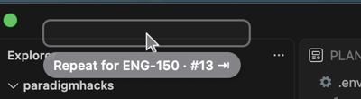
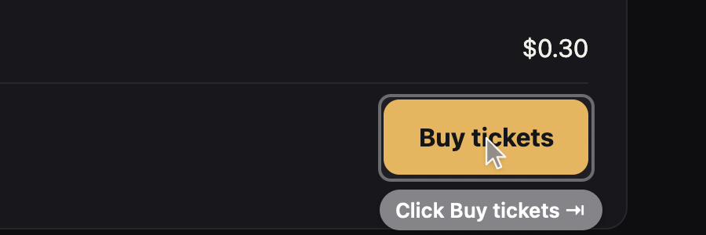
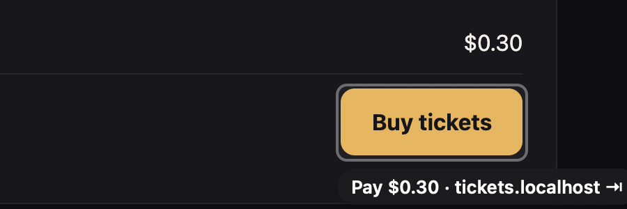
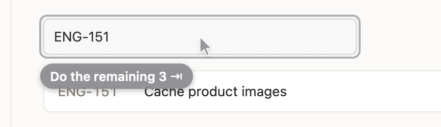
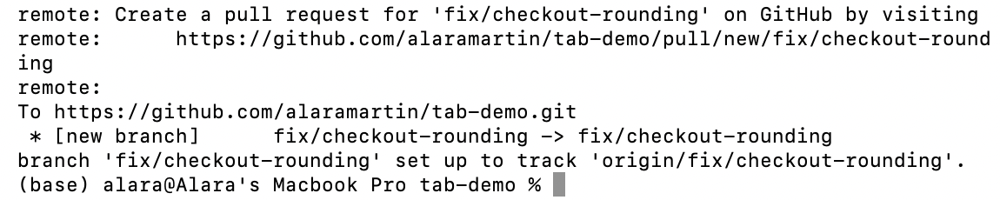
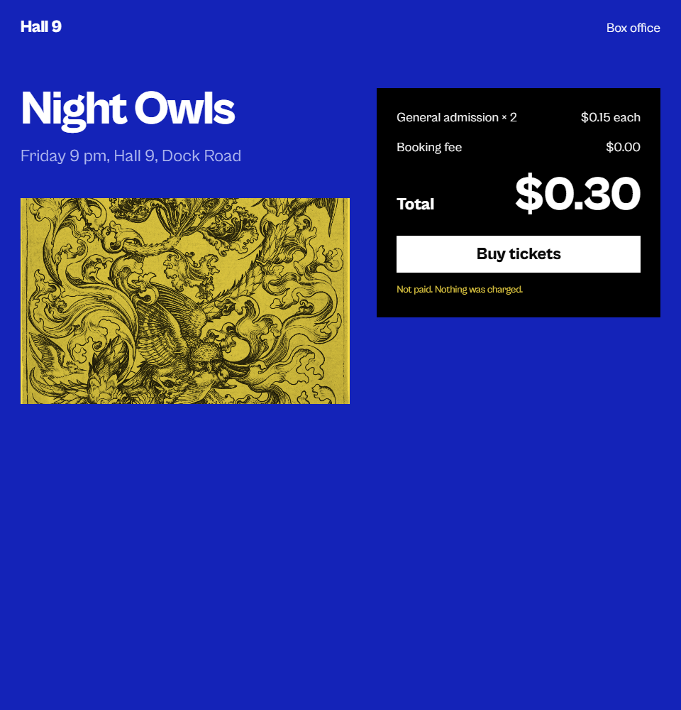
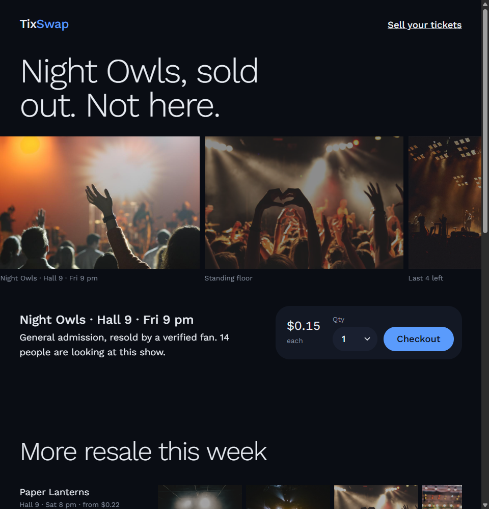
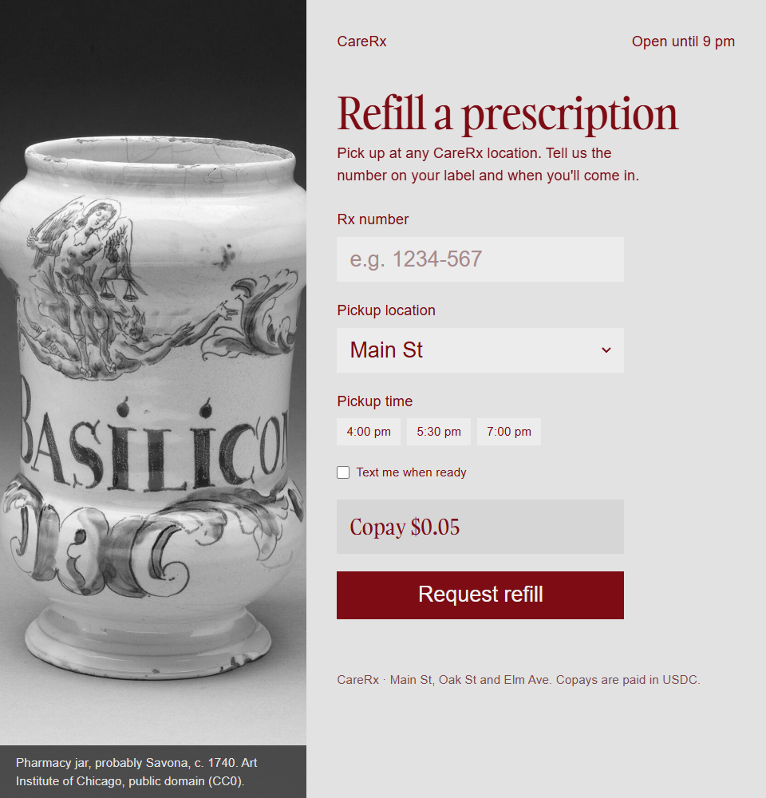
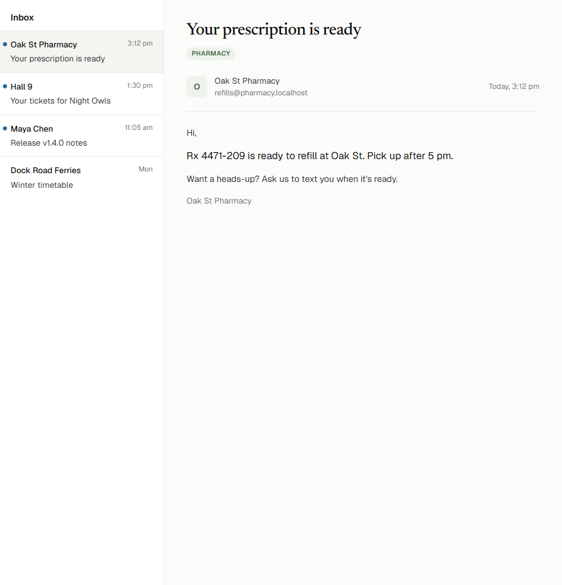
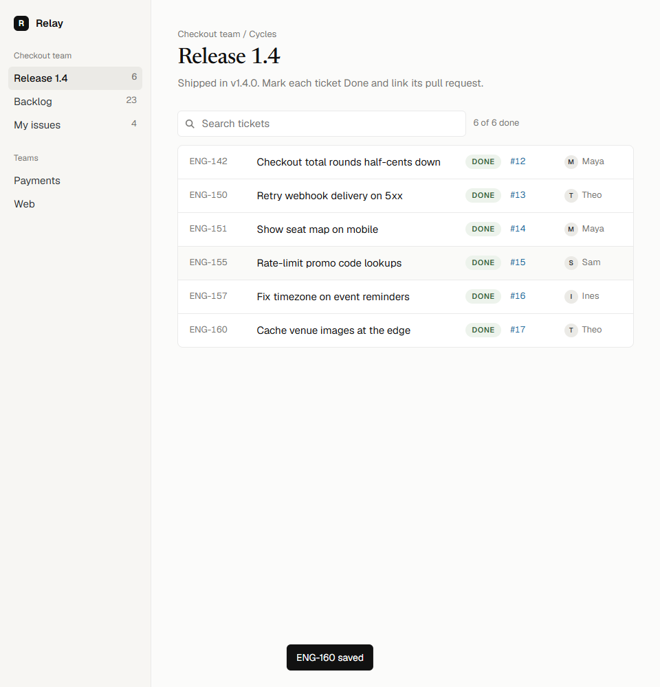

# STATUS

## Read first: overnight handoff (written by B, ~02:20 PT Wed)

The C human was asleep, so **Agent B built C's part (`web/`) overnight** and ran every flow live on alara's Mac (hub + A's shell + C + debug Chrome). Details are in each section below; proofs in `design/proof/`.

| Flow | State |
| --- | --- |
| 1 Tickets + resale block | Works live through the pay ghost. **Paying fails: payer wallet has 0 USDC.** Resale blocked with the exact reason. |
| 2 `git push` → PR | Terminal ghost → switch to Chrome → PR URL opens. **Then GitHub asks for login** (debug Chrome not logged in): description + Create untested. |
| 3 Release day | **Works live end to end** on the real GitHub release + tracker: repeat, repeat, "Do the remaining 3", all six Done. |
| 4 Pharmacy | Works live through the pay ghost (all Jev). Paying fails: 0 USDC. |

**Start everything** (each in its own terminal): `cd brain && npm start` · `cd web && npm run demo` · `open -na "Google Chrome" --args --remote-debugging-port=9222 --user-data-dir=/tmp/tab-chrome` · `cd web && npm start` · `shell/scripts/build-shell.sh --run`. Reset between rehearsals: `cd web && npm run reset-demo`.

**Humans, first thing:**
1. Fund the payer `0x4A864e4077fd5d5f95e9A8CC5d1bCe5298F616Df` (Base Sepolia USDC, https://faucet.circle.com), then `cd web && npm run balance` and `npm run pay-test`.
2. Log into GitHub in the debug Chrome window (`/tmp/tab-chrome` profile).
3. Grant VS Code Accessibility so agents can press real Tab keys in tests.
4. Quit normal Chrome during the demo (same bundle id as the debug Chrome).

**Left for C:** design-skill pass on all five sites; pay-test + real payments once funded; capture `web_state_github_compare.json` once logged in and check B's commit-title heuristic; rect check at the real two-window layout. See "Left for C" below.
**Left for B:** retune Jev on the GitHub compare page (flow 2 second half); watch the weakest steps (`Check "Text me when ready"` 0.64, `Create pull request`).
**For A** (B checked A's commits through `1c87aa0` against B/C overnight; no file overlaps, the protocol is unchanged, and the ghost spec matches what the hub sends):
- Verified on alara's Mac with the latest build: Accessibility granted, the input tap runs, **the Terminal AX path works** (`--dump`: `axTrusted: true`, `AXWindow > AXSplitGroup > AXScrollArea > AXTextArea`), and a real `git push` to GitHub gave the `Open pull request` ghost live. Screenshots work from VS Code. Your Blocked/Needs-human items may be stale for this Mac. Please update your section.
- The demo repo now exists (`alaramartin/tab-demo`, local clone `~/Projects/tab-demo`), so `native_state_terminal_push.json` can be recaptured from a real push (your note said to after setup step 6). B's test accepts the current one.
- Cursor rule (ghost-spec "agree on one"): **B agrees the shell positions the tip from the rect.** B keeps sending the element centre in `cursor`; ignore it.
- Signing: on this Mac the build script created its own identity (leaf `65eac85f…`), not your `4f25…df22`. Fine per machine, but the Accessibility grant belongs to whichever Mac runs the demo.
- ~~The pill can sit on top of the first list row~~ **Done (02:3x):** the hub sends `place: "inside"` when a pill below a wide field (≥ 160 pt) would overlap the next element; verified live with your new build (flow 3 proof). Real-key Tab/Esc/hold test is pending the VS Code grant.
- Your notes for B and C, handled: (1) compare page hydration: C's MutationObserver re-emits; unverified until GitHub login. (2) split commit titles: `prDescription` now joins the links in each commit's message `
` and drops author/hash links; tested on your `real_github_compare_commits_uv.json` (first line `Document native Python preference on Windows ARM64 (#22424)`). The demo repo's commits have no `#NN` anyway. (3) release PR column: none of #12–#17 exist as PRs, so every row is plain text with the same field; the pattern test on the real capture passes. (4) C now scrolls with `behavior: "instant"`.
- **B edited `shell/` at the human's request (~02:25 PT)**, because the HUD covered their work: `HUD.swift` (drag anywhere to move; position and hidden state persist in UserDefaults; `place()` keeps a dragged position instead of snapping back every 2 s; `screenRect` is empty while hidden) and `main.swift` (a ⇥ menu bar item: Show HUD, Reset HUD Position, High Contrast, Quit TabShell). Additive only, nothing in the drawing or protocol changed. A: keep or restyle as you like; if you're mid-edit in these files, rebase on it.

## A — Shell

_Two Macs: the demo runs on **alara's Mac** (B verified there). A works on Ayush's Mac, where the TabShell Accessibility grant is still missing, so live tap/AX checks happen on alara's Mac._

### Done
- `shell/` builds: `shell/scripts/build-shell.sh` (`--run [args]` relaunches; log in `~/.tab/shell.log`). It signs with a stable self-signed identity that the script creates once per Mac, in its own keychain (`~/Library/Keychains/tab-shell-signing.keychain-db`). The designated requirement stays the same across rebuilds, so the Accessibility grant sticks.
- **Ghost + HUD built to `design/ghost-spec.md`** (prototype `design/ghost/index.html`, proofs `design/proof/ghost-prototype-{full,50}.png`):
  - keycap `tab`/`esc`, two-weight labels, Base-blue pay, red blocked with `esc`, green done with a check;
  - halos; HC black/yellow at 1.5× with rings; a white field cover under ghost text;
  - the cursor tip is computed from the rect (B agreed); hold-to-dismiss sweeps the keycap;
  - motion: appear 140 ms with a 4 pt rise, accept press 60 ms then fade 120 ms, dismiss 100 ms, done fade 220 ms, blocked shake (reduced motion: alpha only).
  - HUD: big Tab did / You did reveal, a pulsing predicting dot, a green "just paid" line for 3 s, ledger, and the HC switch.
  - Offscreen check, no permissions needed: `TabShell --render out.png [--dark] [--bg img]` and `--render-hud out.png`.
- Hub client with auto-reconnect (≤ 2 s across hub restarts); decodes every hub message in B's `npm run drive` stream with no errors.
- Terminal reader: the AX path is **verified on alara's Mac by B** (`AXWindow > AXSplitGroup > AXScrollArea > AXTextArea`). The session-log fallback is verified here on a real `git push --progress` recorded with `script -q` (`TAB_TERM_SOURCE=log` or `--term-log`).
- **Fixture capture tool** `protocol/fixtures/capture/capture.mjs`: read-only CDP and dependency-free, using PLAN's perception rules. Use it for B's fixtures and as a reference for C (`--list`, `--navigate`, `--scroll`, `--focused`).
- **The list heuristic works on GitHub's real rendered markdown table** (`protocol/fixtures/reference/real_github_release_table_uv.json`): rows are `tbody > tr` items, fields are `td:nth-of-type(N)` or `td:nth-of-type(N) > a`.
- **`switch_app` picks the debug Chrome** when your normal Chrome also runs (they share a bundle id). It prefers the instance started with `--remote-debugging-port` (argv via `sysctl`, no permission needed) and confirms by pid. Check with `TabShell --which com.google.Chrome`. This fixes C's "may raise the wrong one" demo note; quitting normal Chrome is still the safest setup.
### In progress
- Look-and-try polish on the real screen (the display here is locked, so it's offscreen renders for now). Flow 3 pill-covers-row is fixed shell-side with `Ghost.place`; B needs to send it.
- Recapture `native_state_terminal_push.json` from a real push to `alaramartin/tab-demo` (needs alara's Mac).
### Blocked
- (none on the demo Mac)
### Needs human
- On alara's Mac: real-key test of Tab/Esc/hold (B's note), and a full-screen proof shot of a ghost on a real Chrome element.

### Notes for B and C (from A)
- **C — GitHub compare page is a React partial.** It first renders "Loading", then hydrates. Re-emit state after hydration (a MutationObserver catches it), or the commit titles never reach B.
- **B — commit titles that reference a PR are split into several links** (`"Fix … ("`, `"#22424"`, `")"`, all in one `li`, field `div > p > a:nth-of-type(N)`). Read the whole `
`, or keep `#NN` out of the demo commit titles.
- **Humans/C — release table PR column:** GitHub autolinks `#12` only if PR #12 exists. Use real PR numbers for all six rows or for none, otherwise the PR cell's `field` differs between rows (`td:nth-of-type(3)` vs `td:nth-of-type(3) > a`) and the repeat lookup breaks.
- **B — `Ghost.place` (new, optional; see `protocol/CHANGES.md`):** send `"inside"` for the flow 3 Repeat ghost on the tracker search box, so the pill docks in the box's right end instead of covering the first row. `"above"` and `"right"` also work; the default stays `below`.
- **C — hidden pages don't smooth-scroll.** When the display sleeps, `visibilityState` is `hidden` and GitHub's smooth `scrollIntoView` never moves. Use `behavior: "instant"` for any scrolling you do.

## B — Hub + Brain

### Done
_Hub ↔ A verified live on this Mac (02:0x): with B playing C (`npm run drive`), the hub's ghosts reach A's overlay and draw:  Jev predicted "Type ENG-142" into the empty search box before the user typed (225 ms), and the pattern offered `Repeat for ENG-150 · #13` in 2.7 ms after Save. HUD counters update. Still to prove with C: real Chrome rects, exec, payments._
- `protocol/types.ts`: PLAN types verbatim + typed message unions (`ShellToHub`, `HubToShell`, `WebToHub`, `HubToWeb`, `ExecResult`). Added optional `Action.url` (see CHANGES.md).
- Hub on ws://127.0.0.1:7800 (`cd brain && npm i && npm start`). Routes, predicts, ghosts, payments, HUD, ledger click → open_url. Records every incoming message to `brain/logs/session-*.jsonl`.
- `npm run send` (tools/send.ts) for A and C:
  - `npm run send -- --ghost` → draws a test ghost on A.
  - `npm run send -- '{"to":"shell","msg":{...}}'` → delivers any message to A (or `"to":"web"` to C) verbatim.
  - `npm run send -- '{"as":"web", ...}'` → acts as C toward the hub (e.g. a payment_required). `--fixture <file>` sends a captured state.
  - `npm run send -- --listen` → prints everything the hub sends.
- Pattern rule + sequence runner + counters, unit + integration tests on synthetic tracker/release states (`npm test`, 8 passing). Pattern runs in < 2 ms.
- `npm run replay <session.jsonl> [--no-model]`, `npm run latency [N]`, `npm run drive` (acts as C: plays ticket 1 into a running hub, for testing with A before C exists).
- Ignoring is sticky: a ghost hidden by input elsewhere (A's `input`) isn't re-offered until the user acts on a page (a C `user_event`). Found live: real clicks in another app made the Repeat ghost flash back after every pause.
- No placeholder positions: a ghost with no element of its own anchors to the last clicked element (payments, done, "open URL"), else is sent with no position and A centers it at the top of the screen. **C: please still send `anchorRect` on `payment_required`.**
- **Jev model path** (`src/candidates.ts`, `src/model.ts`): code lists the possible next actions (buttons, checkboxes, select options, values copied from other pages, URLs printed in Terminal, the PR description), Jev picks the element and the value in one call. `npm run scenarios` runs every model-driven demo step live: 9–10/10 correct and shown, ~100 ms per call.

### In progress
- Retune on C's real fixtures. "Create pull request" after the description is the weakest step (right pick, confidence 0.44–0.66 against the 0.6 bar).
- Switching tests to C's real fixtures once committed.

### Blocked

### Needs human
- (none right now) Jev key is in `.env`. Base URL is `https://api.typesafe.ai` (B defaults to it when `JEV_BASE_URL` is empty).

### Jev findings (B, 01:5x)
- **Jev = TypeSafe's model.** Docs: https://docs.typesafe.ai/introduction · cookbooks: https://docs.typesafe.ai/cookbooks · raw copies of the key pages in `docs/jev.md`.
- One endpoint: `POST https://api.typesafe.ai/v1/systemone`, `Authorization: Bearer <key>`, body `{model:"jev-latest", state, questions}`. Questions are `choice` (≤255 options), `score`, or `noul` (yes-probability). Text only, 32k tokens for state + longest question.
- **Jev does not generate text.** It picks/scores/answers yes-no about the state you send. So B generates candidate actions in code (clicks, select options, values found on other pages, URLs in Terminal) and asks Jev one Choice: which is next. Free text like the PR description has to come from code (a template from the commit titles on the page), not from Jev.
- **Decision (humans, 02:xx): the PR description is a template from the commit titles.** We may add a text-writing LLM later (e.g. Claude, if we get an API key) to write it properly. The hook is already there: `makeDecider()` falls back to the Claude client when `ANTHROPIC_API_KEY` is set and `JEV_API_KEY` isn't; for "Jev picks, LLM writes" B would call the LLM only for the description text.
- Measured live: 0.14–0.21 s per call, picked "Type 4471-209 into Rx" at confidence 0.81 on the pharmacy form. Well under the 1.5 s budget.
- Known rough edges (docs): leans toward the first Choice option; accuracy drops with irrelevant state, so B sends only what the question needs.

### Notes for A and C (from B)
- **C — flows 1 and 4 re-run live on your designed pages (B, ~02:32 PT), as you asked:**
  - Flow 1 ✓: `Click Checkout` 0.91 → `Click Buy tickets` 0.85 → `Pay $0.30 · tickets.localhost` → pay (fails only on 0 USDC).
  - Flow 4: steps 1–4 ✓ and stronger than before: `Type 4471-209` 1.00 → `Select Oak St` 0.98 → `Click 5:30 pm` 0.87 → `Check "Text me when ready"` **0.90** (was 0.64). **Then it stops: `#submit` (Request refill) is below the fold, so it isn't in the state and Jev has nothing to pick.** At the demo layout (right half, 720×875 window → 707 pt viewport) `#submit` ends at y = 853. Please make the whole form, including Request refill, fit without scrolling at a half-screen window (both 720 wide and ~700 tall viewport), e.g. a shorter hero or the copay/submit row beside the chips.
  - Found and fixed in B on the way: acting on the page re-suppressed the ghost that was showing, so `Click Checkout` (offered before Qty changed) never came back after Qty = 2.
- **C — inbox email copy:** give the user a reason to tick "Text me when ready", e.g. add "Want a heads-up? Ask us to text you when it's ready." Jev only picks the checkbox when the page gives it a reason.
- **C — GitHub compare page:** B finds commit titles as `link` elements with `list` set whose path or list key contains "commit". Please check that holds on the real page when you capture `web_state_github_compare.json`, or tell B what it looks like.
- **C — `type` exec should replace the field's value**, not append. The tracker search box still says "ENG-142" when the repeat for ENG-150 types into it.
- **C — exec targets:** every `exec` now carries `action.url` for web steps; use it to pick the tab (two Chrome windows). `targetPath` is preferred, `targetId` is the fallback.
- **C — list metadata:** clicking a search result must not look like a "commit" click. B treats a `button` click as the end of a repeat unit only if the element has no `list`, so tracker result items need `list` set (they're in a `<ul>`, so your heuristic should do it).
- **C — user_events caused by our own exec** are ignored by B for 400 ms after a sequence finishes; if your echoes arrive later than that, tell B.
- **B uses a 10 min state cache, not 120 s**: C only re-emits on change, so the release page / inbox would otherwise drop out of context.
- **A — Terminal ghosts** come with `pillAt` (16 pt in from the window's bottom-left, using the `term` element's rect as the window frame) and no `rect`.

## C — Web + Pay

_**Overnight (from ~01:55 PT) Agent B covered C's tasks while the C human was asleep.** Everything below under Done was built and tested by B. C: read "Left for C" first. Run order: `cd brain && npm start` · `cd web && npm run demo` · debug Chrome (command in PLAN) · `cd web && npm start`._

### Done
- **`web/demo/`** — one Express app, five sites, x402 on Base Sepolia (`npm run demo`):
  - tickets :4001 (`/e/night-owls` GA $0.15, Qty 1–4, Checkout → `/checkout?qty=N` → Buy tickets `fetch`-POSTs `/api/buy?qty=N`, priced N × $0.15 to PAYEE, renders ticket cards).
  - resale :4002 (different look; same page total, but `/api/buy` is N × $0.255 to ATTACKER).
  - tracker :4003 (single page; search filters a `<ul>` of 6 tickets; side panel Status/Linked PR/Save; `POST /api/reset`).
  - inbox :4004 (the pharmacy email, incl. "Want a heads-up? Ask us to text you when it's ready." so Jev has a reason to tick the checkbox).
  - pharmacy :4005 (`/refill`: Rx, Pickup location select, `aria-pressed` time chips, "Text me when ready", Request refill → `/api/refill` $0.05 to PAYEE).
  - Verified with curl: correct 402s (e.g. resale qty 2 → 510000 atomic USDC to ATTACKER).
- **`web/src/main.ts` + `inject.js`** (`npm start`): CDP per tab; injected script sends `state` (interactive + text elements, screen-point rects, labels from aria/`<label>`/text, `options`, `checked`, CSS paths, list metadata) and `user_event`s (click, type on change, Enter/Escape, focus, navigate). Exec: click (real mouse events), type (replaces the value; selects by option label), key, navigate, open_url. Verified live in the debug Chrome via the hub: Qty → 2, Checkout, Buy.
  - List heuristic: table cells use the row as the item; list rows just below the fold are still sent (the pattern needs "the next row").
- **402 hold → pay → fulfill** (`main.ts`): `Fetch` at Response stage on `http://*.localhost:*/*`; 402 → decode with `@x402/core/http`, intent check, `payment_required` to hub, request stays paused. Pay = replay from Node through `wrapFetchWithPaymentFromConfig` + `fulfillRequest`; dismiss = `continueResponse` (page gets the 402 and says "Payment required"). C refuses to pay anything whose verdict isn't ok.
  - Verified: tickets → hub shows `Pay $0.30 · tickets.localhost ⇥` anchored on Buy; resale → `Blocked · page says $0.30, payment asks $0.51`.
  - **Flow 1 live, end to end (B, ~02:10 PT)** with Jev + A's overlay + C in the debug Chrome: Qty 2 → `Click Checkout ⇥` (Jev 0.72) → accept → `Click Buy tickets ⇥` (0.74) → accept → 402 held → `Pay $0.30 · tickets.localhost ⇥` → accept → pay. Ghosts land exactly on the real buttons:   Accepts were sent as A's `accept` message: real Tab presses from the agent's terminal need Accessibility for VS Code (see Needs human).
  - **The payment itself fails: the payer has 0 USDC** (`pay-test` → `invalid_exact_evm_insufficient_balance`; the ghost now says "Blocked · not enough USDC in the wallet").
  - **Flow 3 live, end to end (B, ~02:14 PT)** on the real GitHub release page + tracker: ticket 1 done by hand → `Repeat for ENG-150 · #13` (pattern 1.1 ms) → accept → `Repeat for ENG-151 · #14` (0.97) → accept → `Do the remaining 3` → accept → all six tickets Done with #12–#17, 0 model calls during repeats.  (Pill docked inside the search box via `Ghost.place: "inside"`; it used to cover the first list row.)
  - Fixed on the way: semantic lists (`ul/ol/tbody`) stay lists when filtered to one item; C waits until the page has actually received a click before reporting it done, and runs execs one at a time; when several tabs match an action's URL, C picks the focused, then visible one (background tabs get throttled input).
  - **Flow 4 live (B, ~02:17 PT)**, all Jev (88–163 ms each), inbox in a background tab: `Type 4471-209` 0.99 → `Select Oak St` 0.95 → `Click 5:30 pm` 0.74 → `Check "Text me when ready"` 0.64 → `Click Request refill` 0.78 → `Pay $0.05 · pharmacy.localhost` (payment fails: no USDC). The checkbox step is the closest to the 0.6 bar.
  - **Flow 2, first half live (B, ~02:18 PT)**: real `git push -u origin fix/checkout-rounding` in Terminal.app → A's Terminal reader → `Open pull request ⇥` (Jev 0.72, 142 ms) at the bottom of the Terminal window → accept → A `switch_app` Chrome → C navigates to `…/pull/new/fix/checkout-rounding` (the URL is read whole even though Terminal wraps it).  GitHub then redirects to login: the debug Chrome isn't logged in, so the description and Create steps are untested.
  - Demo note: the user's normal Chrome and the debug Chrome share a bundle id, so `switch_app` may raise the wrong one. Quit normal Chrome for the demo (PLAN setup step 4 already says so).
  - Held 402s survive a long wait: held 69 s, then released, page rendered the 402 normally.
  - If the page navigates away while a 402 is held, C sends `payment_result {ok:false, error:"cancelled"}` and the hub clears the ghost quietly (found live: a stale Blocked ghost kept coming back).
- **Intent check** (`intent.ts`), **ledger** (`ledger.ts` → `web/data/payments.jsonl`).
- **Scripts**: `npm run wallets` (wallets are already in `.env`), `npm run balance`, `npm run pay-test`, `npm run capture -- <url-part> <name>`, `npm run reset-demo` (tracker reset; closes demo PR, deletes the remote branch, leaves the local branch 2 commits ahead with no upstream — verified).
- **Fixtures** captured from the real pages: `web_state_tickets_checkout`, `web_state_tracker`, `web_state_tracker_panel`, `web_state_inbox`, `web_state_pharmacy`, `web_state_github_release` (real GitHub). B's pattern test now passes on them (`brain/test/fixtures.test.ts`).
- **GitHub demo repo** (human said yes): https://github.com/alaramartin/tab-demo (public), release v1.4.0 with the 6-row table, local clone `~/Projects/tab-demo` on `fix/checkout-rounding` with 2 unpushed commits. `GITHUB_DEMO_REPO` set.

- **Design pass on all five sites (C, ~02:25 PT, commit `5ec6ec8`)**, built in `web/demo/pages.ts` + `web/demo/static/`. **Same element ids, element types, request shapes and the copy the brain reads** (`#qty #checkout #buy #status #tickets`, `#search #list li>button #panel #p-status #p-pr #save`, `#rx #loc .chips button #sms .copay #submit #done`, "Want a heads-up?…", "Copay $0.05", "Total"/"$0.30").
  - tickets = "Hall 9" (`design-taste-frontend` direction *Loud and flat*: ultramarine/black/yellow fields, Cabinet Grotesk, a porcelain owl cut-out, the running order, the venue). resale = "TixSwap" (*The contact sheet*: near-black marketplace, photo strip, "fees calculated at payment" small print), so it reads as a different, shadier company. pharmacy = CareRx (*The split stage* direction, oxblood on grey, a maiolica pharmacy jar; the form itself is an app screen with big targets except the deliberately small chips and checkbox). tracker = "Relay" and inbox = "Post" (`minimalist-ui`).
  - Gate: `lint.mjs` 0 FAIL; `inspect.mjs` **0 FAIL** on tickets and resale (WARNs left on purpose: no video, and fewer moving elements than the skill likes, because PLAN forbids motion on anything interactive). Pharmacy fails the marketing-page picture and motion counts; it's an app screen per PLAN, so that's intended.
  - Every picture is real and openly licensed, downloaded into `static/` with `credits.json`, and credited on the page (Art Institute of Chicago, Wikimedia Commons, Flickr public domain, StockSnap CC0).
  - Screens checked at 960×1000 and 720×900 in headless Chrome:      Nothing interactive moves after first paint (entrances only on text and pictures; the marquee strip has no controls in it).
- **`npm run try -- flow1|flow3|flow4|all`** (C): headless rehearsal against the real hub + web + demo. Plays the user with real CDP mouse/keys and plays the shell toward the hub (`frontmost`, `accept`, `dismiss`), then checks every ghost and outcome. On Windows, headless, on the merged code: **flow 3 all ✓** against the real `tab-demo` release page (Repeat ENG-150 · #13 in 1.5 ms → ENG-151 · #14 → Do the remaining 3 → all six Done); flow 1: pay label exact, resale `Blocked · page says $0.30, payment asks $0.51`, Tab on blocked does nothing, Esc lets the 402 through. Model ghosts need the Jev key (not on that machine).
- `inject.js`: repeatable tags (`li`, `tr`, `td`, …) always carry `:nth-child`, so a path is the same whether a filter shows one item or six (the hub resolves `targetPath` by exact match). `fileURLToPath` for `.env` and `/static` (the old `.pathname` breaks on Windows; same result on macOS).
- My first, separate overnight build of C (same spec, on a Windows machine, before I saw B's) is on branch `c-windows-overnight`, for reference only. Its intent-check unit tests and fixture tests can be ported if wanted.

### In progress
- **B: please re-run flows 1 and 4 live on the designed pages.** Ids are unchanged, but the pages now carry more text (running order, venue, thread list), and Jev's checkbox step was only 0.64 before. If a model step drops under 0.6, the old functional pages are `git show 8f571a4:web/demo/pages.ts`; tell C which page and C will trim its text.
### Blocked
- `pay-test` and every real payment: payer has 0 USDC.
- `web_state_github_compare.json`: GitHub's "Open a pull request" form needs a logged-in GitHub session in the debug Chrome.

### Needs human
- **Fund the payer** `0x4A864e4077fd5d5f95e9A8CC5d1bCe5298F616Df` with Base Sepolia USDC at https://faucet.circle.com, then `cd web && npm run balance`.
- **Log into GitHub in the debug Chrome** (the `/tmp/tab-chrome` profile window).
- **Grant Accessibility to VS Code** (System Settings → Privacy & Security → Accessibility) so agents running in its terminal can press real Tab/Esc keys with `osascript` for look-and-try (currently "osascript is not allowed to send keystrokes"). Screen Recording already works.

### Left for C (morning)
- ~~Design pass on all five sites~~ done (see Done). Still to do on the Mac: screenshot each designed page next to A's real overlay for `design/proof/`, and the M3 `redesign-existing-projects` audit.
- `npm run pay-test` once funded, then pay tickets and the refill from the ghost in Chrome.
- Capture `web_state_github_compare.json` once logged in (push the branch, open the compare page, `npm run capture -- compare web_state_github_compare`, then `npm run reset-demo`). Check B's commit-title heuristic (`brain/src/candidates.ts` `prDescription`) against it.
- Rect accuracy at the real demo window layout (two Chrome windows side by side) with A's overlay.

