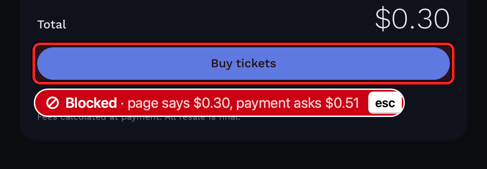
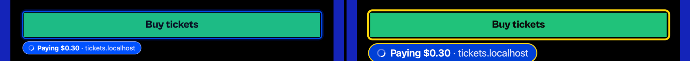

# Ghost and HUD spec (frozen)

Frozen 2026-10-14 after 4 rounds on `design/ghost/index.html`. It supersedes the default numbers in PLAN.md's "Overlay" section. Proof: `design/proof/ghost-prototype-full.png` (full size) and `design/proof/ghost-prototype-50.png` (50%, the back of the room).

All sizes are in points. Colours are sRGB hex plus alpha (α). "Screen" means top-left screen points, the same as the protocol and the flipped overlay view. The prototype's `renderGhost()` implements this spec one to one, so if a value here is unclear, read it there.

## Idea

The ghost should look like a suggestion, not a dialog: a graphite outline, a quiet slate pill, and a **keycap** at the right end of the pill that names the key to press (`tab`, or `esc` on blocked). The keycap is the one memorable element. It teaches the interaction to the audience without words, and it fills while the pedal is held. Money changes the colour: pay is Base blue, blocked is red, done is green. High contrast switches everything to black and yellow at 1.5×.

## Palette

| Token | Hex | Use |
|---|---|---|
| graphite | `#8E8E93` | box stroke, halo, cursor, ghost text |
| slate | `#636366` | action/text pill fill |
| pay | `#0052FF` | pay box + pill (Base blue) |
| payHC | `#0040D6` | pay pill in high contrast |
| blockFill | `#D70015` | blocked pill fill (white text 5.9:1) |
| blockStroke | `#FF3B30` | blocked box stroke, halo, fill |
| doneFill | `#248A3D` | done pill fill (white text 4.6:1) |
| doneStroke | `#34C759` | done box stroke, halo, fill |
| hc | `#FFD60A` | high-contrast outline, keycap, pill text |
| black | `#000000` | high-contrast rings, pill fill, ghost text |

## Geometry (normal → high contrast)

| Name | Normal | HC | Notes |
|---|---|---|---|
| boxOutset | 3 | 5 | box path = element rect outset by this |
| boxRadius | 7 | 9 | corner radius of the box path (stroke centreline) |
| boxStroke | 2.5 | 4 | blocked normal = 3.0 |
| halo | 3 wide | none | outside the stroke: path outset by `boxStroke/2 + 1.5`, radius `boxRadius + boxStroke/2 + 1.5`, lineWidth 3 |
| hcRings | none | 1.5 black on both sides | draw the box path in black at lineWidth `4 + 2×1.5 = 7`, then in the kind's colour at lineWidth 4 |
| pill font | SF Pro 14 semibold | 21 semibold | `NSFont.systemFont(ofSize:weight:.semibold)` |
| pillH | 28 | 42 | capsule, radius = pillH/2 |
| padL | 12 | 18 | left padding to the icon/text |
| padR (no key) | 12 | 18 | |
| keyInset | 3 | 4.5 | key's top/bottom/right inset inside the pill |
| key height | 22 | 33 | = pillH − 2·keyInset |
| key minWidth | 33 | 49.5 | = 1.5 × key height |
| key padH | 6 | 9 | |
| key radius | 5 | 7.5 | |
| key font | SF Pro 12 semibold | 18 semibold | |
| keyGap | 8 | 12 | text → key |
| icon | 13 square | 19.5 | left of the text, gap 6 (HC 9) |
| gap | 6 | 8 | box → pill |
| clamp | 4 | 4 | pill stays 4 pt inside the visible frame (below the menu bar) |

## Pill content

- **Key glyph.** Strip a trailing `⇥` from `label`. If it was there, draw a keycap labelled `tab`. A `blocked` ghost always gets a keycap labelled `esc`. A `done` ghost has no keycap.
- **Two weights.** Split the label at its first ` · `. The head is semibold at full alpha. The tail is drawn as `· <rest>`, regular weight, text colour at α .82, after a 4.2 pt gap (0.3 em; HC 6.3). In AppKit, draw one attributed string: `head` + ` · rest` with the tail attributes. Examples: **Pay $0.30** · tickets.localhost, **Repeat for ENG-150** · #13, **Blocked** · page says $0.30, payment asks $0.51.
- **Icons.** `blocked`: a circle-slash, 12-unit viewBox, circle r 4.9 at (6,6) and a line (2.6,9.4)→(9.4,2.6), stroke 1.6 in the pill's text colour. `done`: strip a trailing `✓` and draw a check path (2.2,6.4)→(4.9,9)→(9.8,3.2), stroke 1.8, round caps and joins. Scale the icon to its size (13 or 19.5).
- **Key-only pill.** A `text` ghost's label is just `⇥`, so the pill is the keycap plus a `keyInset` ring of pill fill. Left padding is `keyInset`.

## Per kind, normal mode (light and dark backgrounds)

Every normal pill also gets a **1 pt inner hairline** in white α .22, which gives it an edge on dark pages, and an **NSShadow** of black α .22, blur 8, offset 2 pt down (`shadowOffset = (0, −2)` in a non-flipped context; in the flipped overlay view, check visually that it falls downward).

| Kind | Box stroke | Halo | Box fill | Pill fill | Pill text | Key fill | Key text | Key |
|---|---|---|---|---|---|---|---|---|
| action | graphite α .90, 2.5 | graphite α .16 | graphite α .08 | slate α .96 | white | white α .20 | white | `tab` |
| text | graphite α .70, 2.5 | graphite α .12 | none (field cover, see Ghost text) | slate α .96 | white | white α .20 | white | `tab` |
| pay | pay α .90, 2.5 | pay α .16 | pay α .07 | pay α 1 | white | white α .22 | white | `tab` |
| blocked | blockStroke α 1, **3.0** | blockStroke α .20 | blockStroke α .10 | blockFill | white | white α .22 | white | `esc` |
| done | doneStroke α .95, 2.5 | doneStroke α .18 | doneStroke α .08 | doneFill | white | — | — | none |

On dark backgrounds (checked on a GitHub-dark stand-in, the "Dark page" row) the same values hold. Slate, Base blue, red, and green pills all separate from #0d1117, and the hairline outlines them. No separate dark table is needed.

## Per kind, high contrast (pedal flow 4)

No drop shadow and no halo in HC. The pill border is a 2 pt inner stroke. All boxes get the 1.5 pt black rings, so yellow and green read on white pages.

| Kind | Box (on black rings) | Box fill | Pill fill | Pill text | Pill border | Key fill | Key text | Key |
|---|---|---|---|---|---|---|---|---|
| action | hc 4 | none | black | hc | hc 2 | hc | black | `tab` |
| text | hc 4 | none (field cover) | black | hc | hc 2 | hc | black | `tab` |
| pay | hc 4 | none | payHC | white | hc 2 | hc | black | `tab` |
| blocked | blockStroke 4 | blockStroke α .12 | blockFill | white | white 2 | white | black | `esc` |
| done | doneStroke 4 | none | doneFill | white | white 2 | — | — | none |

## Ghost text (`text` kind)

1. **Field cover:** first fill the element rect inset by 1.5, radius 4, with white α 1 in both modes. It hides the page's own placeholder ("Add a description", which otherwise collides with the ghost text). It also gives the ghost text a known background on any field, light or dark. That is the explicit dark-field rule: Tab never trusts the field colour; it brings its own paper. Every demo field is light, so the cover is invisible in practice.
2. **Font:** SF Pro regular. Multiline (rect h ≥ 44): 14 pt, line height 1.45 (20.3 pt), word wrap, inset 8 left/right/top. Single line: size `clamp(12, h × 0.42, 15)`, line height 1.2 × size, vertically centred, inset 8 left, truncating tail.
3. **Colour:** normal graphite `#8E8E93` α 1. HC is black text on a hc α 1 marker, drawn with `NSAttributedString.Key.backgroundColor`, which gives a per-line highlight. It reads on any field because of the cover.
4. **Pill placement:** single line: inline, 6 pt after the end of the ghost text, centred on the field, if it fits before `rect.maxX − 4`; otherwise to the right of the box (`x = rect.maxX + gap + boxOutset`), vertically centred. Multiline: **inside the rect's bottom-right corner**, inset 8 (`x = rect.maxX − pillW − 8`, `y = rect.maxY − pillH − 8`).
5. A text ghost never draws a cursor.

## Placement (all other ghosts)

- With a rect: the pill goes below the box, `x = box.minX`, `y = box.maxY + gap`. If `y + pillH > usable.maxY − 4`, flip it above: `y = box.minY − gap − pillH`.
- `pillAt` with no rect (Terminal): `pillAt` is the pill's **bottom-left corner** (`y = pillAt.y − pillH`). B sends `(win.x + 16, win.y + win.h − 16)`.
- No rect and no `pillAt`: centre horizontally, 40 pt below the usable top.
- Then clamp x and y to 4 pt inside `usable` (`NSScreen.visibleFrame`, converted to top-left).

## Cursor

- Path in points, tip at (0,0), y down: `(0,0) (0,17) (4.2,13.2) (7.0,19.6) (9.6,18.5) (6.9,12.2) (12.2,12.2)`, closed. Scale 1.0 (HC 1.4). Round line join.
- Normal: fill graphite α .90, stroke white α .95 at 1.2. Shadow black α .30, blur 3, 1 pt down.
- HC: fill hc, stroke black at 1.5, same shadow.
- **Only on `action` ghosts that have a rect and a `cursor`** (cursor present = show it). Pay, blocked, done, text, and Terminal ghosts get no cursor.
- **The shell positions the tip from the rect, not from `cursor`** (B sends the element centre, which puts the arrow over the button's own label). If `w ≥ 48`: tip = `(min(x + 0.78·w, x + w − 14), y + 0.62·h)`, the lower-right quadrant, clear of centred labels and left-aligned select/list text. If `w < 48` (chips, checkboxes): tip = `(x + 0.6·w, y + 0.6·h)`.

## Motion (ms)

| Event | Spec |
|---|---|
| appear | alpha 0→1 over 140 ms, ease-out. The pill also moves up 4 pt into place over the same 140 ms. The box is alpha only. |
| accept (Tab released < 600 ms) | The key shows pressed for 60 ms (normal: key fill white α .45; HC: black α .25 over the hc key). Then the whole ghost goes alpha →0 over 120 ms, ease-in, with the pill scaling 1→0.97. |
| dismiss (Esc, hold, other input, `ghost_hide`) | alpha →0 over 100 ms, ease-in, with no movement. Other input hides at once (≤ 100 ms) per "ignoring is free". |
| done | Appears like any ghost, stays until `ttlMs` (1500), then alpha →0 over 220 ms. |
| blocked shake (Tab on blocked) | The box and pill move together in translateX: `0, −7, 7, −5, 5, −2, 0`, keyframes evenly spaced over 320 ms. |
| hold progress (Tab held) | Hidden for the first 150 ms after keyDown, so a normal tap never flashes it. The key fill then sweeps left to right, linear, reaching 100% at 600 ms after keyDown, and the ghost dismisses (100 ms fade). The fill is white α 1 (normal) or black (HC). The key label is drawn twice: clipped to the filled part in slate (normal) or hc (HC), and clipped to the rest in the normal key text colour. If Tab is released before 600 ms, the fill resets with no animation and accept runs. |
| HUD "predicting" dot | alpha 1→.35→1, 900 ms loop, only while `mode == predicting`. |
| reduced motion | If `NSWorkspace.shared.accessibilityDisplayShouldReduceMotion`, use alpha only: no translate, scale, or shake (blocked flashes the pill border α 1→.4→1 over 320 ms instead). |

## HUD

A non-activating panel at the top right, 12 pt in from the visible frame's top and right edges. **Width 264**; height fits the content (≈ 196).

- **Panel:** fill `#1C1C1E` α .94, radius 12, 1 pt inner stroke white α .10, shadow black α .35, blur 20, 8 pt down. Padding 14 horizontal, 12 vertical.
- **Text colours:** primary white α .92, secondary white α .60, disabled white α .45. All numbers use `monospacedDigitSystemFont`.

| Row | Content |
|---|---|
| 1 (h 18) | Left: `Tab`, 13 bold, primary. Right: a 7 pt dot, a 6 pt gap, then the mode word in 11 medium, secondary. Dot colours: offline `#FF3B30`, idle `#8E8E93`, predicting `#0A84FF` (pulsing), shown `#FFFFFF`, running `#FFD60A`. Show `offline` while the websocket is down. |
| 2 (10 pt below) | Two equal columns. Label (11 medium, secondary): `Tab did` / `You did`. Number: 26 semibold, line height 30, primary. `Tab did` = `tabDid.clicks + tabDid.keys`; `You did` = `youDid`. Sub-line (11 regular, secondary): `<clicks> clicks, <keys> keys` / `keys and clicks`. This row is the end-of-demo reveal. |
| divider | 1 pt white α .10, 10 pt above and 8 pt below. |
| 3 | Three items spread across the width, 11, secondary, tabular: `<source>` in semibold primary plus latency (`< 10 ms` gets one decimal, else whole ms), or `no prediction yet`; `<modelCalls>` in semibold primary + ` model calls`; `<accepted>` in semibold primary + `/<shown> accepted`. |
| 4 (h 22, 8 pt below) | Left: `Paid $<amountUsd> · <hash[0..6]>…<hash[-4..]>`, 11, primary, or `No payments yet` (disabled). For 3 s after `lastTx` changes, prefix `✓ ` and colour the line `#30D158`. Right: a `ledger ↗` button, 11 semibold, padding 3×8, radius 6, fill white α .12, primary text. Without a tx: fill α .05, disabled text, clicks ignored. |
| 5 (8 pt below) | High-contrast switch: track 24×14, radius 7, fill white α .20 (off) or hc (on). Knob 12 pt, white, at x+1 (off) or x+11 (on), y+1. Label `High contrast`, 11 medium, secondary (primary when on). The whole row is the hit target. |

### Amendments (HUD, 10-14 demo polish)

These override the HUD table above where they differ. Implemented in `HUD.swift`; check with `TabShell --render-hud out.png [--dark]` (8 states including flow 1 just paid, flow 3 pattern, the reveal, and a stress state).

- **Order and size.** The panel is 264 × **227**, with padding 16 horizontal and 14 at the top. From the top: the reveal, a divider, the last prediction, the session totals, the payment, and a footer. Height grows by 31 pt because the old row 3 is now two rows (see below).
- **The `Tab` title row is gone.** The hero label is a **`tab` keycap** followed by `did`. The keycap is the name and doubles as the bar's legend: 18 pt high, at least 30 pt wide, fill `#0A84FF`, `tab` in 11 semibold white, radius 4.5, with the ghost keycap's 1.5 pt bottom edge in black α .22. `You did` sits right-aligned, 11 medium, secondary.
- **The mode dot and word moved to the footer's right**, with the same colours and the same predicting pulse. The word is primary when offline.
- **Reveal numbers.** SF Pro Rounded, 32 semibold, tabular digits, baseline 65. `Tab did` is left-aligned and `You did` is right-aligned. If both don't fit (6+ digits), they shrink together on one baseline, never below 11 pt.
- **Count-up.** When a number rises it counts up over 350 ms, ease-out cubic (a 60 Hz Timer in `.common` mode, so it keeps running during a drag). It jumps instead when the number falls (a hub restart), under reduced motion, and in offscreen renders.
- **Proportion bar** (y 75, 6 pt capsules): Tab's share runs from the left in `#0A84FF`, yours from the right in white α .85, 3 pt apart. Each segment is at least 6 pt. When both counts are 0, it is an empty white α .10 track. The bar follows the counted values.
- **Sub-line under the bar** (replaces "keys and clicks"). Left: Tab's share as `70%` in `#409CFF` semibold, then `9 clicks · 131 keys` in secondary, truncating the tail. Right: your share as `30%` in white α .85 semibold. No percentages are shown while both counts are 0. Singular forms are used (`1 click`, `1 key`).
- **Old row 3 is split into two rows** so the demo line reads cleanly:
  - **Last prediction** (12 pt, chip at y 120). A source chip: a capsule 20 pt high, filled with the source colour at α .22, label in 12 semibold. `pattern` uses `#30D158`; `model` uses `#BF5AF2` with its text lifted to `#DA8FFF`, because `#BF5AF2` sank on a projector. After the chip, `pattern` shows **`0 model calls · 2 ms`** and `model` shows `212 ms`. Before the first prediction the row reads `no prediction yet`, disabled, as specced (the shell had said `ready`). Latency shows `<1 ms` below 1, one decimal below 10 only when fractional (the hub sends whole ms), otherwise whole ms.
  - **Session totals** (11 pt, baseline 156). Left: `7/8 accepted`. Right: `6 model calls so far`. The words "so far" keep the running total from contradicting the per-prediction `0 model calls` just above. If the row is too narrow, "so far" is dropped and the left side truncates.
- **Paid flash.** It shows only for a tx that appears or changes after the HUD has already received a `hud` since the last connect. Any connection change resets this and ends a running flash, so a hub restart never reads as a new payment. During the flash the ledger button is also green (fill α .20, green text). The payment line truncates before the button.
- **Footer** (y 198). The high-contrast knob is `#1C1C1E` when on (black on yellow, like HC itself). The hit target is the footer from the left edge to 8 pt before the mode dot.
- **Offline.** Everything above the footer draws at α .5 (one transparency layer), so stale numbers step back.
- **Shadow.** Uses this section's values (black α .35, blur 20, 8 pt down). AppKit draws it, not the system: it lives in a separate borderless window with `ignoresMouseEvents`, 36 pt larger on each side, which clips the card out and draws only the outside. That window is ordered right below the panel and moved on the panel's `didMove`.
  - It isn't drawn inside the panel because the window server sends clicks on any non-transparent pixel to the panel, so the soft edge would swallow clicks.
  - It isn't a child window because on this Mac's scaled display the window server reported a child window off-centre, moving at 0.81× the parent.
- **Panel and input.** The level is set after `isFloatingPanel` (NSPanel resets it to `.floating`). The drag threshold is **6 pt** (was 3), so a slightly shaky click still hits ledger or high contrast.

## Not decided here

- **The cursor position rule moves logic into the shell.** If B would rather send the lower-right point itself, the shell should use `cursor` as given. Agree on one of the two; the drawing is the same either way.
- **The `tab` keycap replaces the `⇥` glyph,** but the protocol labels keep `⇥`, so a shell that strips it changes nothing for B.

## Amendments (A, after freeze)

- **02:30 `Ghost.place`** (optional, protocol/CHANGES.md). Values: `below` (default, as specced, flips above at the screen edge), `above`, `right` (gap to the right of the box, vertically centred), and `inside` (docked in the element's right end like a badge, inset `max(4, (h − pillH)/2)` from the right, vertically centred). Use `inside` for wide fields whose pill would otherwise cover the next list row (flow 3's search box).
- **Keycap edge:** a 1.5 pt band along the key's bottom, black α .18 (HC .22, 2.25 pt), clipped to the key, hidden while pressed. It makes the key read as a physical key.
- **Key-only pill in HC:** no 2 pt border. The yellow key on its black ring is the edge; a second yellow ring read as brackets.
- **02:45 checked on C's real pages** (`shell/scripts/look.mjs`: real page in the debug Chrome, real rects, real AppKit drawing; proofs `design/proof/a-composite-*.png`):
  - Multiline threshold raised from 44 to **64 pt**: C's single-line Rx field is 46 pt tall and lost its ghost text. Single-line ghost text now scales up to **20 pt** (was 15), so it matches large form type.
  - `above` and `right` fall back to `below` when they would leave the screen.
  - Pay pill hairline goes to white **α .55** (others stay .22), because C's tickets page is royal blue and Base blue needs an edge there.
  - No cursor when `place == "inside"`: the docked pill already marks the element, and the cursor hid under it.
- **03:20 review pass** (robustness for anything on screen, not just the demo rects):
  - **Width cap.** The label text runs at most 460 pt (HC 690), and never past the visible frame. Past that it truncates: a long head in the middle (`Type "Thanks for the quick revie…docs site rebuilds" into Comment`), a long tail at the end. A short head keeps its full width, so `Blocked · <long reason>` keeps "Blocked". Labels are always one line: whitespace and newlines in hub text, such as wallet errors, collapse to single spaces.
  - **Huge targets.** When neither below nor above fits (a card or editor that fills the screen), the pill docks inside the element's visible bottom-left, inset 8. On targets taller than 64 pt the cursor tip sits at most 40 pt below the top.
  - **Single-line text ghost at the screen edge.** If the pill fits neither inline nor right of the box, it goes below the box, right-aligned with it, and above at the bottom edge. It never covers the ghost text.
  - **Displays.** The overlay moves to the display under the ghost's rect (or `pillAt`). It re-frames when displays change (a projector plugged in, mirroring, a resolution change). Overlay level is `.statusBar + 1`, so ghosts draw over the HUD.
  - **Accept ripple** (new motion): on accept, a ring in the box colour leaves the box (or the pill, for Terminal ghosts). It grows 2→16 pt over 320 ms with an ease-out cubic, and its alpha (.85→0) and stroke (2.5→0.5, HC 4→0.5) shrink with it. It runs under the 60 ms press + 120 ms fade, so the room sees where Tab acted. Reduced motion: no ripple.
  - **`Ghost.avoid`** (optional, protocol/CHANGES.md): rects of the other elements near the target. With `avoid` and no `place`, the shell tries below, above, right, then inside (only if the field is ≥ pill width + 24). It takes the first that fits on screen and covers nothing. Otherwise it takes the one with the smallest covered area. Covering an element below the target counts 3× (forms flow downward, so it's probably the next step), and right counts 1.2×. Checked on the pharmacy form (`look.mjs … "avoid":true`): the time chip and the location select get their pills on the right, the checkbox gets its pill right over its own label, and pay stays below Buy.
  - **Repeat icon:** action ghosts whose label starts with `Repeat for ` or `Do the remaining ` (the pattern rule's fixed pill formats) get a clockwise ↻ before the text: 12-unit viewBox, arc r 4.3 at (6,6) from −50° round 310°, a chevron at 12 o'clock pointing right, stroke 1.6, same size and gap as the other icons. "Teach once, then repeat" is recognisable before anyone reads the label.
- **Reveal card** (demo script flow 4 step 7, "Reveal the HUD totals"): click the HUD's numbers, or menu bar ⇥ → Reveal Totals. The HUD's Tab did / You did block opens 2.4× (vector, drawn through `HUDView.drawScale`), centred on the main display (6% above centre), one level above the ghosts. It fades in over 180 ms, then counts up from 0 over 1.4 s, ease-out (reduced motion: no count-up). It's a snapshot of the totals when opened. Any click or key closes it (150 ms fade), and clicks on it don't count as input. Proof: `design/proof/a-reveal-card.png`.
- **10:35 Remembered workflow ghost** (B's `PatternEngine.recall`, label `Do all 6 from v1.4.0 · learned 10:03 am ⇥`, sent with `place: "inside"` on the tracker search box):
  - **↻ icon** also for labels starting with `Do all ` (the same learned unit, recalled).
  - **`inside` caps the pill at the field's inner width** (field width − 2 × the inside inset). Before, the HC pill (472 pt) was wider than the 425 pt search box: it spilled past the field's left edge, doubled the yellow ring above and below, and covered "0 of 6 done".
  - **The tail gives way first.** The head stays whole if it fits next to a few tail characters (` · ab…`), so HC reads `↻ Do all 6 from v1.4.0 · learned… tab`, not `Do all 6…om v1.4.0`. Only a head with no room for any tail truncates in the middle (to at most 60%), as before. Tails cut at a word boundary when that keeps ≥ 2/3 of the cut (`· page says $0.30, payment…`). A long URL or wallet address still cuts mid-word.
  - **A field too narrow for the head declines `inside`.** In a 200 pt field the docked pill read `Do a….4.0 · lear…`. When the field-capped pill would cut its head, the shell places the pill as if `place` were absent (least-covering with `avoid`, else below) at the screen-width cap.
  - Proofs on the real tracker:  
- **10:40 Display re-frame drops leftovers.** When the overlay moves to another display (the next ghost is there, or displays change), an accepted ghost's fade and its ripple are dropped, not drawn for up to 320 ms at the old display's coordinates on the new one. On the same display the ripple still runs under the next ghost. Checked with a throwaway harness (overlay sources + a test main): re-frame mid-fade leaves 3 views before, 1 after.
- **10:48 M3 audit, HUD copy** (`redesign-existing-projects` on `--render-hud`). The audience reads these words cold on a projector:
  - The `shown` mode displays as **`suggesting`**. The protocol value and the white dot are unchanged.
  - Before the first ghost, the totals row reads **`none offered yet`** (disabled), not `0/0 accepted`, which looked like an error.
  - Placeholders are lowercase like `no prediction yet`: **`no payments yet`** (was `No payments yet`).
- **10:50 M3 audit, ghosts on C's real pages** (`look.mjs`, flows 1 and 4, both modes, `avoid` as the hub sends it). **Pay and blocked ghosts ignore `avoid`** and use the default: below, flipped above at the screen edge. They end the flow, and what sits above their button is the amount they quote (Total, Copay); scoring had put the HC Blocked pill inside resale's Buy button, hiding the button. Now it sits below over the fine print, and `Buy tickets` and `$0.30` stay visible.  Every other ghost looked right as it was (Checkout above the small print, 5:30 pm to the right, Rx inline, pay below Buy and Request refill).
- **10:54 Paying state** (M3 audit: no loading state at the payoff). After Tab on a pay ghost the hub only forwards `pay`, and the payment took 9.6 s on venue wifi, so nothing on screen moved. Now the pay pill does its usual press, ripple and fade, and 180 ms later (60 + 120) **`Paying $0.30 · tickets.localhost`** rises in its place. The keycap is replaced by a spinner on the left: a faint ring (α .3) with a quarter arc running round it, one turn per 0.9 s, stroke 1.6/12 of the icon (reduced motion: the arc stands still). It lasts until the hub's next ghost (`Paid $0.30 ✓`, or Blocked with the error), a `ghost_hide`, a hub disconnect, or 45 s (then a 100 ms fade). It isn't the current ghost, so Tab and Esc pass through and can't pay twice. The label is the shell's own; the protocol is unchanged. 
- **11:06 Review fixes** (two-axis review of `b65b7c1..HEAD` on `shell/`):
  - **While Paying, Tab is swallowed and no input is reported to the hub.** Tab down, its autorepeats and keyUp are all swallowed; other keys and clicks still reach their apps. Reporting it made the hub hide its still-"shown" pay ghost (which ended Paying) and, 600 ms later, offer `Pay $0.30 ⇥` again while the first payment was still settling: the hub keeps `payment` pending until `payment_result`. Clicks on the page reach the hub through web's `user_event` and do the same; that half is B's (STATUS → Notes for B). Tap selftest: 19/19.
  - A display change while Paying redraws the Paying pill on its display, as it does for the current ghost.
  - An `inside` pill wider than its field declines `inside` even when its head isn't cut (the label room never drops below 80 pt, so a short label could still spill out of a narrow field).
  - `avoid` docs (protocol/types.ts, CHANGES.md) now say pay and blocked pills ignore it.
- **11:15 Fitted, quieter highlight box** (the human: "fit the button shape … subtle, you should see it but it shouldn't pop like a pop-up"):
  - **Shape.** New optional `El.radius` / `Ghost.radius` (protocol/CHANGES.md). C's `inject.js` reads each element's CSS corner radius: top-left, `%` of the shorter side, capped at a capsule, 0 for square. The hub copies the target's onto the ghost; pay/blocked/done use the element at `anchorRect`. The shell draws the box concentric with it: corner radius = element radius + outset, capped at a capsule. Square buttons get a square box, rounded fields a rounded box, capsules a capsule. The ghost-text field cover (radius − 1.5) and the accept ripple follow the same shape. Without a radius (older web or hub) the element is assumed to be 6 pt.
  - **Normal mode is quieter.** Outset 3 → **2 pt**. Stroke 2.5 → **1.5 pt** (Blocked 3 → 2). The halo ring is gone. No tint fill, except a faint red on Blocked (α .06). Outline alphas: action graphite .70, text .55, pay .80, blocked .90, done .85. The accept ripple is 1 → 8 pt at 1.5 → 0.5 pt stroke and α .6 (was 2 → 16 pt, 2.5 pt, α .85).
  - **High contrast is unchanged** except for the shape: it exists to be seen.
