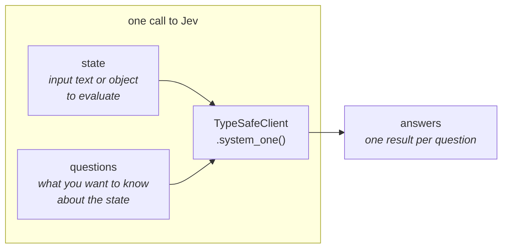
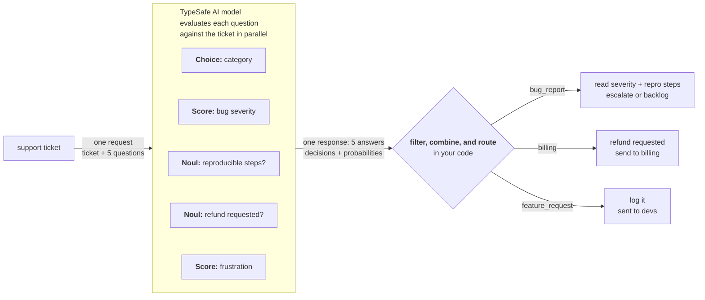

# Jev (TypeSafe) docs

Jev is TypeSafe's model. Docs: https://docs.typesafe.ai/introduction · Cookbooks: https://docs.typesafe.ai/cookbooks · Index: https://docs.typesafe.ai/llms.txt
Raw copies of the pages below, fetched 2026-10-14.

---

<!-- source: https://docs.typesafe.ai/introduction/quickstart.md -->
> ## Documentation Index
> Fetch the complete documentation index at: https://docs.typesafe.ai/llms.txt
> Use this file to discover all available pages before exploring further.

# Quick start

> Get up and running with Jev in 5 minutes.

This guide covers four ways of using Jev, TypeSafe's [System One model](/concepts/system-one), namely: [use our SDK](#code-it-your-first-request), [call our API](#call-it-the-api), [use our agent skill](#vibe-it-the-agent-skill), or [try our browser-based Playground](#try-it-the-playground).

Get an API key from the [TypeSafe console](https://console.typesafe.ai/keys).

## The minimum you should know to use Jev effectively

Each call to Jev takes a [state](/concepts/state) (as a simple string or structured object) and a set of [questions](/primitives), and returns one answer per question:



Jev answers three types of question, called primitives:

| Question type | Goal | Returns |
| - | - | - |
| [Choice](/primitives/choice) | Choose an option from a list | `choice`, `probabilities`, `confidence` |
| [Score](/primitives/score) | Score the state on a rubric | `score`, `probabilities`, `confidence` |
| [Noul](/primitives/noul) | Is this statement true? | `noul` (0–1) |

## Vibe it: the Agent Skill

The fastest way to add Jev to your project is to have your coding agent write the integration with the TypeSafe skill installed.

1. **[Install the TypeSafe skill](/agent-skill#installation)** using the Claude Code plugin or `npx skills add typesafe-ai/skills --skill typesafe-ai`. You can also [read SKILL.md on GitHub](https://github.com/typesafe-ai/skills/blob/main/skills/typesafe-ai/SKILL.md).

<Tabs>
  <Tab title="Claude Code">
    Run these two commands in your terminal:

    ```bash theme={null}
    claude plugin marketplace add typesafe-ai/skills
    claude plugin install typesafe@typesafe-ai
    ```
  </Tab>

  <Tab title="Other agents">
    ```bash theme={null}
    npx skills add typesafe-ai/skills --skill typesafe-ai
    ```

    Choose your agent when prompted. Installation is project-local by default; add `-g` to install globally.
  </Tab>

  <Tab title="Copy to your agent">
    Paste this prompt into your coding agent:

    ```text wrap theme={null}
    Install the TypeSafe skill. If you're in Claude Code, run `claude plugin marketplace add typesafe-ai/skills`, then `claude plugin install typesafe@typesafe-ai`. If you're in another agent, run `npx skills add typesafe-ai/skills --skill typesafe-ai` and select your agent. Use one installation method. You can read the skill directly at https://github.com/typesafe-ai/skills/blob/main/skills/typesafe-ai/SKILL.md (raw: https://raw.githubusercontent.com/typesafe-ai/skills/main/skills/typesafe-ai/SKILL.md). Then use the TypeSafe skill when working on this project.
    ```
  </Tab>
</Tabs>

2. **Tell your coding agent** to use the TypeSafe skill as you build.

```plaintext title="Coding agent prompt" theme={null}
Let's build a simple CLI that uses Jev to evaluate a set of supplied texts on multiple dimensions. Use the TypeSafe skill to understand how to use the TypeSafe API and how to structure the system. Ask me questions about what kinds of texts I want to evaluate and on what dimensions.
```

<Note>
  We suggest that you generate and store your TypeSafe API key in an environment variable (e.g. `TYPESAFE_API_KEY`).
</Note>

The [Agent Skill](/agent-skill) page has more example prompts and fixes for common issues, such as an agent that isn't using the skill.

## Code it: your first request

See how to call Jev from your favourite programming language. The Python, JavaScript, and TypeScript examples use our SDKs; the Bash example calls the API directly.

Create a working directory and set your API key. These setup commands use Bash on macOS, Linux, or Windows with WSL:

```bash wrap theme={null}
mkdir typesafe-quickstart
cd typesafe-quickstart
export TYPESAFE_API_KEY="your-api-key"
```

The example sends a customer support ticket and asks Jev three questions in one request: which team should handle it, how frustrated the customer sounds, and whether the issue is urgent.

<Tabs>
  <Tab title="Python">
    Requires Python 3.10 or later. Choose a package manager to install the SDK:

    <Tabs sync={false}>
      <Tab title="pip">
        With [pip installed](https://pip.pypa.io/en/stable/installation/), create a virtual environment and add the SDK:

        ```bash wrap theme={null}
        python3 -m venv .venv
        .venv/bin/pip install typesafe-sdk
        ```
      </Tab>

      <Tab title="uv">
        With [uv installed](https://docs.astral.sh/uv/getting-started/installation/), initialize a project and add the SDK:

        ```bash wrap theme={null}
        uv init --bare
        uv add typesafe-sdk
        ```
      </Tab>
    </Tabs>

    Save as `route_ticket.py`:

    ```python wrap theme={null}
    from typesafe_sdk import Choice, Noul, Score, TypeSafeClient

    ticket = "Our API integration started returning 500 errors on every request about 20 minutes ago, and we can't process any customer orders until this is fixed."

    with TypeSafeClient(model="jev-latest") as client:  # Reads TYPESAFE_API_KEY.
        response = client.system_one(
            state=ticket,
            questions={
                "department": Choice(
                    instructions="Which team should handle this",
                    criteria={
                        "billing": "Payment or subscription issues",
                        "technical": "Bugs or integration problems",
                        "sales": "Pricing or account questions",
                    },
                ),
                "frustration": Score(
                    instructions="How frustrated the customer appears",
                    criteria=[
                        "Calm, just stating facts",
                        "Frustrated but civil",
                        "Very angry, strong language",
                    ],
                ),
                "is_urgent": Noul(
                    instructions="The message conveys urgency or time-sensitivity",
                ),
            },
        )

    print(response.choices["department"].choice)
    print(response.scores["frustration"].score)
    print(response.nouls["is_urgent"].noul)
    ```

    Run it with either installation method:

    ```bash wrap theme={null}
    .venv/bin/python route_ticket.py
    ```
  </Tab>

  <Tab title="JavaScript">
    Requires Node.js 20 or later. Install the SDK and mark the project as an ES module:

    ```bash wrap theme={null}
    npm install @typesafe-ai/sdk
    npm pkg set type=module
    ```

    Save as `route_ticket.js`:

    ```javascript wrap theme={null}
    import { choice, noul, score, TypeSafeClient } from "@typesafe-ai/sdk";

    const ticket = "Our API integration started returning 500 errors on every request about 20 minutes ago, and we can't process any customer orders until this is fixed.";

    const client = new TypeSafeClient({ defaultModel: "jev-latest" }); // Reads TYPESAFE_API_KEY.
    const response = await client.systemOne({
      state: ticket,
      questions: {
        department: choice("Which team should handle this", {
          billing: "Payment or subscription issues",
          technical: "Bugs or integration problems",
          sales: "Pricing or account questions",
        }),
        frustration: score("How frustrated the customer appears", [
          "Calm, just stating facts",
          "Frustrated but civil",
          "Very angry, strong language",
        ]),
        is_urgent: noul("The message conveys urgency or time-sensitivity"),
      },
    });

    console.log(response.answers.department.choice);
    console.log(response.answers.frustration.score);
    console.log(response.answers.is_urgent.noul);
    ```

    Run it:

    ```bash wrap theme={null}
    node route_ticket.js
    ```
  </Tab>

  <Tab title="TypeScript">
    Requires Node.js 22.18 or later to run TypeScript directly. Install the SDK and mark the project as an ES module:

    ```bash wrap theme={null}
    npm install @typesafe-ai/sdk
    npm pkg set type=module
    ```

    Save as `route_ticket.ts`:

    ```typescript wrap theme={null}
    import { choice, noul, score, TypeSafeClient } from "@typesafe-ai/sdk";

    const ticket = "Our API integration started returning 500 errors on every request about 20 minutes ago, and we can't process any customer orders until this is fixed.";

    const client = new TypeSafeClient({ defaultModel: "jev-latest" }); // Reads TYPESAFE_API_KEY.
    const response = await client.systemOne({
      state: ticket,
      questions: {
        department: choice("Which team should handle this", {
          billing: "Payment or subscription issues",
          technical: "Bugs or integration problems",
          sales: "Pricing or account questions",
        }),
        frustration: score("How frustrated the customer appears", [
          "Calm, just stating facts",
          "Frustrated but civil",
          "Very angry, strong language",
        ]),
        is_urgent: noul("The message conveys urgency or time-sensitivity"),
      },
    });

    console.log(response.answers.department.choice);
    console.log(response.answers.frustration.score);
    console.log(response.answers.is_urgent.noul);
    ```

    Run it:

    ```bash wrap theme={null}
    node route_ticket.ts
    ```

    The SDK infers answer types from your questions, so `response.answers.department.choice` has the type `"billing" | "technical" | "sales"`.
  </Tab>

  <Tab title="Bash">
    Requires curl 7.76 or later. Save as `route_ticket.sh`:

    ```bash wrap theme={null}
    #!/usr/bin/env bash
    set -euo pipefail
    : "${TYPESAFE_API_KEY:?Set TYPESAFE_API_KEY first.}"

    curl --fail-with-body --silent --show-error \
      https://api.typesafe.ai/v1/systemone \
      -H "Authorization: Bearer $TYPESAFE_API_KEY" \
      -H "Content-Type: application/json" \
      --data-binary @- <<'JSON'
    {
      "state": "Our API integration started returning 500 errors on every request about 20 minutes ago, and we can't process any customer orders until this is fixed.",
      "model": "jev-latest",
      "questions": {
        "department": {
          "type": "choice",
          "instructions": "Which team should handle this",
          "criteria": {
            "billing": "Payment or subscription issues",
            "technical": "Bugs or integration problems",
            "sales": "Pricing or account questions"
          }
        },
        "frustration": {
          "type": "score",
          "instructions": "How frustrated the customer appears",
          "criteria": [
            "Calm, just stating facts",
            "Frustrated but civil",
            "Very angry, strong language"
          ]
        },
        "is_urgent": {
          "type": "noul",
          "instructions": "The message conveys urgency or time-sensitivity"
        }
      }
    }
    JSON
    ```

    Run it:

    ```bash wrap theme={null}
    bash route_ticket.sh
    ```
  </Tab>
</Tabs>

Jev evaluates each question against the same state and returns answers under the IDs you supplied. `choice` is the team label, `score` is the position on the three-level frustration rubric (0–2), and `noul` is the probability of urgency (0–1).

The Python, JavaScript, and TypeScript examples print those three values:

```text Example output theme={null}
technical
0.67
0.99
```

The Bash example prints the raw JSON response on one line. The Raw Response in the next section shows it formatted, with each answer's confidence and probabilities. These are example results; values can change between Jev releases.

The [client SDKs](/sdk) pages cover installing the Python and JavaScript SDKs, typed answers, and their retry policy.

## Call it: the API

All four code examples in the previous section use this endpoint. The Bash tab above shows the complete HTTP request without an SDK.

```http theme={null}
POST https://api.typesafe.ai/v1/systemone
Authorization: Bearer <API_KEY>
Content-Type: application/json
```

<Accordion title="Raw Response">
  ```json theme={null}
  {
    "model": "jev-1.13.0",
    "answers": {
      "department": {
        "type": "choice",
        "choice": "technical",
        "confidence": 1.0,
        "probabilities": {
          "technical": 1.0,
          "billing": 0.0,
          "sales": 0.0
        }
      },
      "frustration": {
        "type": "score",
        "score": 0.67,
        "confidence": 0.5,
        "legend": {
          "0": "Calm, just stating facts",
          "1": "Frustrated but civil",
          "2": "Very angry, strong language"
        },
        "probabilities": {
          "0": 0.33,
          "1": 0.67,
          "2": 0.0
        }
      },
      "is_urgent": {
        "type": "noul",
        "noul": 0.99
      }
    },
    "usage": {
      "input_tokens": 428,
      "output_tokens": 73
    }
  }
  ```
</Accordion>

The [API Reference](/api) lists every request field, question type, and answer type.

## Try it: the Playground

The Playground runs Jev in the browser: paste a state, add questions, and read the answers without writing code.

1. **Open the [Playground](https://console.typesafe.ai/playground)** and log in.
2. **Paste any text** as the state.

```plaintext title="Sample state" theme={null}
Our API integration started returning 500 errors on every request about 20 minutes ago, and we can't process any customer orders until this is fixed.
```

3. **Add a question.** Try a Noul question: `"Does this message express urgency?"`

```json theme={null}
{
  "urgency": {
    "type": "noul",
    "instructions": "Does this message express urgency?"
  }
}
```

4. **Add more questions.** Mix Noul, Choice, and Score questions in one call and see all results at once.

***

## Next Steps

Composing the three primitives into larger systems takes some practice, even if you're used to LLMs. The [Machine Learning Primer](/introduction/machine-learning-primer) explains why Jev returns calibrated probabilities instead of generated text, and how that changes the way you build with it.

We’d also suggest taking a look at [Primitives](/primitives) and the [Use Case Map](/concepts/use-case-map).

1. [Errors and retries](/sdk/python/usage#error-handling)
2. [Parallel Questions](/cookbooks/parallel_questions)


This documentation is built and hosted on [Mintlify](https://mintlify.com), a developer documentation platform.
---

<!-- source: https://docs.typesafe.ai/api.md -->
> ## Documentation Index
> Fetch the complete documentation index at: https://docs.typesafe.ai/llms.txt
> Use this file to discover all available pages before exploring further.

# API reference

> Full HTTP API reference for the TypeSafe evaluation endpoint.

Evaluate a `state` against a map of typed `questions` and get back structured `answers`, one per question. For a guided introduction, start with the [primitives](/primitives).

## Evaluation endpoint

```http theme={null}
POST https://api.typesafe.ai/v1/systemone
Authorization: Bearer <API_KEY>
Content-Type: application/json
```

## Request body

The top-level shape of every request. Each entry in the `questions` map is a typed question you name.

<ParamField body="state" type="string | object | array" required>
  The content to evaluate. A plain string for text, or structured data (object/array) for things like chat logs, records, or the current state of your application. See [State](/concepts/state) for formats and best practices.
</ParamField>

<ParamField body="model" type="string" required>
  The model that handles the request. Use `"jev-latest"`, TypeSafe's flagship model. See [Models](/models) for the available models and aliases.
</ParamField>

<ParamField body="questions" type="map<string, Question>" required>
  A map of typed [Question](#question-types) objects. You choose each key; answers come back under the same keys.

  <Expandable title="map entries">
    <ParamField body="‹question id›" type="Question">
      A key you choose. The matching [Answer](#answer-types) is returned under this same id. The key is not sent to the underlying model and is not used in inference.
    </ParamField>
  </Expandable>
</ParamField>

```json Example request theme={null}
{
  "state": "Help! My payouts have been failing for 3 days.",
  "model": "jev-latest",
  "questions": {
    "is_urgent": {
      "type": "noul",
      "instructions": "Does this convey urgency?"
    }
  }
}
```

## Question types

A `Question` is one of three types, set by its `type` field. All three share `type` and `instructions`; each adds its own `criteria`.

The `instructions` property can be a string, an object, or an array. You can break up a long question that has extra context, or data it needs to reference, into a structured object. Put the question in one field and the data in the others, and refer to the data fields by name in backticks, the same way you point a question at a nested `state` value:

```json theme={null}
"instructions": {
  "potential_duplicate": {
    "name": "John Smith",
    "location": "Oakland, California",
    "last_employer": "Google"
  },
  "question": "Is the resume for the same person as `potential_duplicate`?"
}
```

See [Use structure in the questions](/concepts/how-to-build-with-system-one#use-structure-in-the-questions) to learn more.

### Noul

A yes/no question. Returns the probability the answer is yes.

<ParamField body="type" type="&#x22;noul&#x22;" required />

<ParamField body="instructions" type="string | object | array" required>
  The yes/no question to evaluate. An object can hold the question in one field and data it refers to in others; see [Use structure in the questions](/concepts/how-to-build-with-system-one#use-structure-in-the-questions).
</ParamField>

<ParamField body="criteria" type="object">
  Optional descriptions of what a yes and a no mean.

  <Expandable title="properties">
    <ParamField body="true" type="string | object | array">
      What a yes (value near 1) means.
    </ParamField>

    <ParamField body="false" type="string | object | array">
      What a no (value near 0) means.
    </ParamField>
  </Expandable>
</ParamField>

```json Example request focus={5-12} theme={null}
{
  "state": "Help! My payouts have been failing for 3 days.",
  "model": "jev-latest",
  "questions": {
    "is_urgent": {
      "type": "noul",
      "instructions": "Does this convey urgency?",
      "criteria": {
        "true": "Explicitly time-sensitive",
        "false": "No urgency expressed"
      }
    }
  }
}
```

### Choice

Picks one option from a set you define. Returns the chosen option and the full probability distribution.

<ParamField body="type" type="&#x22;choice&#x22;" required />

<ParamField body="instructions" type="string | object | array" required>
  What the model should decide. An object can hold the question in one field and data it refers to in others; see [Structured instructions and criteria](/primitives/choice#structured-instructions-and-criteria).
</ParamField>

<ParamField body="criteria" type="map<string, string | object | array | null>" required>
  A map of option to rubric description; use null when an option needs no extra detail. You can have a maximum of 255 options per Choice.

  <Expandable title="map entries">
    <ParamField body="‹option›" type="string | object | array | null">
      A key you choose. A description of this option.
    </ParamField>
  </Expandable>
</ParamField>

```json Example request focus={5-13} theme={null}
{
  "state": "Help! My payouts have been failing for 3 days.",
  "model": "jev-latest",
  "questions": {
    "department": {
      "type": "choice",
      "instructions": "Which team should handle this?",
      "criteria": {
        "billing": "Payments, invoicing, refunds",
        "technical": "Bugs, outages, integrations",
        "sales": "Pricing, upgrades, new accounts"
      }
    }
  }
}
```

### Score

Rates the state along a rubric you define. Returns a probability-weighted value across your levels.

<ParamField body="type" type="&#x22;score&#x22;" required />

<ParamField body="instructions" type="string | object | array" required>
  What the model should rate. An object can hold the question in one field and data it refers to in others; see [Use structure in the questions](/concepts/how-to-build-with-system-one#use-structure-in-the-questions).
</ParamField>

<ParamField body="criteria" type="array<string | object | array>" required>
  An ordered array of level descriptions. A Score should have at least two levels; the API accepts up to 10.
</ParamField>

```json Example request focus={5-9} theme={null}
{
  "state": "Help! My payouts have been failing for 3 days.",
  "model": "jev-latest",
  "questions": {
    "frustration": {
      "type": "score",
      "instructions": "How frustrated is the customer?",
      "criteria": ["Calm", "Frustrated", "Very angry"]
    }
  }
}
```

## Response body

One answer per question, returned under the same ids you provided.

<ResponseField name="model" type="string" required>
  The model that performed the evaluation.
</ResponseField>

<ResponseField name="answers" type="map<string, Answer>" required>
  One [Answer](#answer-types) per question, keyed by the same ids you used in questions.

  <Expandable title="map entries">
    <ResponseField name="‹question id›" type="Answer">
      The same id you chose in questions.
    </ResponseField>
  </Expandable>
</ResponseField>

<ResponseField name="usage" type="object" required>
  Token usage for the request.

  <Expandable title="properties">
    <ResponseField name="input_tokens" type="integer" />

    <ResponseField name="output_tokens" type="integer" />
  </Expandable>
</ResponseField>

```json Example response theme={null}
{
  "model": "jev-1.13.0",
  "answers": {
    "is_urgent": {
      "type": "noul",
      "noul": 0.95
    }
  },
  "usage": { "input_tokens": 296, "output_tokens": 20 }
}
```

## Answer types

Every answer carries a `type` matching its question. Choice and Score answers also carry a `confidence` between 0 to 1, derived from the answer's probability distribution. See [Confidence](/confidence).

### Noul answer

<ResponseField name="type" type="&#x22;noul&#x22;" required />

<ResponseField name="noul" type="number" required>
  The yes/no answer on a scale from 0 (no) to 1 (yes).
</ResponseField>

```json Example response focus={4-7} theme={null}
{
  "model": "jev-1.13.0",
  "answers": {
    "is_urgent": {
      "type": "noul",
      "noul": 0.95
    }
  },
  "usage": { "input_tokens": 307, "output_tokens": 20 }
}
```

### Choice answer

<ResponseField name="type" type="&#x22;choice&#x22;" required />

<ResponseField name="choice" type="string" required>
  The highest-probability option.
</ResponseField>

<ResponseField name="probabilities" type="map<string, number>" required>
  Every option mapped to its probability (floats that sum to 1).

  <Expandable title="map entries">
    <ResponseField name="‹option›" type="number">
      An option you defined in criteria.
    </ResponseField>
  </Expandable>
</ResponseField>

<ResponseField name="confidence" type="number" required>
  How certain the model is, derived from probabilities.
</ResponseField>

```json Example response focus={4-9} theme={null}
{
  "model": "jev-1.13.0",
  "answers": {
    "department": {
      "type": "choice",
      "choice": "billing",
      "probabilities": { "billing": 0.88, "technical": 0.12, "sales": 0.0 },
      "confidence": 0.81
    }
  },
  "usage": { "input_tokens": 318, "output_tokens": 34 }
}
```

### Score answer

<ResponseField name="type" type="&#x22;score&#x22;" required />

<ResponseField name="score" type="number" required>
  The probability-weighted answer across the levels; can land between levels.
</ResponseField>

<ResponseField name="legend" type="map<string, string>" required>
  Each level number mapped back to its description.
</ResponseField>

<ResponseField name="probabilities" type="map<string, number>" required>
  Each level (string key) mapped to its probability (floats that sum to 1).

  <Expandable title="map entries">
    <ResponseField name="‹level›" type="number">
      A level index, as a string key matching legend.
    </ResponseField>
  </Expandable>
</ResponseField>

<ResponseField name="confidence" type="number" required>
  How certain the model is, derived from probabilities.
</ResponseField>

```json Example response focus={4-10} theme={null}
{
  "model": "jev-1.13.0",
  "answers": {
    "frustration": {
      "type": "score",
      "score": 1.05,
      "legend": { "0": "Calm", "1": "Frustrated", "2": "Very angry" },
      "probabilities": { "0": 0.0, "1": 0.95, "2": 0.05 },
      "confidence": 0.92
    }
  },
  "usage": { "input_tokens": 304, "output_tokens": 18 }
}
```

## Errors

Errors use standard HTTP status codes with a JSON body describing what went wrong.

| Status | Meaning |
| - | - |
| `401 Unauthorized` | Missing or invalid API key. Check the `Authorization` header. |
| `422 Unprocessable Entity` | The request body failed validation — for example a missing required field or a malformed question. The body details the offending field. |
| `429 Too Many Requests` | You have exceeded your rate limit. Back off and retry after a short delay. |
| `529 Overloaded` | TypeSafe is temporarily overloaded. Retry after a short delay. |

### Handling rate limits

When you receive a `429 Too Many Requests` or `529 Overloaded` response, retry the request with exponential backoff instead of retrying immediately. Our client SDKs handle this automatically, so no extra handling is needed if you use one of our SDKs with its default retry policy.


This documentation is built and hosted on [Mintlify](https://mintlify.com), a developer documentation platform.
---

<!-- source: https://docs.typesafe.ai/models.md -->
> ## Documentation Index
> Fetch the complete documentation index at: https://docs.typesafe.ai/llms.txt
> Use this file to discover all available pages before exploring further.

# Models

Jev is TypeSafe's flagship model and the first [System One model](/concepts/system-one). Every model on this page is served by the same endpoint, `POST /v1/systemone`. The request's `model` field selects which one handles the call; see the [API reference](/api) for the full request shape.

## Current models

| Jev 1.13 | `jev-1.13.0` |
| :- | :- |
| Price (per Btok / per Mtok) | \$42 / \$0.042 |
| Rate limits | 100K tokens per second / 80 requests per second |
| Context length | 64k tokens per request; 32k tokens for `state` plus the longest question |
| Input | Text only. String, JSON object, or array of text values. No image, audio, or video input. |

* **Price:** Charged per input token. Output tokens are free. A Btok is a billion tokens and an Mtok is a million tokens.
* **Rate limits:** Measured in tokens per second and requests per second. A request over either limit returns `429 Too Many Requests`. Our [client SDKs](/sdk) retry with backoff by default and honor the `retry-after` header when the response carries one. If you call the HTTP API directly, see [Handling rate limits](/api#handling-rate-limits).
* **Context length:** Jev ingests the `state` once and evaluates every question against it in parallel. The 64k budget covers the `state` plus all questions combined; the 32k budget applies to the `state` plus the single longest question. See [Speculative fan-out](/patterns/fan-out) for packing many questions into one request, and [Jev 1.13 jaggedness](/model-jaggedness/jev-1.13) for how accuracy shifts as the state grows.
* **Input:** Jev evaluates natural-language text. Pre-process non-text inputs (images, audio, video, binaries) into text or structured fields before sending them as `state`. See [State](/concepts/state) for supported shapes.

<Warning>
  **Rate limits are adjusting dynamically.** We are serving a very large volume of demand, and the limits above can change without notice while we do, as upcoming large GPU deals land and we let in more users. Once things settle down more, we'll be able to offer more stable limits. Higher limits are available on custom and enterprise plans. Contact [sales@typesafe.ai](mailto:sales@typesafe.ai).
</Warning>

## Aliases

An alias is a model name that resolves to a versioned model ID. Send it in the `model` field like any other name.

| Alias | Points to | Meaning |
| :- | :- | :- |
| `jev-latest` | `jev-1.13.0` | The most recent stable, official release. The default in our client SDKs, and the name the examples in these docs use. |
| `jev-preview` | `jev-1.13.0` | The most recent release, whether or not it is an official one. Moves ahead of `jev-latest` when a preview build is available. |

<Warning>
  `jev-preview` currently points to the same model as `jev-latest`. There is no preview build available right now.
</Warning>

An alias moves when a new release ships, so the answers behind it can change without a change on your side. The response's `model` field reports the versioned ID that answered, so you can log which model produced each result. If you have tuned confidence thresholds against a specific version, pin that version's ID instead of the alias and move to the new one on your own schedule.

## Customizing Jev

Jev is not fine-tuned or LoRA-adapted with customer data. It is trained with [RLCD](/introduction/machine-learning-primer) to return calibrated decisions, and the same weights serve every account. You shape its answers to your domain through the request rather than through per-account weights:

* Put your proprietary content, records, and reference material in the `state` field. See [State](/concepts/state).
* Encode your domain rules and boundary cases in the `instructions` and `criteria` of each question. See [How to build with TypeSafe](/concepts/how-to-build-with-system-one) and [Advanced: structure](/primitives/advanced).
* Decompose broad judgments into atomic questions and combine the outputs in code. See [Composite scoring](/patterns/composite-scoring) and the [AutoResearch cookbook](/cookbooks/autoresearch_feature_discovery) for training a downstream classical model on Jev's probabilities.

## Language support

Jev accepts natural-language text. English is the primary training language and where accuracy is currently best. Other languages, including CJK scripts, are handled but not equally well; test on your own content before relying on Jev for a non-English workload, and pay close attention to [Confidence](/confidence) when routing.

## Data handling

Jev is not trained on customer requests or responses. See [Legal](/legal) for the Data Processing Agreement, the Privacy Policy, and details on zero data retention (ZDR) for enterprise customers.

## Listing models

`GET /v1/models` returns the names your account can send in the `model` field, with a description and release date for each. It currently lists the aliases. Versioned IDs such as `jev-1.13.0` are accepted by the `model` field whether or not they appear in the list.

<CodeGroup>
  ```bash cURL theme={null}
  curl https://api.typesafe.ai/v1/models \
    -H "Authorization: Bearer $TYPESAFE_API_KEY"
  ```

  ```python Python theme={null}
  from typesafe_sdk import TypeSafeClient

  with TypeSafeClient() as client:
      for model in client.models.list().models:
          print(model.name, model.release_date, model.description)
  ```

  ```typescript JavaScript theme={null}
  import { TypeSafeClient } from "@typesafe-ai/sdk";

  const client = new TypeSafeClient();
  const models = await client.models.list();
  for (const model of models) {
    console.log(model.name, model.release_date, model.description);
  }
  ```
</CodeGroup>

<ResponseField name="models" type="array" required>
  One entry per model or alias.

  <Expandable title="properties">
    <ResponseField name="name" type="string" required>
      The model ID or alias, as accepted by the `model` field.
    </ResponseField>

    <ResponseField name="description" type="string" required>
      What the model is for.
    </ResponseField>

    <ResponseField name="release_date" type="string" required>
      When the model or alias was released.
    </ResponseField>
  </Expandable>
</ResponseField>

See the [Python](/sdk/python/api/clients/sync#typesafe_sdk.Models.list) and [JavaScript](/sdk/javascript/api/interfaces/Models) SDK references for the full method signatures.


This documentation is built and hosted on [Mintlify](https://mintlify.com), a developer documentation platform.
---

<!-- source: https://docs.typesafe.ai/primitives.md -->
> ## Documentation Index
> Fetch the complete documentation index at: https://docs.typesafe.ai/llms.txt
> Use this file to discover all available pages before exploring further.

# Primitives (Questions)

> The three TypeSafe question types (Choice, Score, Noul), the typed answers they return, how to choose between them, and how to ask several at once.

export function TypesafeExample({example, display, title}) {
  const keyStrUriSafe = "ABCDEFGHIJKLMNOPQRSTUVWXYZabcdefghijklmnopqrstuvwxyz0123456789+-$";
  function compressToEncodedURIComponent(input) {
    if (input == null) return "";
    return _compress(input, 6, function (a) {
      return keyStrUriSafe.charAt(a);
    });
  }
  function _compress(uncompressed, bitsPerChar, getCharFromInt) {
    if (uncompressed == null) return "";
    var i, value, context_dictionary = {}, context_dictionaryToCreate = {}, context_c = "", context_wc = "", context_w = "", context_enlargeIn = 2, context_dictSize = 3, context_numBits = 2, context_data = [], context_data_val = 0, context_data_position = 0, ii;
    for (ii = 0; ii < uncompressed.length; ii += 1) {
      context_c = uncompressed.charAt(ii);
      if (!Object.prototype.hasOwnProperty.call(context_dictionary, context_c)) {
        context_dictionary[context_c] = context_dictSize++;
        context_dictionaryToCreate[context_c] = true;
      }
      context_wc = context_w + context_c;
      if (Object.prototype.hasOwnProperty.call(context_dictionary, context_wc)) {
        context_w = context_wc;
      } else {
        if (Object.prototype.hasOwnProperty.call(context_dictionaryToCreate, context_w)) {
          if (context_w.charCodeAt(0) < 256) {
            for (i = 0; i < context_numBits; i++) {
              context_data_val = context_data_val << 1;
              if (context_data_position == bitsPerChar - 1) {
                context_data_position = 0;
                context_data.push(getCharFromInt(context_data_val));
                context_data_val = 0;
              } else {
                context_data_position++;
              }
            }
            value = context_w.charCodeAt(0);
            for (i = 0; i < 8; i++) {
              context_data_val = context_data_val << 1 | value & 1;
              if (context_data_position == bitsPerChar - 1) {
                context_data_position = 0;
                context_data.push(getCharFromInt(context_data_val));
                context_data_val = 0;
              } else {
                context_data_position++;
              }
              value = value >> 1;
            }
          } else {
            value = 1;
            for (i = 0; i < context_numBits; i++) {
              context_data_val = context_data_val << 1 | value;
              if (context_data_position == bitsPerChar - 1) {
                context_data_position = 0;
                context_data.push(getCharFromInt(context_data_val));
                context_data_val = 0;
              } else {
                context_data_position++;
              }
              value = 0;
            }
            value = context_w.charCodeAt(0);
            for (i = 0; i < 16; i++) {
              context_data_val = context_data_val << 1 | value & 1;
              if (context_data_position == bitsPerChar - 1) {
                context_data_position = 0;
                context_data.push(getCharFromInt(context_data_val));
                context_data_val = 0;
              } else {
                context_data_position++;
              }
              value = value >> 1;
            }
          }
          context_enlargeIn--;
          if (context_enlargeIn == 0) {
            context_enlargeIn = Math.pow(2, context_numBits);
            context_numBits++;
          }
          delete context_dictionaryToCreate[context_w];
        } else {
          value = context_dictionary[context_w];
          for (i = 0; i < context_numBits; i++) {
            context_data_val = context_data_val << 1 | value & 1;
            if (context_data_position == bitsPerChar - 1) {
              context_data_position = 0;
              context_data.push(getCharFromInt(context_data_val));
              context_data_val = 0;
            } else {
              context_data_position++;
            }
            value = value >> 1;
          }
        }
        context_enlargeIn--;
        if (context_enlargeIn == 0) {
          context_enlargeIn = Math.pow(2, context_numBits);
          context_numBits++;
        }
        context_dictionary[context_wc] = context_dictSize++;
        context_w = String(context_c);
      }
    }
    if (context_w !== "") {
      if (Object.prototype.hasOwnProperty.call(context_dictionaryToCreate, context_w)) {
        if (context_w.charCodeAt(0) < 256) {
          for (i = 0; i < context_numBits; i++) {
            context_data_val = context_data_val << 1;
            if (context_data_position == bitsPerChar - 1) {
              context_data_position = 0;
              context_data.push(getCharFromInt(context_data_val));
              context_data_val = 0;
            } else {
              context_data_position++;
            }
          }
          value = context_w.charCodeAt(0);
          for (i = 0; i < 8; i++) {
            context_data_val = context_data_val << 1 | value & 1;
            if (context_data_position == bitsPerChar - 1) {
              context_data_position = 0;
              context_data.push(getCharFromInt(context_data_val));
              context_data_val = 0;
            } else {
              context_data_position++;
            }
            value = value >> 1;
          }
        } else {
          value = 1;
          for (i = 0; i < context_numBits; i++) {
            context_data_val = context_data_val << 1 | value;
            if (context_data_position == bitsPerChar - 1) {
              context_data_position = 0;
              context_data.push(getCharFromInt(context_data_val));
              context_data_val = 0;
            } else {
              context_data_position++;
            }
            value = 0;
          }
          value = context_w.charCodeAt(0);
          for (i = 0; i < 16; i++) {
            context_data_val = context_data_val << 1 | value & 1;
            if (context_data_position == bitsPerChar - 1) {
              context_data_position = 0;
              context_data.push(getCharFromInt(context_data_val));
              context_data_val = 0;
            } else {
              context_data_position++;
            }
            value = value >> 1;
          }
        }
        context_enlargeIn--;
        if (context_enlargeIn == 0) {
          context_enlargeIn = Math.pow(2, context_numBits);
          context_numBits++;
        }
        delete context_dictionaryToCreate[context_w];
      } else {
        value = context_dictionary[context_w];
        for (i = 0; i < context_numBits; i++) {
          context_data_val = context_data_val << 1 | value & 1;
          if (context_data_position == bitsPerChar - 1) {
            context_data_position = 0;
            context_data.push(getCharFromInt(context_data_val));
            context_data_val = 0;
          } else {
            context_data_position++;
          }
          value = value >> 1;
        }
      }
      context_enlargeIn--;
      if (context_enlargeIn == 0) {
        context_enlargeIn = Math.pow(2, context_numBits);
        context_numBits++;
      }
    }
    value = 2;
    for (i = 0; i < context_numBits; i++) {
      context_data_val = context_data_val << 1 | value & 1;
      if (context_data_position == bitsPerChar - 1) {
        context_data_position = 0;
        context_data.push(getCharFromInt(context_data_val));
        context_data_val = 0;
      } else {
        context_data_position++;
      }
      value = value >> 1;
    }
    while (true) {
      context_data_val = context_data_val << 1;
      if (context_data_position == bitsPerChar - 1) {
        context_data.push(getCharFromInt(context_data_val));
        break;
      } else context_data_position++;
    }
    return context_data.join("");
  }
  function buildHref(ex) {
    const documentText = ex.state === undefined ? "" : typeof ex.state === "string" ? ex.state : JSON.stringify(ex.state, null, 2);
    return "https://console.typesafe.ai/decode#share/" + compressToEncodedURIComponent(JSON.stringify({
      apiVersion: "v1",
      documentText,
      promptsText: JSON.stringify(ex.questions, null, 2),
      selectedModels: ex.selectedModels
    }));
  }
  const displayedExample = display === "questions" ? example.questions : example.state === undefined ? {
    questions: example.questions
  } : {
    state: example.state,
    questions: example.questions
  };
  const code = JSON.stringify(displayedExample, null, 2);
  const href = buildHref(example);
  return <div style={{
    margin: "1.25rem 0"
  }}>
      <CodeBlock language="json" filename={title ?? "request"}>
        {code}
      </CodeBlock>
      <div className="pb-8">
        <a href={href} target="_blank" rel="noreferrer" className="text-primary">
          Try it in the Playground →
        </a>
      </div>
    </div>;
}

TypeSafe's primitives are the small, typed building blocks you compose in code. They come in pairs: a question defines one judgment for a [System One model](/concepts/system-one) to make about a [state](/concepts/state), and its answer is the typed value that comes back. You compose the answers in your code to make decisions. There are three question types, each returning a different shape of answer.

| Type | What it answers | Returns |
| - | - | - |
| [Choice](/primitives/choice) | Which of these options? | `choice`, `probabilities`, `confidence` |
| [Score](/primitives/score) | Which level? | `score`, `legend`, `probabilities`, `confidence` |
| [Noul](/primitives/noul) | Is this true? | `noul` (0 to 1) |

You can ask one question or send several together. Every question in a request sees the same state, is evaluated independently, and returns a typed answer under the ID you chose.

## Ask for one snap judgment per question

System One models are built for fast, focused judgments. Ask for a judgment a knowledgeable person makes in a second given the right context. "Does this message convey urgency?" is a good question. "Analyze this message and determine the best course of action" is not. That needs slow reasoning, and it is a signal to break the task into small questions and compose the answers in code.

If the judgment you want depends on several independent factors, ask about each factor separately and combine the answers with your own logic. Instead of "rate this startup pitch", ask about market size, technical feasibility, and differentiation, then weight them in code based on their relative importance. When priorities shift, change the value of weights rather than rewriting a prompt. [Ask multiple questions together](#ask-multiple-questions-together) shows how to do this.

## Define a question

Every question has an ID, a `type`, and `instructions`. Choice and Score questions also take `criteria`, which define the options for a Choice question or the levels for a Score. Noul questions accept `criteria` as an optional clarification of what yes and no mean.

* ID. The key you pick, such as `refund_requested`. It identifies the answer in the response.
* `type`. One of `choice`, `score`, or `noul`.
* `instructions`. The question you are asking about the state. This is where your evaluation logic goes. Write it as a clear, specific question, or as a statement for the model to judge. A string is enough for most questions. It can also be an object or an array, which puts the question in one field and the data it refers to in others; see [Use structure in the questions](/concepts/how-to-build-with-system-one#use-structure-in-the-questions).
* `criteria`. The possible answers: a map of options for a Choice question, an ordered list of levels for a Score, and an optional description of yes and no for a Noul. Each question type's page covers its shape.

This question asks whether a customer requested a refund:

```python theme={null}
from typesafe_sdk import Noul

questions = {
    "refund_requested": Noul(
        instructions="Does the customer request a refund?",
    ),
}
```

<Tip>
  Question IDs are for your code. They are not sent to the model. Write the complete question in `instructions`, even when the ID seems self-explanatory.
</Tip>

## Choose a question type

Pick the type that matches the shape of the answer you need.

* **Choice** fits when the answer is one of a known set of options with no order between them: routing a ticket to a department, classifying a document type, detecting a programming language. Give the full list of options, and add an `other` or `none of the above` option when the list might not cover every input.

* **Score** fits when the answer falls on a spectrum and you can describe what each point on that spectrum means: bug severity, customer frustration, skill level. The levels are yours to define, and the model returns a position along them.

* **Noul** fits a clean yes/no question where the probability itself is the useful signal: does this message contain personally identifiable information, is the customer requesting a refund, does the resume mention distributed systems.

<Note>
  Use Noul for a yes/no judgment and Score to measure a position on a spectrum. "Is this candidate strong in Python?" needs a clear definition of "strong". A Noul value of 0.5 means the model gives yes and no equal probability. It does not mean the candidate has a medium skill level. An unclear definition makes that probability hard to interpret.

  If you want to measure skill level, use a Score with defined levels, such as no experience, some familiarity, daily use, and deep expertise. If you need a yes/no decision, define the condition clearly, such as "Does the resume state that the candidate has used Python at work?"
</Note>

If two types both seem to fit, prefer the one whose answer your code can act on directly. A Choice between `refund`, `rebook`, and `information` maps straight onto three code paths. A Score of customer frustration maps onto a threshold. A Noul maps onto an `if`.

## What comes back

Answers are primitives too. Each question type returns a typed value that your code can compare, threshold, sort, pass into further logic, or put into the state of a follow-up request (see [When one question depends on another](#when-one-question-depends-on-another)).

| Type | Answer fields | How to read it |
| - | - | - |
| Choice | `choice`, `probabilities`, `confidence` | `choice` is the selected option. `probabilities` is the distribution across every option. `confidence` summarizes how peaked that distribution is. |
| Score | `score`, `legend`, `probabilities`, `confidence` | `score` is a position along your levels, and can fall between two of them. `legend` repeats the levels by number. `probabilities` is the distribution across levels. |
| Noul | `noul` | The probability that the answer is yes. Near 1 is a strong yes, near 0 a strong no, near 0.5 uncertain. Noul has no separate `confidence`. |

Two properties of these answers make them composable:

* **Every answer is constrained to the options you supplied.** The model returns a probability distribution over your options or levels, never a value outside them. Your code never has to recover a value from generated prose.
* **Every answer is independent.** One question's answer is not hidden context for another. You can add or remove questions without changing the others' results.

[Confidence](/confidence) explains how `confidence` is derived from `probabilities` and how to use it to decide when to act automatically and when to escalate to a person.

## Reference specific fields

The content being evaluated, the [state](/concepts/state), is often a JSON object with several parts: a conversation, a record, a policy. When a question is about one of those parts, name it in the `instructions` with a dot-and-index path to its key, including the backticks. The model then knows which part of the state to judge.

Take the support conversation from the State page:

```json theme={null}
{
  "ticket": {
    "subject": "Duplicate charge",
    "messages": [
      {"from": "customer", "text": "I was charged twice for order A-104. Please refund the duplicate."},
      {"from": "support", "text": "We are checking the charges."}
    ]
  },
  "order": {
    "id": "A-104",
    "charges": [
      {"amount_usd": 49, "status": "captured"},
      {"amount_usd": 49, "status": "captured"}
    ]
  },
  "refund_policy": "Duplicate charges are eligible for a refund."
}
```

These two questions point at the customer's message, the policy, and the charges by path:

```python theme={null}
questions = {
    "refund_requested": {
        "type": "noul",
        "instructions": "Does `ticket.messages[0].text` request a refund?",
    },
    "policy_supports_refund": {
        "type": "noul",
        "instructions": (
            "Does `refund_policy` support the refund requested "
            "in `ticket.messages[0].text`, given `order.charges`?"
        ),
    },
}
```

Explicit paths make it clear which parts of a structured state should inform each judgment. See [State](/concepts/state) for how to structure the input.

## Ask multiple questions together

Send every question that uses the same state in one request. You can mix question types freely. System One models evaluate every question in a request in parallel. Adding questions barely changes the response time and costs only the tokens for the extra questions, which are cheap. Asking a question you might not need is close to free.

This request classifies a customer message, checks for urgency, and scores frustration all at once:

<TypesafeExample
  example={{
state:
  "Our API integration started returning 500 errors on every request about 20 minutes ago, and we can't process any customer orders until this is fixed.",
questions: {
  department: {
    type: 'choice',
    instructions: 'Which team should handle this',
    criteria: {
      billing: 'Payment or subscription issues',
      technical: 'Bugs or integration problems',
      sales: 'Pricing or account questions',
    },
  },
  is_urgent: {
    type: 'noul',
    instructions: 'The message conveys urgency or time-sensitivity',
  },
  frustration: {
    type: 'score',
    instructions: 'How frustrated the customer appears',
    criteria: [
      'Calm, just stating facts',
      'Frustrated but civil',
      'Very angry, strong language',
    ],
  },
},
}}
/>

Our [client SDKs](/sdk) provide typed questions and answers. In Python, pass a `questions` dictionary of `Choice`, `Noul`, and `Score` objects to `client.system_one(...)`. This request sends a ticket and a refund policy once and gets a typed answer for each question:

```python theme={null}
from typesafe_sdk import Choice, Noul, Score, TypeSafeClient

state = {
    "ticket_message": "My flight was cancelled. Can I get a refund?",
    "refund_policy": "Cancelled flights are eligible for a full refund.",
}

with TypeSafeClient() as client:
    response = client.system_one(
        state=state,
        questions={
            "refund_requested": Noul(
                instructions="Does `ticket_message` request a refund?",
            ),
            "request_type": Choice(
                instructions="What is the main request in `ticket_message`?",
                criteria={
                    "refund": "The customer wants money returned.",
                    "rebooking": "The customer wants a replacement flight.",
                    "information": "The customer is asking for information only.",
                },
            ),
            "frustration": Score(
                instructions="How frustrated does the customer appear in `ticket_message`?",
                criteria=[
                    "Calm and neutral.",
                    "Concerned but civil.",
                    "Very angry or using strong language.",
                ],
            ),
        },
    )

print(response.answers["refund_requested"].noul)
print(response.answers["request_type"].choice)
print(response.answers["frustration"].score)
```

See [client SDKs](/sdk) for installation and usage in your language.

### Ask speculative questions

Ask every question your code might need, including ones whose answer only matters for some inputs, and let the code decide which answers to use. If a ticket turns out not to be a bug report, ignore the severity answer. We call this the [Speculative fan-out](/patterns/fan-out) pattern. The [Parallel questions cookbook](/cookbooks/parallel_questions) shows how batching 13 questions into one call is 11.5x cheaper and 9.6x faster than 13 separate calls, with no change in the answers.

<Tip>
  Coding agents fall into the one question per call habit more than people do. The [TypeSafe agent skill](/agent-skill#installation) tells your agent to put many questions in each call, including ones that only matter for some inputs.
</Tip>

### Split a complex judgment into several questions

A judgment that depends on several things is best split into one question per thing. Combine the answers in your code, giving each a weight for its relative importance. The weights are yours. When the combined result doesn't match what your team would decide, change them in code and run again. Adding questions barely changes the response time because they run in parallel within one request. The split costs a few extra question tokens.

For example, ticket priority might be built from three Score questions: how severe the bug is, how frustrated the customer is, and how much the report gives an engineer to work with. The Score page walks through this request and the code that normalizes and weights the answers in [Splitting a complex judgment into several Scores](/primitives/score#splitting-a-complex-judgment-into-several-scores). This technique is called the [Composite scoring](/patterns/composite-scoring) pattern.

### When one question depends on another

Questions in the same request are independent: one answer does not become context for another question. If a later judgment depends on an earlier answer, make a second request in code. The dependency is real only when your code cannot build the second request until it has the first answer: it needs the answer to fetch more data for the state, to decide what the state is made of, or to pick the next question's options. Otherwise, ask the questions together and combine their answers in code.

Two requests are the exception, not the rule. If the second request's questions could have been asked against the original state, ask them in the first request and let the code ignore the ones it doesn't need. Three cookbooks make a second request for a real reason. [Skill suggestion](/cookbooks/skill_suggestion) ranks 182 skills in one request, then fetches the full text of the top three and judges them again against that better evidence. [Structure recovery](/cookbooks/autoformat) asks whether each line break split a sentence, merges lines into blocks from those answers, then classifies the blocks, which did not exist until the first request had answered. [Hierarchical classification](/cookbooks/hierarchical_classification) uses each Choice answer to decide which options the next request offers.

See [How to build with TypeSafe](/concepts/how-to-build-with-system-one) for guidance on breaking a workflow into focused judgments.

## Next steps

<Columns cols={3}>
  <Card title="Choice" href="/primitives/choice" icon="list">
    Pick one option from a fixed list.
  </Card>

  <Card title="Score" href="/primitives/score" icon="gauge">
    Rate the state along ordered levels.
  </Card>

  <Card title="Noul" href="/primitives/noul" icon="circle-check">
    Get the probability that a statement is true.
  </Card>
</Columns>

To see how these compose into system architectures, head to [Patterns](/patterns).


This documentation is built and hosted on [Mintlify](https://mintlify.com), a developer documentation platform.
---

<!-- source: https://docs.typesafe.ai/primitives/choice.md -->
> ## Documentation Index
> Fetch the complete documentation index at: https://docs.typesafe.ai/llms.txt
> Use this file to discover all available pages before exploring further.

# Choice

> A Choice is a System One question type for selecting one option from a defined set. The answer includes the selected option, a probability for each option, and confidence.

export function TypesafeExample({example, display, title}) {
  const keyStrUriSafe = "ABCDEFGHIJKLMNOPQRSTUVWXYZabcdefghijklmnopqrstuvwxyz0123456789+-$";
  function compressToEncodedURIComponent(input) {
    if (input == null) return "";
    return _compress(input, 6, function (a) {
      return keyStrUriSafe.charAt(a);
    });
  }
  function _compress(uncompressed, bitsPerChar, getCharFromInt) {
    if (uncompressed == null) return "";
    var i, value, context_dictionary = {}, context_dictionaryToCreate = {}, context_c = "", context_wc = "", context_w = "", context_enlargeIn = 2, context_dictSize = 3, context_numBits = 2, context_data = [], context_data_val = 0, context_data_position = 0, ii;
    for (ii = 0; ii < uncompressed.length; ii += 1) {
      context_c = uncompressed.charAt(ii);
      if (!Object.prototype.hasOwnProperty.call(context_dictionary, context_c)) {
        context_dictionary[context_c] = context_dictSize++;
        context_dictionaryToCreate[context_c] = true;
      }
      context_wc = context_w + context_c;
      if (Object.prototype.hasOwnProperty.call(context_dictionary, context_wc)) {
        context_w = context_wc;
      } else {
        if (Object.prototype.hasOwnProperty.call(context_dictionaryToCreate, context_w)) {
          if (context_w.charCodeAt(0) < 256) {
            for (i = 0; i < context_numBits; i++) {
              context_data_val = context_data_val << 1;
              if (context_data_position == bitsPerChar - 1) {
                context_data_position = 0;
                context_data.push(getCharFromInt(context_data_val));
                context_data_val = 0;
              } else {
                context_data_position++;
              }
            }
            value = context_w.charCodeAt(0);
            for (i = 0; i < 8; i++) {
              context_data_val = context_data_val << 1 | value & 1;
              if (context_data_position == bitsPerChar - 1) {
                context_data_position = 0;
                context_data.push(getCharFromInt(context_data_val));
                context_data_val = 0;
              } else {
                context_data_position++;
              }
              value = value >> 1;
            }
          } else {
            value = 1;
            for (i = 0; i < context_numBits; i++) {
              context_data_val = context_data_val << 1 | value;
              if (context_data_position == bitsPerChar - 1) {
                context_data_position = 0;
                context_data.push(getCharFromInt(context_data_val));
                context_data_val = 0;
              } else {
                context_data_position++;
              }
              value = 0;
            }
            value = context_w.charCodeAt(0);
            for (i = 0; i < 16; i++) {
              context_data_val = context_data_val << 1 | value & 1;
              if (context_data_position == bitsPerChar - 1) {
                context_data_position = 0;
                context_data.push(getCharFromInt(context_data_val));
                context_data_val = 0;
              } else {
                context_data_position++;
              }
              value = value >> 1;
            }
          }
          context_enlargeIn--;
          if (context_enlargeIn == 0) {
            context_enlargeIn = Math.pow(2, context_numBits);
            context_numBits++;
          }
          delete context_dictionaryToCreate[context_w];
        } else {
          value = context_dictionary[context_w];
          for (i = 0; i < context_numBits; i++) {
            context_data_val = context_data_val << 1 | value & 1;
            if (context_data_position == bitsPerChar - 1) {
              context_data_position = 0;
              context_data.push(getCharFromInt(context_data_val));
              context_data_val = 0;
            } else {
              context_data_position++;
            }
            value = value >> 1;
          }
        }
        context_enlargeIn--;
        if (context_enlargeIn == 0) {
          context_enlargeIn = Math.pow(2, context_numBits);
          context_numBits++;
        }
        context_dictionary[context_wc] = context_dictSize++;
        context_w = String(context_c);
      }
    }
    if (context_w !== "") {
      if (Object.prototype.hasOwnProperty.call(context_dictionaryToCreate, context_w)) {
        if (context_w.charCodeAt(0) < 256) {
          for (i = 0; i < context_numBits; i++) {
            context_data_val = context_data_val << 1;
            if (context_data_position == bitsPerChar - 1) {
              context_data_position = 0;
              context_data.push(getCharFromInt(context_data_val));
              context_data_val = 0;
            } else {
              context_data_position++;
            }
          }
          value = context_w.charCodeAt(0);
          for (i = 0; i < 8; i++) {
            context_data_val = context_data_val << 1 | value & 1;
            if (context_data_position == bitsPerChar - 1) {
              context_data_position = 0;
              context_data.push(getCharFromInt(context_data_val));
              context_data_val = 0;
            } else {
              context_data_position++;
            }
            value = value >> 1;
          }
        } else {
          value = 1;
          for (i = 0; i < context_numBits; i++) {
            context_data_val = context_data_val << 1 | value;
            if (context_data_position == bitsPerChar - 1) {
              context_data_position = 0;
              context_data.push(getCharFromInt(context_data_val));
              context_data_val = 0;
            } else {
              context_data_position++;
            }
            value = 0;
          }
          value = context_w.charCodeAt(0);
          for (i = 0; i < 16; i++) {
            context_data_val = context_data_val << 1 | value & 1;
            if (context_data_position == bitsPerChar - 1) {
              context_data_position = 0;
              context_data.push(getCharFromInt(context_data_val));
              context_data_val = 0;
            } else {
              context_data_position++;
            }
            value = value >> 1;
          }
        }
        context_enlargeIn--;
        if (context_enlargeIn == 0) {
          context_enlargeIn = Math.pow(2, context_numBits);
          context_numBits++;
        }
        delete context_dictionaryToCreate[context_w];
      } else {
        value = context_dictionary[context_w];
        for (i = 0; i < context_numBits; i++) {
          context_data_val = context_data_val << 1 | value & 1;
          if (context_data_position == bitsPerChar - 1) {
            context_data_position = 0;
            context_data.push(getCharFromInt(context_data_val));
            context_data_val = 0;
          } else {
            context_data_position++;
          }
          value = value >> 1;
        }
      }
      context_enlargeIn--;
      if (context_enlargeIn == 0) {
        context_enlargeIn = Math.pow(2, context_numBits);
        context_numBits++;
      }
    }
    value = 2;
    for (i = 0; i < context_numBits; i++) {
      context_data_val = context_data_val << 1 | value & 1;
      if (context_data_position == bitsPerChar - 1) {
        context_data_position = 0;
        context_data.push(getCharFromInt(context_data_val));
        context_data_val = 0;
      } else {
        context_data_position++;
      }
      value = value >> 1;
    }
    while (true) {
      context_data_val = context_data_val << 1;
      if (context_data_position == bitsPerChar - 1) {
        context_data.push(getCharFromInt(context_data_val));
        break;
      } else context_data_position++;
    }
    return context_data.join("");
  }
  function buildHref(ex) {
    const documentText = ex.state === undefined ? "" : typeof ex.state === "string" ? ex.state : JSON.stringify(ex.state, null, 2);
    return "https://console.typesafe.ai/decode#share/" + compressToEncodedURIComponent(JSON.stringify({
      apiVersion: "v1",
      documentText,
      promptsText: JSON.stringify(ex.questions, null, 2),
      selectedModels: ex.selectedModels
    }));
  }
  const displayedExample = display === "questions" ? example.questions : example.state === undefined ? {
    questions: example.questions
  } : {
    state: example.state,
    questions: example.questions
  };
  const code = JSON.stringify(displayedExample, null, 2);
  const href = buildHref(example);
  return <div style={{
    margin: "1.25rem 0"
  }}>
      <CodeBlock language="json" filename={title ?? "request"}>
        {code}
      </CodeBlock>
      <div className="pb-8">
        <a href={href} target="_blank" rel="noreferrer" className="text-primary">
          Try it in the Playground →
        </a>
      </div>
    </div>;
}

Use a Choice when the answer is one of a fixed set of options. For example, which team handles a ticket, which category a product belongs to, or which language a code snippet is written in. If the answer is a position on a spectrum, use a [Score](/primitives/score). If it's a yes or no, use a [Noul](/primitives/noul). [Choose a question type](/primitives#choose-a-question-type) compares all three.

A Choice answer is the selected option in `choice`. The model also returns a probability for every option in `probabilities`, and a `confidence` value for the selected option.

Example questions:

```
"What programming language is this code written in"
  → options: python, javascript, typescript, go, rust, other

"What type of meeting is this based on the title and description"
  → options: standup, planning, retrospective, one on one, brainstorm, none of the above

"Which product category does this item belong to"
  → options: electronics, clothing, home garden, food and beverage
```

## Request structure

The POST request body to the [TypeSafe API](/api) has a specific structure. The top level has three fields: `state`, the content to evaluate; `model`; and `questions`, a map from question ids you choose to question objects. Each Choice question has the following fields:

* `type`: Always `"choice"`.
* `instructions`: The question the model answers.
* `criteria`: The answer options, as a map. Each key is an option name and each value is a description of that option.

Below is a request where the state is a support ticket from an online shoe store and the question is which team should handle it:

<TypesafeExample
  display="request"
  example={{
state: 'My running shoes arrived in the wrong size. Can I swap them for a size 10?',
selectedModels: ['jev-latest'],
questions: {
  department: {
    type: 'choice',
    instructions: 'Which team should handle this?',
    criteria: {
      returns: 'Exchanges, wrong or damaged items',
      shipping: 'Delivery status, delays, lost packages',
      billing: 'Charges, invoices, payment problems',
    },
  },
},
}}
/>

You choose the question id, `department` in this case. The answer is returned under the same id. The model never sees the question id. The option names and their descriptions are both sent to the model, so write descriptions that separate the options from each other.

Our [client SDKs](/sdk) provide typed questions. In Python, the same question is a `Choice`:

```python theme={null}
from typesafe_sdk import Choice, TypeSafeClient

with TypeSafeClient() as client:
    response = client.system_one(
        state="My running shoes arrived in the wrong size. Can I swap them for a size 10?",
        questions={
            "department": Choice(
                instructions="Which team should handle this?",
                criteria={
                    "returns": "Exchanges, wrong or damaged items",
                    "shipping": "Delivery status, delays, lost packages",
                    "billing": "Charges, invoices, payment problems",
                },
            ),
        },
    )

    print(response.answers["department"].choice)
```

Use the `system_one` method or the `https://api.typesafe.ai/v1/systemone` endpoint to call a System One model. The `model` field selects which model handles the request. [How to build with TypeSafe](/concepts/how-to-build-with-system-one) covers where in your code to call it.

Use one of our [client SDKs](/sdk) or call the [HTTP API](/api) directly. If a coding agent is writing the integration for you, install the [TypeSafe agent skill](/agent-skill#installation) first so it knows the request and response shapes.

<Note>
  `instructions` and each entry in `criteria` can be a string, an object, or an array. Start with a string. Use an object when a description needs several kinds of guidance, such as what an option covers, what it doesn't cover, and some examples. See [Structured instructions and criteria](#structured-instructions-and-criteria) below and the [API reference](/api#param-instructions-1).
</Note>

## Response structure

The response has one entry in `answers` per question, under the ids from the request. This is the response to the example request above:

```json theme={null}
{
  "model": "jev-1.13.0",
  "answers": {
    "department": {
      "type": "choice",
      "choice": "returns",
      "confidence": 1.0,
      "probabilities": {
        "shipping": 0.0,
        "returns": 1.0,
        "billing": 0.0
      }
    }
  },
  "usage": {
    "input_tokens": 328,
    "output_tokens": 34
  }
}
```

Besides `type`, each Choice answer has three values:

* `choice`: The option with the highest probability.
* `probabilities`: The full probability distribution across every option. The sum of all values is 1.
* [`confidence`](/confidence): A number from 0 to 1 computed from how `probabilities` is spread. A flat shape, with probability spread across several options, means low confidence. A single peak on one option means high confidence.

This ticket is an easy one, so all of the probability is on `returns` and confidence is 1.0. A ticket that mentions a wrong size and a missing refund would split probability between `returns` and `billing`, and confidence would drop.

## Good practice: ask more than one question per call

Ask every Choice question your code might need in a single request rather than one request per question. Questions are evaluated in parallel. Adding questions barely changes the response time, and the code can ignore answers it doesn't need. Extra questions still cost tokens. [Ask multiple questions together](/primitives#ask-multiple-questions-together) explains this in full; the next section shows five Choice questions in one call.

The same logic applies to the options inside a single Choice question. A Choice question accepts up to 255 options, and adding options costs a few tokens each, so give the model the full list of teams, categories, or products rather than a shortlist. Add an `other` or `none of the above` option when the list might not cover every input, so the model can say none of the others fit.

To classify documents through a deep hierarchy or large taxonomy, chain Choice questions level by level. The [Hierarchical Classification cookbook](/cookbooks/hierarchical_classification) shows how to run a beam search over Choice probabilities, keeping the best `K` candidate paths at each level instead of committing to a single greedy path.

## A more complex example

The basic example above routes a ticket to a team. A bigger support system might also need the return reason, the delivery problem, what the customer wants, and the customer's tone.

The request below asks five Choice questions about a ticket that is more ambiguous than the first: it involves three teams and doesn't say what the customer wants.

<TypesafeExample
  display="request"
  example={{
state: 'Shoes arrived two weeks late and in the wrong size. Also I see two charges of $120 on my card. What are you going to do about this?',
selectedModels: ['jev-latest'],
questions: {
  department: {
    type: 'choice',
    instructions: 'Which team should handle this?',
    criteria: {
      returns: 'Exchanges, wrong or damaged items',
      shipping: 'Delivery status, delays, lost packages',
      billing: 'Charges, invoices, payment problems',
    },
  },
  return_reason: {
    type: 'choice',
    instructions: 'If the customer wants to return something, why?',
    criteria: {
      wrong_size: "The item doesn't fit",
      wrong_item: 'A different product was delivered',
      damaged: 'The item arrived broken or faulty',
      changed_mind: 'The item is fine, the customer no longer wants it',
      other: 'A return reason that fits none of the above',
    },
  },
  shipping_issue: {
    type: 'choice',
    instructions: 'If this is a shipping problem, which kind is it?',
    criteria: {
      not_delivered: 'The package never arrived',
      delayed: 'The package is late but still on its way',
      wrong_address: 'The package went to the wrong place',
      damaged_in_transit: 'The package arrived damaged',
      other: 'A shipping problem that fits none of the above',
    },
  },
  requested_resolution: {
    type: 'choice',
    instructions: 'What does the customer want to happen?',
    criteria: {
      exchange: 'Swap the item for a different one',
      refund: 'Money back',
      replacement: 'The same item sent again',
      information: 'Just an answer, no action needed',
    },
  },
  tone: {
    type: 'choice',
    instructions: "What is the customer's tone?",
    criteria: {
      calm: null,
      frustrated: null,
      angry: null,
    },
  },
},
}}
/>

Two of these Choice questions are speculative: `return_reason` only matters if the `department` is `returns`, and `shipping_issue` only matters if it's `shipping`. The `tone` question uses `null` descriptions because the option names are clear on their own.

The TypeSafe response:

```json theme={null}
{
  "model": "jev-1.13.0",
  "answers": {
    "department": {
      "type": "choice",
      "choice": "returns",
      "confidence": 0.42,
      "probabilities": {
        "shipping": 0.04,
        "billing": 0.35,
        "returns": 0.61
      }
    },
    "return_reason": {
      "type": "choice",
      "choice": "wrong_size",
      "confidence": 1.0,
      "probabilities": {
        "other": 0.0,
        "wrong_size": 1.0,
        "changed_mind": 0.0,
        "damaged": 0.0,
        "wrong_item": 0.0
      }
    },
    "shipping_issue": {
      "type": "choice",
      "choice": "delayed",
      "confidence": 0.67,
      "probabilities": {
        "wrong_address": 0.0,
        "other": 0.26,
        "not_delivered": 0.0,
        "damaged_in_transit": 0.0,
        "delayed": 0.74
      }
    },
    "requested_resolution": {
      "type": "choice",
      "choice": "refund",
      "confidence": 0.2,
      "probabilities": {
        "replacement": 0.34,
        "refund": 0.4,
        "information": 0.02,
        "exchange": 0.24
      }
    },
    "tone": {
      "type": "choice",
      "choice": "frustrated",
      "confidence": 0.76,
      "probabilities": {
        "frustrated": 0.84,
        "angry": 0.16,
        "calm": 0.0
      }
    }
  },
  "usage": {
    "input_tokens": 589,
    "output_tokens": 212
  }
}
```

Each question is answered on its own against the ticket:

* The `department` answer is `returns` with a 0.61 probability, but `billing` has 0.35 because of the double charge. The ticket belongs to two teams, and the split confidence of 0.42 reflects that.
* The `return_reason` is `wrong_size` with a confidence of 1.0, which is expected because it says this clearly in the ticket.
* The `shipping_issue` answer is split between `delayed` and `other`. It's a speculative question and `department` didn't come back as shipping, so it can be ignored by the code, as shown in the example code snippet below.
* The `requested_resolution` answer leans to `refund` at 0.40, with `replacement` and `exchange` sharing most of the rest, and the confidence is 0.20. The double charge suggests money back, the wrong size suggests a swap, and the customer never says which they want.
* The `tone` answer is `frustrated` with a probability of 0.84 and a confidence of 0.76.

The example code below reads the answers it needs, ignores the rest, and treats a low-confidence answer as a reason to ask rather than act:

```python theme={null}
from typesafe_sdk import Choice, TypeSafeClient

TRIAGE_QUESTIONS = {
    "department": Choice(
        instructions="Which team should handle this?",
        criteria={
            "returns": "Exchanges, wrong or damaged items",
            "shipping": "Delivery status, delays, lost packages",
            "billing": "Charges, invoices, payment problems",
        },
    ),
    "return_reason": Choice(
        instructions="If the customer wants to return something, why?",
        criteria={
            "wrong_size": "The item doesn't fit",
            "wrong_item": "A different product was delivered",
            "damaged": "The item arrived broken or faulty",
            "changed_mind": "The item is fine, the customer no longer wants it",
            "other": "A return reason that fits none of the above",
        },
    ),
    "shipping_issue": Choice(
        instructions="If this is a shipping problem, which kind is it?",
        criteria={
            "not_delivered": "The package never arrived",
            "delayed": "The package is late but still on its way",
            "wrong_address": "The package went to the wrong place",
            "damaged_in_transit": "The package arrived damaged",
            "other": "A shipping problem that fits none of the above",
        },
    ),
    "requested_resolution": Choice(
        instructions="What does the customer want to happen?",
        criteria={
            "exchange": "Swap the item for a different one",
            "refund": "Money back",
            "replacement": "The same item sent again",
            "information": "Just an answer, no action needed",
        },
    ),
    "tone": Choice(
        instructions="What is the customer's tone?",
        criteria={"calm": None, "frustrated": None, "angry": None},
    ),
}


def triage(ticket: str) -> None:
    with TypeSafeClient() as client:
        response = client.system_one(
            state=ticket,
            questions=TRIAGE_QUESTIONS,
        )
    answers = response.answers

    department = answers["department"]
    if department.confidence < 0.3:
        # Not clear which team to send to. Let a person decide.
        send_to_manual_triage(ticket)
        return

    if department.choice == "returns":
        # return_reason answer is only used here
        assign(ticket, team="returns", issue=answers["return_reason"].choice)
    elif department.choice == "shipping":
        # shipping_issue answer is only used here
        assign(ticket, team="shipping", issue=answers["shipping_issue"].choice)
    else:
        assign(ticket, team="billing")

    # A second team with a real share of the probability gets a copy
    for team, probability in department.probabilities.items():
        if team != department.choice and probability > 0.25:
            notify(ticket, team=team)

    resolution = answers["requested_resolution"]
    if resolution.confidence < 0.5:
        # The customer hasn't said what they want. Ask, don't guess.
        ask_customer_what_they_want(ticket)
    elif resolution.choice == "refund":
        flag_for_refund_approval(ticket)

    if answers["tone"].choice == "angry":
        flag_for_senior_agent(ticket)
```

For the ticket above, this assigns the ticket to the returns team with issue `wrong_size`, sends the billing team a copy because its 0.35 share is over the 0.25 threshold, and asks the customer what they want because the resolution confidence of 0.20 is under 0.5. The code does not use the `shipping_issue` answer.

One request, five answers, and the routing logic is ordinary `if` statements. If you later need to know the customer's language, or which product the ticket is about, add another Choice question to `TRIAGE_QUESTIONS`; the request count stays at one.

The [smart home assistant demo](/demos/smart-home) evaluates every user request against a long list of Choice questions in one call: the request category, the room, the device, and the action. Most of those questions are irrelevant to any one request and the code ignores them.

## Structured instructions and criteria

Start with a one-line description per option. When two options are similar and the model keeps confusing them, describe each one with an object instead of a string. Give it fields for what the option covers, what belongs to a neighboring option instead, and a few example inputs.

The two answer options below, return\_policy and return\_status, are easy to confuse. A ticket about either one can mention returns and refunds, so each option says what it is not for.

<TypesafeExample
  display="request"
  example={{
state: 'I sent the shoes back a week ago. When do I get my money?',
selectedModels: ['jev-latest'],
questions: {
  return_topic: {
    type: 'choice',
    instructions: {
      question: 'Which returns topic is the customer asking about?',
      focus: 'Classify the information the customer wants.',
    },
    criteria: {
      return_policy: {
        what: 'Whether and how an item can be returned',
        not_for: 'Progress of a return already sent',
        examples: [
          "Can I return shoes I've worn once?",
          'How long do I have to return an order?',
        ],
      },
      return_status: {
        what: 'Progress of a return already sent',
        not_for: 'Whether and how an item can be returned',
        examples: [
          'Has my return arrived yet?',
          'When will my refund be paid?',
        ],
      },
    },
  },
},
}}
/>

The response is `return_status` at confidence 1.0:

```json theme={null}
{
  "model": "jev-1.13.0",
  "answers": {
    "return_topic": {
      "type": "choice",
      "choice": "return_status",
      "confidence": 1.0,
      "probabilities": {
        "return_policy": 0.0,
        "return_status": 1.0
      }
    }
  },
  "usage": {
    "input_tokens": 407,
    "output_tokens": 32
  }
}
```

The field names `question`, `focus`, `what`, `not_for`, and `examples` are not part of the API, and none are reserved. You choose them, the same way you choose option names. The model sees the names along with the values, so use short names that label what follows.


This documentation is built and hosted on [Mintlify](https://mintlify.com), a developer documentation platform.
---

<!-- source: https://docs.typesafe.ai/primitives/score.md -->
> ## Documentation Index
> Fetch the complete documentation index at: https://docs.typesafe.ai/llms.txt
> Use this file to discover all available pages before exploring further.

# Score

> A Score is a System One question type for rating content against ordered, descriptive levels. The answer includes a score, a probability for each level, and confidence.

export function ScoreExplorer() {
  const examples = [{
    "id": "severity",
    "label": "Bug severity",
    "question": "How severe is the reported issue?",
    "state": "The export button crashes the settings page in Safari. It works in Chrome, but a few of our customers only use Safari.",
    "levels": ["Cosmetic; no impact to functionality", "Broken or degraded feature, but workaround exists", "Blocking issue; no workaround exists"],
    "shortLevels": ["Cosmetic", "Workaround", "Blocking"],
    "answer": {
      "type": "score",
      "score": 1.43,
      "confidence": 0.35,
      "legend": {
        "0": "Cosmetic; no impact to functionality",
        "1": "Broken or degraded feature, but workaround exists",
        "2": "Blocking issue; no workaround exists"
      },
      "probabilities": {
        "0": 0.0,
        "1": 0.57,
        "2": 0.43
      }
    }
  }, {
    "id": "formality",
    "label": "Outfit formality",
    "question": "How formal is this outfit based on the description?",
    "state": "A navy blazer over a plain white T-shirt, dark jeans, and clean leather loafers. No tie.",
    "levels": ["gym clothes", "casual", "business casual", "formal", "black tie"],
    "shortLevels": ["Gym", "Casual", "Business casual", "Formal", "Black tie"],
    "answer": {
      "type": "score",
      "score": 1.86,
      "confidence": 0.89,
      "legend": {
        "0": "gym clothes",
        "1": "casual",
        "2": "business casual",
        "3": "formal",
        "4": "black tie"
      },
      "probabilities": {
        "0": 0.0,
        "1": 0.14,
        "2": 0.86,
        "3": 0.0,
        "4": 0.0
      }
    }
  }, {
    "id": "relevance",
    "label": "Candidate fit",
    "question": "How relevant is this candidate's experience to the job posting?",
    "state": "Job posting: Senior backend engineer building Python APIs and PostgreSQL services. Candidate: Three years building Django REST APIs with PostgreSQL, preceded by two years in frontend JavaScript. Has owned small services but has not led a backend team.",
    "levels": ["completely unrelated", "adjacent field", "some direct experience", "deep, direct experience"],
    "shortLevels": ["Unrelated", "Adjacent", "Some direct", "Deep direct"],
    "answer": {
      "type": "score",
      "score": 2.52,
      "confidence": 0.52,
      "legend": {
        "0": "completely unrelated",
        "1": "adjacent field",
        "2": "some direct experience",
        "3": "deep, direct experience"
      },
      "probabilities": {
        "0": 0.0,
        "1": 0.0,
        "2": 0.48,
        "3": 0.52
      }
    }
  }, {
    "id": "frustration",
    "label": "Customer frustration",
    "question": "How frustrated is the customer?",
    "state": "Export to PDF fails with a spinner that never finishes. Some of our team say CSV export still works for them, others say it fails too. This is the third time I'm writing in and honestly I'm done. Steps: open any report, click Export, choose PDF. Chrome 128 on macOS.",
    "levels": ["Calm, just stating facts", "Frustrated but civil", "Very angry, strong language or threatening to leave"],
    "shortLevels": ["Calm", "Frustrated", "Very angry"],
    "answer": {
      "type": "score",
      "score": 1.26,
      "confidence": 0.61,
      "legend": {
        "0": "Calm, just stating facts",
        "1": "Frustrated but civil",
        "2": "Very angry, strong language or threatening to leave"
      },
      "probabilities": {
        "0": 0.0,
        "1": 0.74,
        "2": 0.26
      }
    }
  }, {
    "id": "detail",
    "label": "Report detail",
    "question": "How much does the report give an engineer to work with?",
    "state": "Export to PDF fails with a spinner that never finishes. Some of our team say CSV export still works for them, others say it fails too. This is the third time I'm writing in and honestly I'm done. Steps: open any report, click Export, choose PDF. Chrome 128 on macOS.",
    "levels": ["No detail; just says something is broken", "Names the feature but no steps or environment", "Steps to reproduce or environment, but not both", "Steps to reproduce and environment"],
    "shortLevels": ["No detail", "Feature only", "Some detail", "Steps + environment"],
    "answer": {
      "type": "score",
      "score": 3.0,
      "confidence": 1.0,
      "legend": {
        "0": "No detail; just says something is broken",
        "1": "Names the feature but no steps or environment",
        "2": "Steps to reproduce or environment, but not both",
        "3": "Steps to reproduce and environment"
      },
      "probabilities": {
        "0": 0.0,
        "1": 0.0,
        "2": 0.0,
        "3": 1.0
      }
    }
  }];
  const [selectedIndex, setSelectedIndex] = useState(0);
  const example = examples[selectedIndex];
  const topLevel = example.levels.length - 1;
  const score = example.answer.score;
  const confidence = example.answer.confidence;
  const probabilities = example.levels.map((_, level) => example.answer.probabilities[String(level)]);
  const percents = probabilities.map(probability => Number((probability * 100).toFixed(2)));
  const accent = "#E551BA";
  const eyebrow = {
    fontSize: "0.6875rem",
    fontWeight: 700,
    letterSpacing: "0.08em",
    textTransform: "uppercase"
  };
  const columnWidth = 56;
  const buttonClass = "border px-3 py-2 text-sm text-left hover:bg-zinc-100 dark:hover:bg-zinc-800 focus-visible:outline focus-visible:outline-2 focus-visible:outline-offset-2 focus-visible:outline-pink-500";
  const unselectedStyle = {
    borderColor: "#71717a"
  };
  const selectedStyle = {
    borderColor: accent,
    boxShadow: `inset 0 0 0 1px ${accent}`,
    background: "color-mix(in srgb, #E551BA 10%, transparent)"
  };
  const endNameClass = "text-xs text-zinc-600 dark:text-zinc-400";
  const midNameClass = "hidden sm:block text-xs text-zinc-600 dark:text-zinc-400";
  function position(value) {
    return `${value / topLevel * 100}%`;
  }
  function tickNameStyle(level) {
    if (level === 0) return {
      left: 0,
      textAlign: "left",
      maxWidth: "calc(50% - 8px)"
    };
    if (level === topLevel) return {
      right: 0,
      textAlign: "right",
      maxWidth: "calc(50% - 8px)"
    };
    return {
      left: position(level),
      transform: "translateX(-50%)",
      textAlign: "center",
      maxWidth: `calc(${100 / topLevel}% - 8px)`
    };
  }
  const chartSummary = example.levels.map((_, level) => `level ${level}, ${example.shortLevels[level]}: ${percents[level]}%`).join("; ");
  return <section aria-label="Explore Score examples" className="not-prose my-6 border border-zinc-300 dark:border-zinc-700 p-5 sm:p-6 text-zinc-800 dark:text-zinc-200">
      <div className="text-zinc-600 dark:text-zinc-400" style={eyebrow}>Example Score question</div>
      <div className="mt-3 flex flex-wrap gap-2" role="group" aria-label="Example questions">
        {examples.map((item, index) => <button key={item.id} type="button" aria-pressed={index === selectedIndex} onClick={() => setSelectedIndex(index)} className={buttonClass} style={index === selectedIndex ? selectedStyle : unselectedStyle}>
            {item.label}
          </button>)}
      </div>

      {}
      <div className="mt-6" style={{
    minHeight: "152px"
  }}>
        <div className="mt-2 text-base font-semibold">{example.question}</div>
        <div role="list" aria-label="Levels" className="mt-3 space-y-1 text-sm">
          {example.levels.map((description, level) => <div role="listitem" key={level}>
              <span className="font-semibold tabular-nums">{level}</span> {description}
            </div>)}
        </div>
      </div>

      {}
      <div className="mt-5 h-40 sm:h-32 overflow-y-auto bg-zinc-100 dark:bg-zinc-900 px-4 py-3" role="region" aria-label="Example state" tabIndex={0}>
        <div className="mb-1 text-zinc-600 dark:text-zinc-400" style={eyebrow}>State (content to evaluate)</div>
        <p className="text-sm leading-relaxed">{example.state}</p>
      </div>

      {}
      <div className="mt-6 border-t border-zinc-200 dark:border-zinc-800 pt-4">
        {}
        <div className="flex items-start justify-between gap-4">
          <div>
            <div className="text-zinc-600 dark:text-zinc-400" style={eyebrow}>Answer</div>
            <div className="mt-3 text-sm font-semibold">Probability of each level</div>
          </div>
          <div className="shrink-0 text-right" role="status" aria-live="polite" aria-atomic="true">
            <div className="text-sm text-zinc-600 dark:text-zinc-400">Confidence</div>
            <output aria-label="Confidence" className="block text-3xl font-semibold tabular-nums">{confidence.toFixed(2)}</output>
          </div>
        </div>
        <div className="mt-1 flex items-center justify-end gap-2 text-xs text-zinc-600 dark:text-zinc-400" aria-live="polite">
          <span aria-hidden="true" style={{
    display: "inline-block",
    width: "10px",
    height: "10px",
    background: accent,
    transform: "rotate(45deg)"
  }} />
          score {score.toFixed(2)}
        </div>

        <div role="img" aria-label={`Probability of each level: ${chartSummary}. Score ${score.toFixed(2)}`} style={{
    padding: `0 ${columnWidth / 2}px`
  }}>
          <div aria-hidden="true" style={{
    position: "relative",
    height: "150px",
    marginTop: "36px"
  }}>
            {[50, 100].map(tick => <div key={tick} style={{
    position: "absolute",
    left: 0,
    right: 0,
    bottom: `${tick}%`,
    borderTop: "1px dashed",
    borderColor: "color-mix(in srgb, currentColor 30%, transparent)"
  }} />)}
            {example.levels.map((_, level) => <div key={level} className="bg-zinc-500" style={{
    position: "absolute",
    left: position(level),
    bottom: 0,
    width: `${columnWidth}px`,
    height: `${percents[level]}%`,
    transform: "translateX(-50%)"
  }}>
                <span className="text-sm font-semibold tabular-nums" style={{
    position: "absolute",
    bottom: "calc(100% + 6px)",
    left: "50%",
    transform: "translateX(-50%)",
    whiteSpace: "nowrap"
  }}>{percents[level]}%</span>
              </div>)}
          </div>

          <div aria-hidden="true" style={{
    position: "relative",
    height: "72px"
  }}>
            <div className="bg-zinc-500" style={{
    position: "absolute",
    left: 0,
    right: 0,
    top: 0,
    height: "2px"
  }} />
            {example.levels.map((_, level) => <div key={level} className="bg-zinc-500" style={{
    position: "absolute",
    left: position(level),
    top: 0,
    width: "2px",
    height: "10px",
    transform: "translateX(-50%)"
  }} />)}
            {example.levels.map((_, level) => <div key={level} className="text-sm font-semibold tabular-nums" style={{
    position: "absolute",
    left: position(level),
    top: "14px",
    transform: "translateX(-50%)"
  }}>{level}</div>)}
            {example.levels.map((_, level) => <div key={level} className={level === 0 || level === topLevel ? endNameClass : midNameClass} style={{
    position: "absolute",
    top: "36px",
    ...tickNameStyle(level)
  }}>
                {example.shortLevels[level]}
              </div>)}
            <div className="ring-2 ring-white dark:ring-black" style={{
    position: "absolute",
    left: position(score),
    top: "1px",
    width: "14px",
    height: "14px",
    background: accent,
    transform: "translate(-50%, -50%) rotate(45deg)"
  }} />
          </div>
        </div>
      </div>

      <details className="mt-5 text-sm text-zinc-600 dark:text-zinc-400">
        <summary className="cursor-pointer">How the score and confidence are calculated</summary>
        <div className="mt-3 font-semibold text-zinc-800 dark:text-zinc-200">Score:</div>
        <p className="mt-1">Multiply each level number by its probability, then add the results:</p>
        <div className="mt-2 font-mono text-sm" style={{
    overflowWrap: "anywhere"
  }}>
          {probabilities.map((probability, level) => `${level} × ${probability}`).join(" + ")} ≈ {score.toFixed(2)}
        </div>
        <div className="mt-3 font-semibold text-zinc-800 dark:text-zinc-200">Confidence:</div>
        <p className="mt-1">TypeSafe computes this from how the probability is spread across the levels. All of it on one level gives 1.0; the more evenly it spreads, the lower the confidence.</p>
      </details>
    </section>;
}

export function TypesafeExample({example, display, title}) {
  const keyStrUriSafe = "ABCDEFGHIJKLMNOPQRSTUVWXYZabcdefghijklmnopqrstuvwxyz0123456789+-$";
  function compressToEncodedURIComponent(input) {
    if (input == null) return "";
    return _compress(input, 6, function (a) {
      return keyStrUriSafe.charAt(a);
    });
  }
  function _compress(uncompressed, bitsPerChar, getCharFromInt) {
    if (uncompressed == null) return "";
    var i, value, context_dictionary = {}, context_dictionaryToCreate = {}, context_c = "", context_wc = "", context_w = "", context_enlargeIn = 2, context_dictSize = 3, context_numBits = 2, context_data = [], context_data_val = 0, context_data_position = 0, ii;
    for (ii = 0; ii < uncompressed.length; ii += 1) {
      context_c = uncompressed.charAt(ii);
      if (!Object.prototype.hasOwnProperty.call(context_dictionary, context_c)) {
        context_dictionary[context_c] = context_dictSize++;
        context_dictionaryToCreate[context_c] = true;
      }
      context_wc = context_w + context_c;
      if (Object.prototype.hasOwnProperty.call(context_dictionary, context_wc)) {
        context_w = context_wc;
      } else {
        if (Object.prototype.hasOwnProperty.call(context_dictionaryToCreate, context_w)) {
          if (context_w.charCodeAt(0) < 256) {
            for (i = 0; i < context_numBits; i++) {
              context_data_val = context_data_val << 1;
              if (context_data_position == bitsPerChar - 1) {
                context_data_position = 0;
                context_data.push(getCharFromInt(context_data_val));
                context_data_val = 0;
              } else {
                context_data_position++;
              }
            }
            value = context_w.charCodeAt(0);
            for (i = 0; i < 8; i++) {
              context_data_val = context_data_val << 1 | value & 1;
              if (context_data_position == bitsPerChar - 1) {
                context_data_position = 0;
                context_data.push(getCharFromInt(context_data_val));
                context_data_val = 0;
              } else {
                context_data_position++;
              }
              value = value >> 1;
            }
          } else {
            value = 1;
            for (i = 0; i < context_numBits; i++) {
              context_data_val = context_data_val << 1 | value;
              if (context_data_position == bitsPerChar - 1) {
                context_data_position = 0;
                context_data.push(getCharFromInt(context_data_val));
                context_data_val = 0;
              } else {
                context_data_position++;
              }
              value = 0;
            }
            value = context_w.charCodeAt(0);
            for (i = 0; i < 16; i++) {
              context_data_val = context_data_val << 1 | value & 1;
              if (context_data_position == bitsPerChar - 1) {
                context_data_position = 0;
                context_data.push(getCharFromInt(context_data_val));
                context_data_val = 0;
              } else {
                context_data_position++;
              }
              value = value >> 1;
            }
          }
          context_enlargeIn--;
          if (context_enlargeIn == 0) {
            context_enlargeIn = Math.pow(2, context_numBits);
            context_numBits++;
          }
          delete context_dictionaryToCreate[context_w];
        } else {
          value = context_dictionary[context_w];
          for (i = 0; i < context_numBits; i++) {
            context_data_val = context_data_val << 1 | value & 1;
            if (context_data_position == bitsPerChar - 1) {
              context_data_position = 0;
              context_data.push(getCharFromInt(context_data_val));
              context_data_val = 0;
            } else {
              context_data_position++;
            }
            value = value >> 1;
          }
        }
        context_enlargeIn--;
        if (context_enlargeIn == 0) {
          context_enlargeIn = Math.pow(2, context_numBits);
          context_numBits++;
        }
        context_dictionary[context_wc] = context_dictSize++;
        context_w = String(context_c);
      }
    }
    if (context_w !== "") {
      if (Object.prototype.hasOwnProperty.call(context_dictionaryToCreate, context_w)) {
        if (context_w.charCodeAt(0) < 256) {
          for (i = 0; i < context_numBits; i++) {
            context_data_val = context_data_val << 1;
            if (context_data_position == bitsPerChar - 1) {
              context_data_position = 0;
              context_data.push(getCharFromInt(context_data_val));
              context_data_val = 0;
            } else {
              context_data_position++;
            }
          }
          value = context_w.charCodeAt(0);
          for (i = 0; i < 8; i++) {
            context_data_val = context_data_val << 1 | value & 1;
            if (context_data_position == bitsPerChar - 1) {
              context_data_position = 0;
              context_data.push(getCharFromInt(context_data_val));
              context_data_val = 0;
            } else {
              context_data_position++;
            }
            value = value >> 1;
          }
        } else {
          value = 1;
          for (i = 0; i < context_numBits; i++) {
            context_data_val = context_data_val << 1 | value;
            if (context_data_position == bitsPerChar - 1) {
              context_data_position = 0;
              context_data.push(getCharFromInt(context_data_val));
              context_data_val = 0;
            } else {
              context_data_position++;
            }
            value = 0;
          }
          value = context_w.charCodeAt(0);
          for (i = 0; i < 16; i++) {
            context_data_val = context_data_val << 1 | value & 1;
            if (context_data_position == bitsPerChar - 1) {
              context_data_position = 0;
              context_data.push(getCharFromInt(context_data_val));
              context_data_val = 0;
            } else {
              context_data_position++;
            }
            value = value >> 1;
          }
        }
        context_enlargeIn--;
        if (context_enlargeIn == 0) {
          context_enlargeIn = Math.pow(2, context_numBits);
          context_numBits++;
        }
        delete context_dictionaryToCreate[context_w];
      } else {
        value = context_dictionary[context_w];
        for (i = 0; i < context_numBits; i++) {
          context_data_val = context_data_val << 1 | value & 1;
          if (context_data_position == bitsPerChar - 1) {
            context_data_position = 0;
            context_data.push(getCharFromInt(context_data_val));
            context_data_val = 0;
          } else {
            context_data_position++;
          }
          value = value >> 1;
        }
      }
      context_enlargeIn--;
      if (context_enlargeIn == 0) {
        context_enlargeIn = Math.pow(2, context_numBits);
        context_numBits++;
      }
    }
    value = 2;
    for (i = 0; i < context_numBits; i++) {
      context_data_val = context_data_val << 1 | value & 1;
      if (context_data_position == bitsPerChar - 1) {
        context_data_position = 0;
        context_data.push(getCharFromInt(context_data_val));
        context_data_val = 0;
      } else {
        context_data_position++;
      }
      value = value >> 1;
    }
    while (true) {
      context_data_val = context_data_val << 1;
      if (context_data_position == bitsPerChar - 1) {
        context_data.push(getCharFromInt(context_data_val));
        break;
      } else context_data_position++;
    }
    return context_data.join("");
  }
  function buildHref(ex) {
    const documentText = ex.state === undefined ? "" : typeof ex.state === "string" ? ex.state : JSON.stringify(ex.state, null, 2);
    return "https://console.typesafe.ai/decode#share/" + compressToEncodedURIComponent(JSON.stringify({
      apiVersion: "v1",
      documentText,
      promptsText: JSON.stringify(ex.questions, null, 2),
      selectedModels: ex.selectedModels
    }));
  }
  const displayedExample = display === "questions" ? example.questions : example.state === undefined ? {
    questions: example.questions
  } : {
    state: example.state,
    questions: example.questions
  };
  const code = JSON.stringify(displayedExample, null, 2);
  const href = buildHref(example);
  return <div style={{
    margin: "1.25rem 0"
  }}>
      <CodeBlock language="json" filename={title ?? "request"}>
        {code}
      </CodeBlock>
      <div className="pb-8">
        <a href={href} target="_blank" rel="noreferrer" className="text-primary">
          Try it in the Playground →
        </a>
      </div>
    </div>;
}

Use a Score when the answer is a position on a spectrum you can describe in steps. For example, how severe a bug is, how happy a customer is, or how much Python experience a candidate has. If the answer is one of a fixed set of options with no order between them, use a [Choice](/primitives/choice). If it's a yes or no, use a [Noul](/primitives/noul). [Choose a question type](/primitives#choose-a-question-type) compares all three.

A Score answer is a position along your levels in `score`, which can fall between two levels. The model also returns a probability for every level in `probabilities`, and a `confidence` value for the answer.

<ScoreExplorer />

The numbers in front of each step are positions, explained under [Levels](#levels).

## Request structure

The POST request body to the [TypeSafe API](/api) has the same three top-level fields as any other question type: `state`, which is the content to evaluate; `model`; and `questions`. Each Score question has the following fields:

* `type`: Always `"score"`.
* `instructions`: The question the model answers. What it's rating.
* `criteria`: An ordered array of level descriptions, from the low end of the scale to the high end. Should have at least two levels; the API accepts up to 10.

Below is a request where the state is a bug report and the question is how severe the bug is:

<TypesafeExample
  display="request"
  example={{
state: 'The export button crashes the settings page in Safari. It works in Chrome, but a few of our customers only use Safari.',
selectedModels: ['jev-latest'],
questions: {
  bug_severity: {
    type: 'score',
    instructions: 'How severe is the reported issue?',
    criteria: [
      'Cosmetic; no impact to functionality',
      'Broken or degraded feature, but workaround exists',
      'Blocking issue; no workaround exists',
    ],
  },
},
}}
/>

You choose the question id, `bug_severity` in this case. This id is not sent to the model. The answer is returned under the same id.

### Levels

Each entry in `criteria` is a level: one point on the spectrum of possible answers, described in words. A level's number is its position in the `criteria` array, starting at 0, so the three entries above are levels 0, 1 and 2. The order of the array is the numbering.

The model gets the descriptions and nothing else, and each level is judged on its own against the state.

The `score` in the response is a position on the levels spectrum. For a three-level scale it runs from 0 to 2, and it can land between two levels.

Our [client SDKs](/sdk) provide typed questions. In Python, the same question is a `Score`:

```python theme={null}
from typesafe_sdk import Score, TypeSafeClient

with TypeSafeClient() as client:
    response = client.system_one(
        state="The export button crashes the settings page in Safari. It works in Chrome, but a few of our customers only use Safari.",
        questions={
            "bug_severity": Score(
                instructions="How severe is the reported issue?",
                criteria=[
                    "Cosmetic; no impact to functionality",
                    "Broken or degraded feature, but workaround exists",
                    "Blocking issue; no workaround exists",
                ],
            ),
        },
    )

    print(response.answers["bug_severity"].score)
```

Use the `system_one` method or the `https://api.typesafe.ai/v1/systemone` endpoint to call a System One model. The `model` field selects which model handles the request. [How to build with TypeSafe](/concepts/how-to-build-with-system-one) covers where in your code to call it.

Use one of our [client SDKs](/sdk) or call the [TypeSafe API](/api) directly. If a coding agent is writing the integration for you, install the [TypeSafe agent skill](/agent-skill#installation) first so it knows the request and response shapes.

<Note>
  `instructions` and each level in `criteria` can be a string, an object, or an array. Start with strings. Use an object when a level needs a description plus a few example situations. See [Structured level descriptions](#structured-level-descriptions) below and the [API reference](/api#param-instructions-2).
</Note>

## Response structure

The response has one entry in `answers` per question, under the ids from the request. This is the response to the example request above:

```json theme={null}
{
  "model": "jev-1.13.0",
  "answers": {
    "bug_severity": {
      "type": "score",
      "score": 1.43,
      "confidence": 0.35,
      "legend": {
        "0": "Cosmetic; no impact to functionality",
        "1": "Broken or degraded feature, but workaround exists",
        "2": "Blocking issue; no workaround exists"
      },
      "probabilities": {
        "0": 0.0,
        "1": 0.57,
        "2": 0.43
      }
    }
  },
  "usage": {
    "input_tokens": 332,
    "output_tokens": 18
  }
}
```

Each Score answer has five values:

* `type`: The type of TypeSafe question.
* `probabilities`: The probability of each level, keyed by level number as a string. The sum of all values is 1.
* `score`: The position on the level number line, from 0 to the top level number, which is 2 here. It's each level number multiplied by its probability, added up: 0 x 0.0 + 1 x 0.57 + 2 x 0.43 = 1.43.
* `legend`: Each level number mapped back to its description.
* [`confidence`](/confidence): A number from 0 to 1 computed from how `probabilities` is spread. A single peak on one level means high confidence. Probability spread over several levels means low confidence.

A score of 1.43 means the model is split between levels 1 and 2, leaning to level 1. That matches the report: the export is broken, and switching to Chrome is a workaround for most customers, but not for the ones who only use Safari. The model puts 0.57 on "workaround exists" and 0.43 on "no workaround", and confidence is 0.35 because it's split.

Using the Python SDK, `ScoreAnswer` has `score`, `confidence`, `probabilities`, and `legend` as typed fields. The SDK keys `probabilities` and `legend` by integer level rather than by string.

## Reading a Score

Let's look at how the score changes with different inputs. For example, using the question and its levels from the request above:

```
"How severe is the reported issue?"
  → 0: Cosmetic; no impact to functionality
  → 1: Broken or degraded feature, but workaround exists
  → 2: Blocking issue; no workaround exists
```

We can see how different bug reports change the score:

<table>
  <thead>
    <tr>
      <th colSpan={3} />

      <th colSpan={3} style={{ textAlign: 'left' }}><code>probabilities</code></th>
    </tr>

    <tr>
      <th style={{ width: '44%' }}>State</th>
      <th style={{ width: '12%', whiteSpace: 'nowrap' }}><code>score</code></th>
      <th style={{ width: '16%', whiteSpace: 'nowrap' }}><code>confidence</code></th>
      <th style={{ width: '9%', whiteSpace: 'nowrap' }}>Level 0</th>
      <th style={{ width: '9%', whiteSpace: 'nowrap' }}>Level 1</th>
      <th style={{ width: '10%', whiteSpace: 'nowrap' }}>Level 2</th>
    </tr>
  </thead>

  <tbody>
    <tr>
      <td>The export button is misaligned by a few pixels on the settings page.</td>
      <td>0.0</td><td>1.0</td><td>1.0</td><td>0.0</td><td>0.0</td>
    </tr>

    <tr>
      <td>The PDF export button does nothing when clicked. I can still export to CSV and convert it myself, but that takes ages.</td>
      <td>1.0</td><td>1.0</td><td>0.0</td><td>1.0</td><td>0.0</td>
    </tr>

    <tr>
      <td>Export to PDF fails with a spinner that never finishes. Some of our team say CSV export still works for them, others say it fails too.</td>
      <td>1.11</td><td>0.84</td><td>0.0</td><td>0.89</td><td>0.11</td>
    </tr>

    <tr>
      <td>The export button crashes the settings page in Safari. It works in Chrome, but a few of our customers only use Safari.</td>
      <td>1.43</td><td>0.35</td><td>0.0</td><td>0.57</td><td>0.43</td>
    </tr>

    <tr>
      <td>Nobody on our team can log in since this morning. We get a 500 error on every attempt.</td>
      <td>2.0</td><td>1.0</td><td>0.0</td><td>0.0</td><td>1.0</td>
    </tr>
  </tbody>
</table>

In these examples, confidence 1.0 means the returned distribution puts all its probability on one level. This describes the model's answer, not a guarantee that the answer is correct.

The score is a probability-weighted mean of the level numbers. In the third and fourth examples, probability is split between levels 1 and 2. More weight on level 2 raises the score. It does not measure the fraction of customers without a workaround.

Different distributions can produce the same score. A score of 1.0 can mean all probability is on level 1, or half is on each of levels 0 and 2. Read `probabilities` and `confidence` alongside the score to distinguish these cases.

A fractional score is a position. You can use it to rank reports by severity, or round it to the nearest level when your code needs one outcome. Our [entity alignment cookbook](/cookbooks/entity_alignment) shows an example of rounding to the nearest level to make a decision.

Low confidence on a Score usually means one of three things. The levels overlap for this state, the question is measuring more than one thing, or the state doesn't say enough to place it. Our [Confidence](/confidence) docs cover how to use it in your code.

## Writing good levels

Describe situations, not degrees. "Broken or degraded feature, but workaround exists" gives the model something to match the state against. "Moderately severe" doesn't. Concrete descriptions can help the model distinguish levels. Check the answers against known examples; higher confidence alone does not show that a description is better.

Every level is evaluated separately. The model doesn't see a level's number or its neighbours, so "worse than the previous level" means nothing to it, and numbers in the descriptions or the instructions don't help. Here is what happens when the levels are only numbers, on the misaligned-button report from the table above:

```
instructions: "Rate severity from 0 to 2, where 2 is worst"
criteria: ["0", "1", "2"]
→ score 0.55, confidence 0.33, probabilities 0: 0.45, 1: 0.55, 2: 0.0
```

The same report with the three descriptive levels scores 0.0 at confidence 1.0. With numbers only, the model has nothing to match against and splits the probability between 0 and 1.

Use as many levels as you can describe distinctly, up to 10. Three is fine. Don't add levels you can't describe distinctly.

Keep each Score question to one dimension. If a description says "punctual and smart and experienced", the question is measuring three things, and an input that is high on one and low on another can't be placed. Confidence drops and the score means less. Split it into one Score question per thing and combine them in code, as the next section shows.

If the top of your scale has a rare extreme case you need to act on differently, give it its own level. A sentiment scale that ends at "very angry" can add "abusive or threatening". Without that level, both messages may receive a score near the top. The score alone may not distinguish them.

If there is no in-between at all, and the answer is one of a few discrete categories, use a [Choice](/primitives/choice) instead, or split the question into several [Noul](/primitives/noul) questions. It's important to test your levels against your own data. Two wordings of the same scale can behave differently on your data.

## Splitting a complex judgment into several Score questions

A complex judgment, one that depends on several things, is best split into one Score question per thing. You can then combine the Scores returned from TypeSafe in your code to make the judgment. Some Score questions may matter more than others, so give each Score question a weight for its relative importance. The weights are yours. When the combined result doesn't match what your team would decide, change them in code and run again. Send the Score questions in one request. They are evaluated in parallel. Adding questions barely changes the response time and costs a few extra question tokens; see [Ask multiple questions together](/primitives#ask-multiple-questions-together).

The request below is the spinner ticket from the table above with some more context. It asks three Score questions: how severe the bug is, how frustrated the customer is, and how much the report gives an engineer to work with.

<TypesafeExample
  display="request"
  example={{
state: 'Export to PDF fails with a spinner that never finishes. Some of our team say CSV export still works for them, others say it fails too. This is the third time I\'m writing in and honestly I\'m done. Steps: open any report, click Export, choose PDF. Chrome 128 on macOS.',
selectedModels: ['jev-latest'],
questions: {
  severity: {
    type: 'score',
    instructions: 'How severe is the reported issue?',
    criteria: [
      'Cosmetic; no impact to functionality',
      'Broken or degraded feature, but workaround exists',
      'Blocking issue; no workaround exists',
    ],
  },
  frustration: {
    type: 'score',
    instructions: 'How frustrated is the customer?',
    criteria: [
      'Calm, just stating facts',
      'Frustrated but civil',
      'Very angry, strong language or threatening to leave',
    ],
  },
  report_quality: {
    type: 'score',
    instructions: 'How much does the report give an engineer to work with?',
    criteria: [
      'No detail; just says something is broken',
      'Names the feature but no steps or environment',
      'Steps to reproduce or environment, but not both',
      'Steps to reproduce and environment',
    ],
  },
},
}}
/>

TypeSafe's response:

```json theme={null}
{
  "model": "jev-1.13.0",
  "answers": {
    "severity": {
      "type": "score",
      "score": 1.24,
      "confidence": 0.64,
      "legend": {
        "0": "Cosmetic; no impact to functionality",
        "1": "Broken or degraded feature, but workaround exists",
        "2": "Blocking issue; no workaround exists"
      },
      "probabilities": {
        "0": 0.0,
        "1": 0.76,
        "2": 0.24
      }
    },
    "frustration": {
      "type": "score",
      "score": 1.28,
      "confidence": 0.58,
      "legend": {
        "0": "Calm, just stating facts",
        "1": "Frustrated but civil",
        "2": "Very angry, strong language or threatening to leave"
      },
      "probabilities": {
        "0": 0.0,
        "1": 0.72,
        "2": 0.28
      }
    },
    "report_quality": {
      "type": "score",
      "score": 3.0,
      "confidence": 1.0,
      "legend": {
        "0": "No detail; just says something is broken",
        "1": "Names the feature but no steps or environment",
        "2": "Steps to reproduce or environment, but not both",
        "3": "Steps to reproduce and environment"
      },
      "probabilities": {
        "0": 0.0,
        "1": 0.0,
        "2": 0.0,
        "3": 1.0
      }
    }
  },
  "usage": {
    "input_tokens": 468,
    "output_tokens": 43
  }
}
```

Each question is answered on its own against the ticket and given a score:

* `severity` is 1.24 at confidence 0.64. Same reading as the opening example: the export is broken and some have a workaround.
* `frustration` is 1.28 at confidence 0.58. The wording is civil, but "third time" and "I'm done" shift some of the score toward the top level, so the model splits 0.72 and 0.28 between "frustrated but civil" and "very angry". For this ticket the two levels overlap, which is why the confidence is moderate.
* `report_quality` is 3.0 at confidence 1.0. The steps and browser version are both stated.

The three scales have different lengths, so before combining them, normalize each score. A four-level scale returns 0 to 3 and a three-level scale returns 0 to 2, so a top score on one is bigger than a top score on the other. Divide each score by its top level number, `len(criteria) - 1`, to put every score on 0 to 1. Then the weights mean what they say: 0.6 on severity and 0.3 on frustration makes severity count twice as much.

The TypeSafe Python SDK code below asks the three questions, normalizes each score, and combines them using an example priority calculation:

```python theme={null}
from typesafe_sdk import Score, TypeSafeClient

TRIAGE_QUESTIONS = {
    "severity": Score(
        instructions="How severe is the reported issue?",
        criteria=[
            "Cosmetic; no impact to functionality",
            "Broken or degraded feature, but workaround exists",
            "Blocking issue; no workaround exists",
        ],
    ),
    "frustration": Score(
        instructions="How frustrated is the customer?",
        criteria=[
            "Calm, just stating facts",
            "Frustrated but civil",
            "Very angry, strong language or threatening to leave",
        ],
    ),
    "report_quality": Score(
        instructions="How much does the report give an engineer to work with?",
        criteria=[
            "No detail; just says something is broken",
            "Names the feature but no steps or environment",
            "Steps to reproduce or environment, but not both",
            "Steps to reproduce and environment",
        ],
    ),
}


def normalized(answers, question_id: str) -> float:
    """Put a score on 0 to 1 by dividing by its top level number."""
    top_level = len(TRIAGE_QUESTIONS[question_id].criteria) - 1
    return answers[question_id].score / top_level


def priority(ticket: str) -> float:
    with TypeSafeClient() as client:
        response = client.system_one(
            state=ticket,
            questions=TRIAGE_QUESTIONS,
        )
    answers = response.answers

    severity = normalized(answers, "severity")
    frustration = normalized(answers, "frustration")
    report_quality = normalized(answers, "report_quality")

    # A detailed report helps an engineer investigate, so it raises priority a little.
    return 0.6 * severity + 0.3 * frustration + 0.1 * report_quality
```

For the example response above, the normalized scores are 0.62 for severity, 0.64 for frustration, and 1.0 for report quality. The priority is `0.6 × 0.62 + 0.3 × 0.64 + 0.1 × 1.0 = 0.664`, which rounds to `0.66`.

The weights live in your code, so you can see exactly how the number is made and change it when the ranking doesn't match what your team would do. If you later need more Score questions, add them to `TRIAGE_QUESTIONS`. The request count stays at one. This technique of breaking a complex judgment into separate Scores and then combining them with weights in your code is called the [Composite scoring](/patterns/composite-scoring) pattern.

## Structured level descriptions

Start with a basic text description for each level. When the model keeps scoring between two neighbouring levels on inputs you think are clear, give each level an object instead of a string, with a field for what the level covers and a field with a few example situations. Use the same field names on every level so the model can compare like with like.

The request below is the spinner ticket that we used earlier, but with examples on each level:

<TypesafeExample
  display="request"
  example={{
state: 'Export to PDF fails with a spinner that never finishes. Some of our team say CSV export still works for them, others say it fails too.',
selectedModels: ['jev-latest'],
questions: {
  bug_severity: {
    type: 'score',
    instructions: 'How severe is the reported issue?',
    criteria: [
      {
        what: 'Cosmetic; no impact to functionality',
        examples: ['typo in a label', 'misaligned icon'],
      },
      {
        what: 'Broken or degraded feature, but workaround exists',
        examples: ['export fails in one browser but works in another'],
      },
      {
        what: 'Blocking issue; no workaround exists',
        examples: ['cannot log in', 'data loss'],
      },
    ],
  },
},
}}
/>

The response:

```json theme={null}
{
  "model": "jev-1.13.0",
  "answers": {
    "bug_severity": {
      "type": "score",
      "score": 1.09,
      "confidence": 0.87,
      "legend": {
        "0": {
          "what": "Cosmetic; no impact to functionality",
          "examples": [
            "typo in a label",
            "misaligned icon"
          ]
        },
        "1": {
          "what": "Broken or degraded feature, but workaround exists",
          "examples": [
            "export fails in one browser but works in another"
          ]
        },
        "2": {
          "what": "Blocking issue; no workaround exists",
          "examples": [
            "cannot log in",
            "data loss"
          ]
        }
      },
      "probabilities": {
        "0": 0.0,
        "1": 0.91,
        "2": 0.09
      }
    }
  },
  "usage": {
    "input_tokens": 379,
    "output_tokens": 18
  }
}
```

With plain strings this ticket scored 1.11 with a confidence of 0.84. With examples it scores 1.09 at 0.87 confidence, a small shift because the plain strings already placed it well. The effect is larger when the plain strings leave the model split, as the next table shows.

Examples steer the model, and they only help when they look like your real inputs. The table below is the opening Safari report with three different sets of level objects:

| Level description | `score` | `confidence` |
| - | - | - |
| plain string: no object with examples | 1.43 | 0.35 |
| Added examples array with useful example: "export fails in one browser but works in another" | 1.03 | 0.96 |
| Added examples array with example unrelated to browsers: "search fails, but browsing categories still works" | 1.43 | 0.35 |

In this comparison, the matching example concentrates almost all the probability on one level. The unrelated example returns the same result as plain strings. Higher confidence does not establish which answer is correct. Choose examples with known expected levels, then test the revised descriptions on separate inputs before keeping them.


This documentation is built and hosted on [Mintlify](https://mintlify.com), a developer documentation platform.
---

<!-- source: https://docs.typesafe.ai/primitives/noul.md -->
> ## Documentation Index
> Fetch the complete documentation index at: https://docs.typesafe.ai/llms.txt
> Use this file to discover all available pages before exploring further.

# Noul

> A Noul question asks the TypeSafe model to evaluate a yes/no question and return the probability that the answer is yes.

export function TypesafeExample({example, display, title}) {
  const keyStrUriSafe = "ABCDEFGHIJKLMNOPQRSTUVWXYZabcdefghijklmnopqrstuvwxyz0123456789+-$";
  function compressToEncodedURIComponent(input) {
    if (input == null) return "";
    return _compress(input, 6, function (a) {
      return keyStrUriSafe.charAt(a);
    });
  }
  function _compress(uncompressed, bitsPerChar, getCharFromInt) {
    if (uncompressed == null) return "";
    var i, value, context_dictionary = {}, context_dictionaryToCreate = {}, context_c = "", context_wc = "", context_w = "", context_enlargeIn = 2, context_dictSize = 3, context_numBits = 2, context_data = [], context_data_val = 0, context_data_position = 0, ii;
    for (ii = 0; ii < uncompressed.length; ii += 1) {
      context_c = uncompressed.charAt(ii);
      if (!Object.prototype.hasOwnProperty.call(context_dictionary, context_c)) {
        context_dictionary[context_c] = context_dictSize++;
        context_dictionaryToCreate[context_c] = true;
      }
      context_wc = context_w + context_c;
      if (Object.prototype.hasOwnProperty.call(context_dictionary, context_wc)) {
        context_w = context_wc;
      } else {
        if (Object.prototype.hasOwnProperty.call(context_dictionaryToCreate, context_w)) {
          if (context_w.charCodeAt(0) < 256) {
            for (i = 0; i < context_numBits; i++) {
              context_data_val = context_data_val << 1;
              if (context_data_position == bitsPerChar - 1) {
                context_data_position = 0;
                context_data.push(getCharFromInt(context_data_val));
                context_data_val = 0;
              } else {
                context_data_position++;
              }
            }
            value = context_w.charCodeAt(0);
            for (i = 0; i < 8; i++) {
              context_data_val = context_data_val << 1 | value & 1;
              if (context_data_position == bitsPerChar - 1) {
                context_data_position = 0;
                context_data.push(getCharFromInt(context_data_val));
                context_data_val = 0;
              } else {
                context_data_position++;
              }
              value = value >> 1;
            }
          } else {
            value = 1;
            for (i = 0; i < context_numBits; i++) {
              context_data_val = context_data_val << 1 | value;
              if (context_data_position == bitsPerChar - 1) {
                context_data_position = 0;
                context_data.push(getCharFromInt(context_data_val));
                context_data_val = 0;
              } else {
                context_data_position++;
              }
              value = 0;
            }
            value = context_w.charCodeAt(0);
            for (i = 0; i < 16; i++) {
              context_data_val = context_data_val << 1 | value & 1;
              if (context_data_position == bitsPerChar - 1) {
                context_data_position = 0;
                context_data.push(getCharFromInt(context_data_val));
                context_data_val = 0;
              } else {
                context_data_position++;
              }
              value = value >> 1;
            }
          }
          context_enlargeIn--;
          if (context_enlargeIn == 0) {
            context_enlargeIn = Math.pow(2, context_numBits);
            context_numBits++;
          }
          delete context_dictionaryToCreate[context_w];
        } else {
          value = context_dictionary[context_w];
          for (i = 0; i < context_numBits; i++) {
            context_data_val = context_data_val << 1 | value & 1;
            if (context_data_position == bitsPerChar - 1) {
              context_data_position = 0;
              context_data.push(getCharFromInt(context_data_val));
              context_data_val = 0;
            } else {
              context_data_position++;
            }
            value = value >> 1;
          }
        }
        context_enlargeIn--;
        if (context_enlargeIn == 0) {
          context_enlargeIn = Math.pow(2, context_numBits);
          context_numBits++;
        }
        context_dictionary[context_wc] = context_dictSize++;
        context_w = String(context_c);
      }
    }
    if (context_w !== "") {
      if (Object.prototype.hasOwnProperty.call(context_dictionaryToCreate, context_w)) {
        if (context_w.charCodeAt(0) < 256) {
          for (i = 0; i < context_numBits; i++) {
            context_data_val = context_data_val << 1;
            if (context_data_position == bitsPerChar - 1) {
              context_data_position = 0;
              context_data.push(getCharFromInt(context_data_val));
              context_data_val = 0;
            } else {
              context_data_position++;
            }
          }
          value = context_w.charCodeAt(0);
          for (i = 0; i < 8; i++) {
            context_data_val = context_data_val << 1 | value & 1;
            if (context_data_position == bitsPerChar - 1) {
              context_data_position = 0;
              context_data.push(getCharFromInt(context_data_val));
              context_data_val = 0;
            } else {
              context_data_position++;
            }
            value = value >> 1;
          }
        } else {
          value = 1;
          for (i = 0; i < context_numBits; i++) {
            context_data_val = context_data_val << 1 | value;
            if (context_data_position == bitsPerChar - 1) {
              context_data_position = 0;
              context_data.push(getCharFromInt(context_data_val));
              context_data_val = 0;
            } else {
              context_data_position++;
            }
            value = 0;
          }
          value = context_w.charCodeAt(0);
          for (i = 0; i < 16; i++) {
            context_data_val = context_data_val << 1 | value & 1;
            if (context_data_position == bitsPerChar - 1) {
              context_data_position = 0;
              context_data.push(getCharFromInt(context_data_val));
              context_data_val = 0;
            } else {
              context_data_position++;
            }
            value = value >> 1;
          }
        }
        context_enlargeIn--;
        if (context_enlargeIn == 0) {
          context_enlargeIn = Math.pow(2, context_numBits);
          context_numBits++;
        }
        delete context_dictionaryToCreate[context_w];
      } else {
        value = context_dictionary[context_w];
        for (i = 0; i < context_numBits; i++) {
          context_data_val = context_data_val << 1 | value & 1;
          if (context_data_position == bitsPerChar - 1) {
            context_data_position = 0;
            context_data.push(getCharFromInt(context_data_val));
            context_data_val = 0;
          } else {
            context_data_position++;
          }
          value = value >> 1;
        }
      }
      context_enlargeIn--;
      if (context_enlargeIn == 0) {
        context_enlargeIn = Math.pow(2, context_numBits);
        context_numBits++;
      }
    }
    value = 2;
    for (i = 0; i < context_numBits; i++) {
      context_data_val = context_data_val << 1 | value & 1;
      if (context_data_position == bitsPerChar - 1) {
        context_data_position = 0;
        context_data.push(getCharFromInt(context_data_val));
        context_data_val = 0;
      } else {
        context_data_position++;
      }
      value = value >> 1;
    }
    while (true) {
      context_data_val = context_data_val << 1;
      if (context_data_position == bitsPerChar - 1) {
        context_data.push(getCharFromInt(context_data_val));
        break;
      } else context_data_position++;
    }
    return context_data.join("");
  }
  function buildHref(ex) {
    const documentText = ex.state === undefined ? "" : typeof ex.state === "string" ? ex.state : JSON.stringify(ex.state, null, 2);
    return "https://console.typesafe.ai/decode#share/" + compressToEncodedURIComponent(JSON.stringify({
      apiVersion: "v1",
      documentText,
      promptsText: JSON.stringify(ex.questions, null, 2),
      selectedModels: ex.selectedModels
    }));
  }
  const displayedExample = display === "questions" ? example.questions : example.state === undefined ? {
    questions: example.questions
  } : {
    state: example.state,
    questions: example.questions
  };
  const code = JSON.stringify(displayedExample, null, 2);
  const href = buildHref(example);
  return <div style={{
    margin: "1.25rem 0"
  }}>
      <CodeBlock language="json" filename={title ?? "request"}>
        {code}
      </CodeBlock>
      <div className="pb-8">
        <a href={href} target="_blank" rel="noreferrer" className="text-primary">
          Try it in the Playground →
        </a>
      </div>
    </div>;
}

Use a Noul when the answer is yes or no. For example, does this message ask for a refund, does this resume mention distributed systems, does this comment contain personal data. If the answer is one of several options, use a [Choice](/primitives/choice). If it's a position on a spectrum, use a [Score](/primitives/score). [Choose a question type](/primitives#choose-a-question-type) compares all three.

A Noul answer is a single number representing the probability that the answer is yes where 0 means no and 1 means yes.

## Request structure

The POST request body to the [TypeSafe API](/api) has the same three top-level fields as any other question type: `state`, which is the content to evaluate; `model`; and `questions`. Each Noul question has the following fields:

* `type`: Always `"noul"`.
* `instructions`: The yes/no question the model answers, or a statement for it to judge.
* `criteria`: Optional. An object with `true` and `false` descriptions of what a yes and a no mean.

Below is a request where the state is a support message and the two questions are whether the customer wants a person and whether they have contacted support before:

<TypesafeExample
  display="request"
  example={{
state: 'I have asked three times now. Can I please just talk to a real person?',
selectedModels: ['jev-latest'],
questions: {
  is_human_escalation: {
    type: 'noul',
    instructions: 'Is the customer asking for a human agent?',
  },
  is_repeat_contact: {
    type: 'noul',
    instructions: 'Has the customer contacted support about this before?',
    criteria: {
      true: 'Mentions a prior attempt, ticket, or that they have asked before',
      false: 'No sign of any previous contact',
    },
  },
},
}}
/>

You choose the question ids, `is_human_escalation` and `is_repeat_contact` here. The ids are not sent to the model. Each answer is returned under the same id. The first question relies on `instructions` alone. The second adds `criteria` to say what counts as a yes and what counts as a no.

With the [Python SDK](/sdk/python), the same questions are `Noul` objects:

```python theme={null}
from typesafe_sdk import Noul, NoulCriteria, TypeSafeClient

with TypeSafeClient() as client:
    response = client.system_one(
        model="jev-latest",
        state="I have asked three times now. Can I please just talk to a real person?",
        questions={
            "is_human_escalation": Noul(
                instructions="Is the customer asking for a human agent?",
            ),
            "is_repeat_contact": Noul(
                instructions="Has the customer contacted support about this before?",
                criteria=NoulCriteria(
                    true="Mentions a prior attempt, ticket, or that they have asked before",
                    false="No sign of any previous contact",
                ),
            ),
        },
    )

    print(response.answers["is_human_escalation"].noul)
    print(response.answers["is_repeat_contact"].noul)
```

The `system_one` method and the `https://api.typesafe.ai/v1/systemone` endpoint are both named after [System One](/concepts/system-one), TypeSafe's AI model. [How to build with TypeSafe](/concepts/how-to-build-with-system-one) covers where to use it in your code.

If you're using a coding agent, install the [TypeSafe agent skill](/agent-skill#installation) first so it knows the request and response shapes.

<Note>
  `instructions` can be a string, an object, or an array. Start with a string. Use an object when the question needs data alongside it, such as a record to compare the state against, or when part of the question is built by your code. [Use structure in the questions](/concepts/how-to-build-with-system-one#use-structure-in-the-questions) explains when structure helps, and [the example below](#structured-instructions) shows it with questions built in code.
</Note>

## Response structure

The response has one entry in `answers` per question, under the ids from the request:

```json theme={null}
{
  "model": "jev-1.13.0",
  "answers": {
    "is_human_escalation": {
      "type": "noul",
      "noul": 0.99
    },
    "is_repeat_contact": {
      "type": "noul",
      "noul": 0.93
    }
  },
  "usage": {
    "input_tokens": 360,
    "output_tokens": 39
  }
}
```

Both answers here are close to 1. The customer says "talk to a real person", so `is_human_escalation` is 0.99. "I have asked three times now" matches the `true` description of `is_repeat_contact`, so it is 0.93.

## Reading a Noul

The number is the answer and the certainty in one. A value near 1 is a strong yes. A value near 0 is a strong no. A value near 0.5 means the model gives yes and no similar probability.

The table below shows recorded `jev-1.13.0` answers to the `is_human_escalation` question for different customer messages:

| State | `noul` |
| - | - |
| Thanks, that fixed it! | 0.02 |
| How do I reset my password? | 0.07 |
| I need this sorted today, whatever it takes. | 0.26 |
| Are you a bot? | 0.40 |
| Is there any way to speak to someone about my invoice? | 0.84 |
| I have asked three times now. Can I please just talk to a real person? | 0.99 |

The first two and the last two are clear. "I need this sorted today" is urgent but never asks for a person, and gets 0.26. "Are you a bot?" hints at wanting a human without asking for one, and the model splits almost evenly at 0.40. Both are the kind of message where a decision needs to be made based on a threshold in your code.

There is no separate `confidence` value for a Noul, unlike a [Choice](/primitives/choice) or a [Score](/primitives/score). A Noul's probability distribution has only two outcomes, yes and no, so the single `noul` value describes it completely. A Choice or Score spreads probability over several options or levels, and `confidence` summarizes that spread.

Most often your code thresholds `noul` into a boolean:

```python theme={null}
wants_human = response.answers["is_human_escalation"].noul > 0.9

if wants_human:
    route_to_agent(ticket)
else:
    route_to_bot(ticket)
```

Where to set the threshold depends on the cost of being wrong. Use 0.5 when yes and no are equally easy to act on. Raise it when acting on a false yes is expensive, such as paging someone or issuing a refund. Lower it when missing a true yes is expensive, such as failing to flag a safety issue. Values in the middle can go to a person rather than either code path. That is the same three-way split the [Confidence](/confidence#three-paths-for-using-confidence-in-your-code) page describes for Choice and Score answers.

A Noul value runs from 0 to 1, but it's not a scale of the thing you asked about. It is the probability that the answer is yes. If the question is really about degree, the value does not measure the degree. Below, "Is the candidate strong in Python?" is asked about four candidates, next to a [Score](/primitives/score) with four levels: no experience, some familiarity, regular use in a job, deep expertise.

| Candidate | Noul: "Is the candidate strong in Python?" | Score: "How much Python experience does the candidate have?" |
| - | - | - |
| My experience is in Java and Go. I have not used Python. | 0.03 | 0.0 (No experience) |
| I have used Python occasionally for small scripts alongside my main Java work. | 0.14 | 1.0 (Some familiarity) |
| I used Python every day for two years in my last job, mostly data pipelines. | 0.81 | 2.05 (Regular use in a job) |
| I have written Python daily for eight years, including maintaining a large Django codebase. | 0.92 | 2.89 (Deep expertise) |

The Noul judges one proposition, "strong", and the values are how likely it is. You could create levels in the 0 to 1 range in your code, such as 0.3 to 0.7 for "some experience", but the model will not see them, so nothing in the answer was judged against them. A middle value can mean medium experience or an unclear case, and the spacing between candidates is not something you chose. The Score judges each level description on its own, so every candidate landed on or near a level you wrote, and the returned probabilities show how the model divided its judgment between levels. If you disagree, reword a level and run it again. [Choose a question type](/primitives#choose-a-question-type) explains the distinction.

## Writing a Noul question

Ask one yes/no question per Noul. If a question has two conditions, such as "Is the customer angry and asking for a refund?", the model has to judge both at once and the value means less. Ask two Nouls and combine them in code.

Phrase the question so that a high value means yes. "Does the message contain personal data?" is clear. "Is the message free of personal data?" inverts the meaning, and code that reads it later will get it backwards.

A statement works as well as a question. For "The customer is requesting a refund", a value near 1 means the statement is true. Try both phrasings with your own data to see which works better.

Make the boundary between yes and no unambiguous. "Does this candidate have any Python experience?" works well because "any" leaves no middle ground. When the boundary is subtle, add `criteria` with `true` and `false` descriptions, as the `is_repeat_contact` question above does. The instruction is enough for most Nouls, so try your questions with and without `criteria` and keep whichever gives better answers on your documents.

## Good practice: ask more than one question per call

For a checklist of conditions, ask many Noul questions in one request: one question per condition, and the code decides what the combination means. Questions are evaluated in parallel, so adding Nouls barely changes the response time. [Ask multiple questions together](/primitives#ask-multiple-questions-together) explains this in more detail.

## Handling multiple Noul answers in code

The two-question request above gives the code enough to route the message. The example below escalates to a person when the customer asks for one, and raises the priority when they have been in touch before. A value in the middle on either question goes to a reviewer instead of a code path:

```python theme={null}
from typesafe_sdk import Noul, NoulCriteria, TypeSafeClient

SUPPORT_QUESTIONS = {
    "is_human_escalation": Noul(
        instructions="Is the customer asking for a human agent?",
    ),
    "is_repeat_contact": Noul(
        instructions="Has the customer contacted support about this before?",
        criteria=NoulCriteria(
            true="Mentions a prior attempt, ticket, or that they have asked before",
            false="No sign of any previous contact",
        ),
    ),
}

YES = 0.8
NO = 0.2


def route(message: str) -> None:
    with TypeSafeClient() as client:
        response = client.system_one(
            model="jev-latest",
            state=message,
            questions=SUPPORT_QUESTIONS,
        )
    answers = response.answers

    wants_human = answers["is_human_escalation"].noul
    repeat = answers["is_repeat_contact"].noul

    if NO < wants_human < YES or NO < repeat < YES:
        # The model isn't sure either way. Let a person decide.
        send_to_review(message)
        return

    priority = "high" if repeat > YES else "normal"
    if wants_human > YES:
        route_to_agent(message, priority=priority)
    else:
        route_to_bot(message, priority=priority)
```

For the message above, the noul answer value for `is_human_escalation` is 0.99 and `is_repeat_contact` is 0.93, so the code routes it to an agent at high priority. The message "How do I reset my password?" is 0.07 on both questions and is routed to the bot.

The thresholds live in your code. If reviewers see too many messages, narrow the gap between `NO` and `YES`. If too many wrong routes get through, widen it. If you later need to know whether the message mentions a payment, or whether it contains personal data, add another Noul to `SUPPORT_QUESTIONS`. The request count stays at one.

## Structured instructions

Instructions can be an object instead of a string, with the question in one field and supplementary data in the others. [Use structure in the questions](/concepts/how-to-build-with-system-one#use-structure-in-the-questions) covers when that helps. Here it's used for a question built using code: a resume that has just arrived is compared against records in a candidate database that might be the same person. Each record goes into a `potential_duplicate` field as it is, the `question` is the same for every record, and all the records are checked in one request. The code-generated question keys contain each record's database ID:

<TypesafeExample
  display="request"
  example={{
state: {
  resume: {
    name: 'John Smith',
    location: 'Oakland, CA',
    summary: 'Backend engineer with eight years of Python and Go experience.',
    experience: [
      { employer: 'Google', title: 'Senior Backend Engineer', years: '2021-2025' },
      { employer: 'Microsoft', title: 'Software Engineer', years: '2017-2021' },
    ],
  },
},
selectedModels: ['jev-latest'],
questions: {
  same_as_record_18: {
    type: 'noul',
    instructions: {
      potential_duplicate: { name: 'Jon Smith', location: 'Oakland, CA', last_employer: 'Google' },
      question: 'Is the resume for the same person as `potential_duplicate`?',
    },
  },
  same_as_record_42: {
    type: 'noul',
    instructions: {
      potential_duplicate: { name: 'John Smith', location: 'Austin, TX', last_employer: 'Lone Star Freight' },
      question: 'Is the resume for the same person as `potential_duplicate`?',
    },
  },
  same_as_record_77: {
    type: 'noul',
    instructions: {
      potential_duplicate: { name: 'John Smithers', location: 'Oakland, CA', last_employer: 'Bay Health Clinic' },
      question: 'Is the resume for the same person as `potential_duplicate`?',
    },
  },
},
}}
/>

The response:

```json theme={null}
{
  "model": "jev-1.13.0",
  "answers": {
    "same_as_record_18": {
      "type": "noul",
      "noul": 0.74
    },
    "same_as_record_42": {
      "type": "noul",
      "noul": 0.09
    },
    "same_as_record_77": {
      "type": "noul",
      "noul": 0.08
    }
  },
  "usage": {
    "input_tokens": 535,
    "output_tokens": 58
  }
}
```

Each answer is the probability that the resume is for the person in that record. Record 18 spells the name differently but matches on location and employer, and gets 0.74. Record 42 has the same name in a different city with a different employer, and gets 0.09. Record 77 is a similar name at the same location with a different employer, and gets 0.08. Threshold each value in your code, as in [Handling multiple Noul answers in code](#handling-multiple-noul-answers-in-code), and send the middle values to a person.

With the Python SDK, the questions are built from the candidate records. The question text is fixed and the record changes:

```python theme={null}
from typesafe_sdk import Noul, TypeSafeClient

SAME_PERSON = "Is the resume for the same person as `potential_duplicate`?"


def duplicate_questions(candidates: list[dict]) -> dict[str, Noul]:
    """One Noul per candidate record, all asking the same question."""
    return {
        f"same_as_record_{candidate['id']}": Noul(
            instructions={
                "potential_duplicate": {
                    "name": candidate["name"],
                    "location": candidate["location"],
                    "last_employer": candidate["last_employer"],
                },
                "question": SAME_PERSON,
            },
        )
        for candidate in candidates
    }


def find_duplicates(resume: dict, candidates: list[dict]) -> list[str]:
    with TypeSafeClient() as client:
        response = client.system_one(
            model="jev-latest",
            state={"resume": resume},
            questions=duplicate_questions(candidates),
        )
    return [
        question_id
        for question_id, answer in response.answers.items()
        if answer.noul > 0.7
    ]
```

The [structured-data-extraction cascade cookbook](/cookbooks/sde_cascade) uses structured instructions to verify an extracted record. Every field gets the same set of questions. Each question's `instructions` object has the question text in the `main_question` property. There are also `field_spec` and `extracted_field` properties that change for each field.

## Noul in the cookbooks

Take a look at our cookbooks to see apps using Noul questions:

* [Parallel questions](/cookbooks/parallel_questions) runs a 13-question regulatory checklist over one article in a single request.
* [Self-consistency: nouls](/cookbooks/consistency_noul_cookbook) scores an insurance claim against a 15-question rubric and measures how stable the values are across runs.
* [Re-ranking](/cookbooks/rerank_typesafe) uses the probability itself, not a threshold: one Noul per query-candidate pair, then sorts candidates by the value.
* [Line-by-line search](/cookbooks/semantic_find) pairs a Choice that finds the matching line with a Noul that checks whether the document contains an answer at all.
* [Structure recovery](/cookbooks/autoformat) asks one Noul per pair of lines, whether a line break split a sentence, to rebuild paragraphs from plain text.


This documentation is built and hosted on [Mintlify](https://mintlify.com), a developer documentation platform.
---

<!-- source: https://docs.typesafe.ai/primitives/advanced.md -->
> ## Documentation Index
> Fetch the complete documentation index at: https://docs.typesafe.ai/llms.txt
> Use this file to discover all available pages before exploring further.

# Advanced: structure

> Instructions, Choice options, Score levels, and Noul criteria all accept JSON structure.

export function TypesafeExample({example, display, title}) {
  const keyStrUriSafe = "ABCDEFGHIJKLMNOPQRSTUVWXYZabcdefghijklmnopqrstuvwxyz0123456789+-$";
  function compressToEncodedURIComponent(input) {
    if (input == null) return "";
    return _compress(input, 6, function (a) {
      return keyStrUriSafe.charAt(a);
    });
  }
  function _compress(uncompressed, bitsPerChar, getCharFromInt) {
    if (uncompressed == null) return "";
    var i, value, context_dictionary = {}, context_dictionaryToCreate = {}, context_c = "", context_wc = "", context_w = "", context_enlargeIn = 2, context_dictSize = 3, context_numBits = 2, context_data = [], context_data_val = 0, context_data_position = 0, ii;
    for (ii = 0; ii < uncompressed.length; ii += 1) {
      context_c = uncompressed.charAt(ii);
      if (!Object.prototype.hasOwnProperty.call(context_dictionary, context_c)) {
        context_dictionary[context_c] = context_dictSize++;
        context_dictionaryToCreate[context_c] = true;
      }
      context_wc = context_w + context_c;
      if (Object.prototype.hasOwnProperty.call(context_dictionary, context_wc)) {
        context_w = context_wc;
      } else {
        if (Object.prototype.hasOwnProperty.call(context_dictionaryToCreate, context_w)) {
          if (context_w.charCodeAt(0) < 256) {
            for (i = 0; i < context_numBits; i++) {
              context_data_val = context_data_val << 1;
              if (context_data_position == bitsPerChar - 1) {
                context_data_position = 0;
                context_data.push(getCharFromInt(context_data_val));
                context_data_val = 0;
              } else {
                context_data_position++;
              }
            }
            value = context_w.charCodeAt(0);
            for (i = 0; i < 8; i++) {
              context_data_val = context_data_val << 1 | value & 1;
              if (context_data_position == bitsPerChar - 1) {
                context_data_position = 0;
                context_data.push(getCharFromInt(context_data_val));
                context_data_val = 0;
              } else {
                context_data_position++;
              }
              value = value >> 1;
            }
          } else {
            value = 1;
            for (i = 0; i < context_numBits; i++) {
              context_data_val = context_data_val << 1 | value;
              if (context_data_position == bitsPerChar - 1) {
                context_data_position = 0;
                context_data.push(getCharFromInt(context_data_val));
                context_data_val = 0;
              } else {
                context_data_position++;
              }
              value = 0;
            }
            value = context_w.charCodeAt(0);
            for (i = 0; i < 16; i++) {
              context_data_val = context_data_val << 1 | value & 1;
              if (context_data_position == bitsPerChar - 1) {
                context_data_position = 0;
                context_data.push(getCharFromInt(context_data_val));
                context_data_val = 0;
              } else {
                context_data_position++;
              }
              value = value >> 1;
            }
          }
          context_enlargeIn--;
          if (context_enlargeIn == 0) {
            context_enlargeIn = Math.pow(2, context_numBits);
            context_numBits++;
          }
          delete context_dictionaryToCreate[context_w];
        } else {
          value = context_dictionary[context_w];
          for (i = 0; i < context_numBits; i++) {
            context_data_val = context_data_val << 1 | value & 1;
            if (context_data_position == bitsPerChar - 1) {
              context_data_position = 0;
              context_data.push(getCharFromInt(context_data_val));
              context_data_val = 0;
            } else {
              context_data_position++;
            }
            value = value >> 1;
          }
        }
        context_enlargeIn--;
        if (context_enlargeIn == 0) {
          context_enlargeIn = Math.pow(2, context_numBits);
          context_numBits++;
        }
        context_dictionary[context_wc] = context_dictSize++;
        context_w = String(context_c);
      }
    }
    if (context_w !== "") {
      if (Object.prototype.hasOwnProperty.call(context_dictionaryToCreate, context_w)) {
        if (context_w.charCodeAt(0) < 256) {
          for (i = 0; i < context_numBits; i++) {
            context_data_val = context_data_val << 1;
            if (context_data_position == bitsPerChar - 1) {
              context_data_position = 0;
              context_data.push(getCharFromInt(context_data_val));
              context_data_val = 0;
            } else {
              context_data_position++;
            }
          }
          value = context_w.charCodeAt(0);
          for (i = 0; i < 8; i++) {
            context_data_val = context_data_val << 1 | value & 1;
            if (context_data_position == bitsPerChar - 1) {
              context_data_position = 0;
              context_data.push(getCharFromInt(context_data_val));
              context_data_val = 0;
            } else {
              context_data_position++;
            }
            value = value >> 1;
          }
        } else {
          value = 1;
          for (i = 0; i < context_numBits; i++) {
            context_data_val = context_data_val << 1 | value;
            if (context_data_position == bitsPerChar - 1) {
              context_data_position = 0;
              context_data.push(getCharFromInt(context_data_val));
              context_data_val = 0;
            } else {
              context_data_position++;
            }
            value = 0;
          }
          value = context_w.charCodeAt(0);
          for (i = 0; i < 16; i++) {
            context_data_val = context_data_val << 1 | value & 1;
            if (context_data_position == bitsPerChar - 1) {
              context_data_position = 0;
              context_data.push(getCharFromInt(context_data_val));
              context_data_val = 0;
            } else {
              context_data_position++;
            }
            value = value >> 1;
          }
        }
        context_enlargeIn--;
        if (context_enlargeIn == 0) {
          context_enlargeIn = Math.pow(2, context_numBits);
          context_numBits++;
        }
        delete context_dictionaryToCreate[context_w];
      } else {
        value = context_dictionary[context_w];
        for (i = 0; i < context_numBits; i++) {
          context_data_val = context_data_val << 1 | value & 1;
          if (context_data_position == bitsPerChar - 1) {
            context_data_position = 0;
            context_data.push(getCharFromInt(context_data_val));
            context_data_val = 0;
          } else {
            context_data_position++;
          }
          value = value >> 1;
        }
      }
      context_enlargeIn--;
      if (context_enlargeIn == 0) {
        context_enlargeIn = Math.pow(2, context_numBits);
        context_numBits++;
      }
    }
    value = 2;
    for (i = 0; i < context_numBits; i++) {
      context_data_val = context_data_val << 1 | value & 1;
      if (context_data_position == bitsPerChar - 1) {
        context_data_position = 0;
        context_data.push(getCharFromInt(context_data_val));
        context_data_val = 0;
      } else {
        context_data_position++;
      }
      value = value >> 1;
    }
    while (true) {
      context_data_val = context_data_val << 1;
      if (context_data_position == bitsPerChar - 1) {
        context_data.push(getCharFromInt(context_data_val));
        break;
      } else context_data_position++;
    }
    return context_data.join("");
  }
  function buildHref(ex) {
    const documentText = ex.state === undefined ? "" : typeof ex.state === "string" ? ex.state : JSON.stringify(ex.state, null, 2);
    return "https://console.typesafe.ai/decode#share/" + compressToEncodedURIComponent(JSON.stringify({
      apiVersion: "v1",
      documentText,
      promptsText: JSON.stringify(ex.questions, null, 2),
      selectedModels: ex.selectedModels
    }));
  }
  const displayedExample = display === "questions" ? example.questions : example.state === undefined ? {
    questions: example.questions
  } : {
    state: example.state,
    questions: example.questions
  };
  const code = JSON.stringify(displayedExample, null, 2);
  const href = buildHref(example);
  return <div style={{
    margin: "1.25rem 0"
  }}>
      <CodeBlock language="json" filename={title ?? "request"}>
        {code}
      </CodeBlock>
      <div className="pb-8">
        <a href={href} target="_blank" rel="noreferrer" className="text-primary">
          Try it in the Playground →
        </a>
      </div>
    </div>;
}

System One models are trained to understand structure.

## Where structure is allowed

Every one of these fields is an [`EntryType`](/sdk/javascript/api/type-aliases/EntryType).

| Field | Applies to | Accepted shape |
| - | - | - |
| `instructions` | Choice, Score, Noul | `string`, `object`, `array`, or `null` |
| `criteria` values (option descriptions) | Choice | `string`, `object`, `array`, or `null` |
| `criteria` entries (level descriptions) | Score | `string`, `object`, `array`, or `null` |
| `criteria.true` and `criteria.false` | Noul | `string`, `object`, `array`, or `null` |

## When to structure a question

* **When it helps with clarity.** When a question has multiple parts, putting them in the form of JSON helps with clarity because the keys are labeled.
* **When question needs supporting data.** A schema, a taxonomy, or a database row is already JSON. Use the JSON entirely or pass in the relevant subfields instead of serializing them into a string template.

## Structured instructions

One `field` object describes the field being checked, and each question refers to it by key. The same shape drives a Noul that verifies a value, a Choice that picks one from candidates, and two Scores that place a value on a scale.

<TypesafeExample
  display="request"
  example={{
state: {
  source_text:
    'Invoice #4471 issued March 3, 2026 to Beaver Dam Logistics for $12,840.00, net 30.',
},
selectedModels: ['jev-latest'],
questions: {
  invoice_number_is_correct: {
    type: 'noul',
    instructions: {
      field: {
        name: 'invoice_number',
        type: 'string',
        description: 'The identifier printed on the invoice.',
      },
      extracted_value: '4471',
      question: 'Does `extracted_value` match the `field` as it appears in `source_text`?',
    },
  },
  customer_name: {
    type: 'choice',
    instructions: {
      field: {
        name: 'customer_name',
        type: 'string',
        description: 'The organization the invoice was issued to.',
      },
      question: 'Which option is the value of `field` in `source_text`?',
    },
    criteria: {
      'Beaver Logistics': null,
      'Dam Logistics': null,
      'Beaver Dam Logistics': null,
      'Beaver': null,
      'Dam': null,
    },
  },
  amount_due: {
    type: 'score',
    instructions: {
      field: {
        name: 'amount_due',
        type: 'number',
        unit: 'USD',
        description: 'The total the invoice asks to be paid.',
      },
      question: 'How large is the `field` value in `source_text`?',
    },
    criteria: [
      'Under $1,000',
      '$1,000 to $10,000',
      '$10,000 to $100,000',
      '$100,000 to $1,000,000',
      'Over $1,000,000',
    ],
  },
  payment_terms: {
    type: 'score',
    instructions: {
      field: {
        name: 'payment_terms',
        type: 'integer',
        unit: 'days',
        description: 'Days allowed for payment, from terms such as "net 30".',
      },
      question: 'How many days does the `field` in `source_text` allow for payment?',
    },
    criteria: [
      'Due on receipt',
      'Net 10',
      'Net 30',
      'Net 60',
      'Net 90',
    ],
  },
},
}}
/>

In code, you could loop over the potential records and build one of these questions per field, all sent in a single call. The [SDE cascade cookbook](/cookbooks/sde_cascade) does something similar to this.

Arrays work too. Use one when the instruction is a list of things to check or to compare:

```json theme={null}
"instructions": {
  "question": "Does the claimed sender identity conflict with the sending domain?",
  "compare": ["ticket.sender.display_name", "ticket.sender.email"],
  "focus": "Compare the named organization with the email domain."
}
```

## Structured Choice options

A Choice option description can be a structured object as well.

### JSON rubric for boundary clarification

<TypesafeExample
  display="request"
  example={{
state:
  'I ordered the standing desk two weeks ago and tracking still says label created. Was I even charged?',
selectedModels: ['jev-latest'],
questions: {
  department: {
    type: 'choice',
    instructions: {
      question: 'Which team should handle this message?',
      focus: "Classify the customer's primary request, not every topic mentioned.",
    },
    criteria: {
      billing: {
        what: 'Charges, invoices, refunds, or subscriptions',
        not_for: 'Order tracking or account access',
        examples: ['I was charged twice', 'Where is my refund?'],
      },
      orders: {
        what: 'Order status, delivery, cancellation, or returns',
        not_for: 'Charges or account access',
        examples: ['Where is my package?', 'Cancel my order'],
      },
      account: {
        what: 'Login, password, profile, or security',
        not_for: 'Charges or delivery',
        examples: ["I can't log in", 'Change my email'],
      },
    },
  },
},
}}
/>

The example tells the model what each option does and does *not* cover. It sharpens the boundary between options.

### Walking a taxonomy

To classify into a deep taxonomy, ask one Choice per level and walk the tree in code. At each step the options are the children of the current node, and each option's value is the child's tree. Doing so lets the model see what lives under a branch before committing to it, which matters when the item belongs to a leaf whose name is not obvious from the branch name alone.

Here the state is a product listing and the first question picks a top-level department.

<TypesafeExample
  display="request"
  example={{
state:
  "32oz plastic bottle with a flip straw lid. Fits most bike cages.",
selectedModels: ['jev-latest'],
questions: {
  department: {
    type: 'choice',
    instructions: 'Which top-level department does this product belong to?',
    criteria: {
      'Sporting Goods': {
        Cycling: ['Bike Bottles & Cages', 'Bike Lights', 'Helmets'],
        Fitness: ['Yoga Mats', 'Resistance Bands'],
        Outdoor: ['Tents', 'Sleeping Bags', 'Hydration Packs'],
      },
      'Home & Kitchen': {
        Drinkware: ['Water Bottles', 'Travel Mugs', 'Tumblers'],
        Cookware: ['Pots & Pans', 'Bakeware'],
      },
      'Baby & Toddler': ['Sippy Cups', 'Bottle Warmers', 'Bibs'],
    },
  },
},
}}
/>

The bottle plausibly fits under two departments. Showing the subtrees lets the model see that both `Sporting Goods > Cycling > Bike Bottles & Cages` and `Home & Kitchen > Drinkware > Water Bottles` exist, and weigh the listing's emphasis on bike cages against everyday drinkware. The `probabilities` on this answer tell you whether the split is close enough to explore both branches.

Once a department is chosen, ask the next Choice with that department's children as the options and their subtrees as the values, and repeat until you reach a leaf. In code this could be a loop over a nested dict, where each question's `criteria` is simply the current node. The [Hierarchical Classification cookbook](/cookbooks/hierarchical_classification) shows an example of a similar walk of the tree, including a beam search that keeps several candidate paths alive when the probabilities are close.

<Note>
  Subtrees can get large. If a branch is too large, trim the value to its direct children and a sample of leaves.
</Note>

## Structured Score levels

Each entry in a Score `criteria` array can be an object.

<TypesafeExample
  display="request"
  example={{
state:
  'Fixed the null check in the payment handler. Also refactored the retry loop while I was in there, and bumped the SDK version since the old one had that timeout bug.',
selectedModels: ['jev-latest'],
questions: {
  pr_scope: {
    type: 'score',
    instructions: {
      question: 'How focused is this pull request description on a single change?',
      note: 'Judge the number of independent changes, not the size of any one change.',
    },
    criteria: [
      {
        summary: 'One change, clearly stated',
        signals: ['A single fix or feature', 'Nothing described as "also" or "while I was in there"'],
      },
      {
        summary: 'One main change plus a small related tweak',
        signals: ['A primary change and one minor adjacent edit', 'The tweak supports the main change'],
      },
      {
        summary: 'Several independent changes bundled together',
        signals: ['Two or more unrelated fixes or features', 'Changes that could each be their own PR'],
      },
    ],
  },
},
}}
/>

## Structured Noul criteria

Noul `criteria` is optional, and when the yes/no boundary is subtle, structured `true` and `false` descriptions let you pin it down with a definition and examples on each side.

<TypesafeExample
  display="request"
  example={{
state: {
  sender: { display_name: 'Beaver Dam Builders Ltd.', email: 'donotreply@payroll.example' },
  message:
    'Your Q3 bonus is ready. Reply with your login password so we can verify your identity and release the funds.',
},
selectedModels: ['jev-latest'],
questions: {
  requests_credentials: {
    type: 'noul',
    instructions: {
      question: 'Does the `message` ask the recipient to disclose a sensitive credential?',
      inspect: 'message',
      focus: 'Look for a request to send the credential itself, not a request to change or reset it.',
    },
    criteria: {
      true: {
        what: 'Asks the recipient to reply with, type, or send a password, PIN, one-time code, or other security sensitive answer',
        examples: ['Reply with your password', 'Send us the 6-digit code you just received'],
      },
      false: {
        what: 'No sensitive credential is requested',
        examples: ['Reset your password from the settings page', 'Your statement is ready'],
      },
    },
  },
},
}}
/>


This documentation is built and hosted on [Mintlify](https://mintlify.com), a developer documentation platform.
---

<!-- source: https://docs.typesafe.ai/concepts/state.md -->
> ## Documentation Index
> Fetch the complete documentation index at: https://docs.typesafe.ai/llms.txt
> Use this file to discover all available pages before exploring further.

# State

> What state is, how to structure it, and how to give a System One model the context it needs.

**State** is the content you ask a System One model to evaluate. It could be a support message, a passage of text, or the current state of your application. You pass it in the `state` field of an API request, alongside the questions you want answered.

Each request evaluates one state against one or more questions. All questions see the same state and are evaluated independently. You can mix [Choice](/primitives/choice), [Score](/primitives/score), and [Noul](/primitives/noul) questions in one request.

## State can be a simple string or a structured JSON value

The simplest state is a plain string:

```python theme={null}
state = "My card was charged twice."
```

State can also be a JSON object or array containing related context, examples, and other information that helps the model answer the associated questions. Think of state as the material you would present to a panel of experts before asking them to make a judgment. In Python, pass the corresponding string, dictionary, or list directly to `client.system_one(state=...)`.

| Format | Useful for | Example |
| - | - | - |
| String | A message, article, or passage | `"My card was charged twice."` |
| Object | Named fields, related records, or application state | `{"message": "My card was charged twice.", "order_id": "A-104"}` |
| Array | A sequence of messages or records | `["Hi", "My customer number is TS1337.", "My card was charged twice."]` |

Use an object for most requests so each part of the state has a descriptive name and its relationships remain clear. A string is suitable when the use case is simple and requires only one piece of text.

<Note>
  Jev accepts text only. State must be a string, JSON object, or array of text values. Images, audio, and video are not supported (yet). Jev's primary training language is English; other languages, including CJK scripts, are accepted but currently have lower accuracy — see [Models](/models#language-support).
</Note>

```json title="A support conversation as state" theme={null}
{
  "ticket": {
    "subject": "Duplicate charge",
    "messages": [
      {"from": "customer", "text": "I was charged twice for order A-104. Please refund the duplicate."},
      {"from": "support", "text": "We are checking the charges."}
    ]
  },
  "order": {
    "id": "A-104",
    "charges": [
      {"amount_usd": 49, "status": "captured"},
      {"amount_usd": 49, "status": "captured"}
    ]
  },
  "refund_policy": "Duplicate charges are eligible for a refund."
}
```

This object is one state, even though it contains a conversation, an order, and a policy. Put related information together when the decision requires comparing those parts.

## Separate content from questions

The state contains the content and supporting facts. [Questions](/primitives) define the judgments the model should make about that material. For example, keep the refund request and policy in the state, then ask whether the customer requested a refund and whether the policy supports it.

See [Primitives (Questions)](/primitives) for guidance on instructions, criteria, question types, and asking several questions about one state.

See the [API reference](/api) for the request schema and [client SDKs](/sdk) for installation, typed inputs, and response handling.


This documentation is built and hosted on [Mintlify](https://mintlify.com), a developer documentation platform.
---

<!-- source: https://docs.typesafe.ai/confidence.md -->
> ## Documentation Index
> Fetch the complete documentation index at: https://docs.typesafe.ai/llms.txt
> Use this file to discover all available pages before exploring further.

# Confidence

> How TypeSafe reports certainty, how it differs from probability, and how to use it to control system behavior.

export function ScoreConfidenceExplorer() {
  const [probabilities, setProbabilities] = useState([0, 5, 90, 5, 0]);
  const levels = [0, 1, 2, 3, 4];
  function changeProbability(index, value) {
    setProbabilities(current => {
      const others = levels.filter(i => i !== index);
      const remaining = 100 - value;
      const previousRemaining = others.reduce((sum, i) => sum + current[i], 0);
      const next = [...current];
      next[index] = value;
      for (const i of others) {
        next[i] = previousRemaining > 0 ? remaining * current[i] / previousRemaining : remaining / others.length;
      }
      return next;
    });
  }
  function formatProbability(value) {
    return `${Number(value.toFixed(1))}%`;
  }
  function scoreConfidence(values) {
    const count = values.length;
    const total = values.reduce((sum, value) => sum + value, 0);
    const p = values.map(value => value / total);
    const peak = p.indexOf(Math.max(...p));
    const spread = p.reduce((sum, value, i) => sum + value * Math.abs(i - peak), 0);
    const evenSpread = p.reduce((sum, _, i) => sum + Math.abs(i - (count - 1) / 2), 0) / count;
    return Math.max(0, Math.min(1, 1 - spread / evenSpread));
  }
  function choiceConfidence(values) {
    const count = values.length;
    const peak = Math.max(...values) / 100;
    return Math.max(0, Math.min(1, (count * peak - 1) / (count - 1)));
  }
  const confidence = scoreConfidence(probabilities);
  const choiceComparison = choiceConfidence(probabilities);
  const score = probabilities.reduce((sum, value, i) => sum + i * value / 100, 0);
  const peak = probabilities.indexOf(Math.max(...probabilities));
  const buttonClass = "border px-3 py-2 text-sm hover:bg-zinc-100 dark:hover:bg-zinc-800 focus-visible:outline focus-visible:outline-2 focus-visible:outline-offset-2 focus-visible:outline-pink-500";
  const buttonStyle = {
    borderColor: "#71717a"
  };
  const eyebrow = {
    fontSize: "0.6875rem",
    fontWeight: 700,
    letterSpacing: "0.08em",
    textTransform: "uppercase"
  };
  return <section aria-label="Explore Score probabilities and confidence" className="not-prose my-6 border border-zinc-300 dark:border-zinc-700 p-5 sm:p-6 text-zinc-800 dark:text-zinc-200">
      <div className="flex flex-wrap items-start justify-between gap-4">
        <div>
          <div className="text-zinc-600 dark:text-zinc-400" style={eyebrow}>Score question with five levels</div>
          <div className="mt-2 text-base font-semibold">See how distance between levels changes confidence</div>
        </div>
        <div className="text-right" role="status" aria-live="polite" aria-atomic="true">
          <div className="text-sm text-zinc-600 dark:text-zinc-400">Confidence</div>
          <output className="block text-3xl font-semibold tabular-nums" style={{
    color: "#E551BA"
  }}>
            {confidence.toFixed(2)}
          </output>
        </div>
      </div>

      <div role="img" aria-label={`Probability distribution: ${levels.map(level => `level ${level} ${formatProbability(probabilities[level])}`).join(", ")}. Most likely level ${peak}.`} className="my-6">
        <div className="text-xs text-zinc-600 dark:text-zinc-400">Probability</div>
        <div aria-hidden="true" style={{
    position: "relative",
    height: "180px",
    margin: "34px 0 52px 44px"
  }}>
          {[0, 50, 100].map(tick => <div key={tick} style={{
    position: "absolute",
    bottom: `${tick}%`,
    width: "100%",
    borderBottom: "1px solid",
    borderColor: "color-mix(in srgb, currentColor 18%, transparent)"
  }}>
              <span className="text-xs" style={{
    position: "absolute",
    right: "calc(100% + 8px)",
    transform: "translateY(-50%)"
  }}>{tick}%</span>
            </div>)}
          <div style={{
    position: "absolute",
    inset: 0,
    display: "flex",
    justifyContent: "space-around",
    alignItems: "flex-end"
  }}>
            {levels.map(level => <div key={level} style={{
    position: "relative",
    width: "14%",
    height: `${probabilities[level]}%`
  }}>
                <span className="text-sm font-semibold tabular-nums" style={{
    position: "absolute",
    bottom: "calc(100% + 6px)",
    left: "50%",
    transform: "translateX(-50%)",
    whiteSpace: "nowrap"
  }}>{formatProbability(probabilities[level])}</span>
                <div style={{
    height: "100%",
    background: level === peak ? "#E551BA" : "currentColor",
    opacity: level === peak ? 1 : 0.45
  }} />
                <span className="text-sm" style={{
    position: "absolute",
    top: "calc(100% + 8px)",
    left: "50%",
    transform: "translateX(-50%)"
  }}>{level}</span>
                <span className="text-xs text-zinc-600 dark:text-zinc-400" style={{
    position: "absolute",
    top: "calc(100% + 28px)",
    left: "50%",
    transform: "translateX(-50%)",
    whiteSpace: "nowrap"
  }}>
                  {level === peak ? "peak" : `${Math.abs(level - peak)} away`}
                </span>
              </div>)}
          </div>
        </div>
      </div>

      <div className="space-y-3">
        {levels.map(level => <label key={level} className="flex items-center gap-3 text-sm">
            <span className="w-5 font-semibold">{level}</span>
            <input type="range" min="0" max="100" step="1" value={probabilities[level]} onChange={event => changeProbability(level, Number(event.target.value))} aria-label={`Probability of level ${level}`} aria-valuetext={formatProbability(probabilities[level])} className="min-w-0 flex-1 cursor-pointer" style={{
    accentColor: "#E551BA",
    minHeight: "44px"
  }} />
            <output className="w-16 text-right tabular-nums">{formatProbability(probabilities[level])}</output>
          </label>)}
      </div>
      <p className="mt-3 text-sm text-zinc-600 dark:text-zinc-400">Move a slider to change a level's probability. The other probabilities adjust to keep the total at 100%.</p>

      <div className="mt-4 flex flex-wrap gap-2" aria-label="Example distributions">
        <button type="button" className={buttonClass} style={buttonStyle} onClick={() => setProbabilities([0, 5, 90, 5, 0])}>Clear peak</button>
        <button type="button" className={buttonClass} style={buttonStyle} onClick={() => setProbabilities([0, 55, 45, 0, 0])}>Split between neighbors</button>
        <button type="button" className={buttonClass} style={buttonStyle} onClick={() => setProbabilities([55, 0, 0, 0, 45])}>Split between ends</button>
        <button type="button" className={buttonClass} style={buttonStyle} onClick={() => setProbabilities([20, 20, 20, 20, 20])}>Even spread</button>
      </div>
      <dl className="mt-4 flex flex-wrap gap-x-6 gap-y-1 text-sm" aria-live="polite">
        <div className="flex gap-2"><dt className="text-zinc-600 dark:text-zinc-400">Score</dt><dd className="tabular-nums">{score.toFixed(2)}</dd></div>
        <div className="flex gap-2"><dt className="text-zinc-600 dark:text-zinc-400">Choice formula on the same probabilities</dt><dd className="tabular-nums">{choiceComparison.toFixed(2)}</dd></div>
      </dl>
      <details className="mt-4 text-sm text-zinc-600 dark:text-zinc-400">
        <summary className="cursor-pointer">How this demo calculates Confidence</summary>
        <p className="mt-3">This demo uses the <a href="#score">Score formula</a>. It takes the average distance, in levels, between the answer and the peak, weighted by probability. It divides that by 1.2, the same average for an even spread over five levels measured from the middle level, and subtracts the result from 1, stopping at 0. Probability on a level next to the peak lowers confidence less than probability far from it, which the Choice formula does not take into account.</p>
      </details>
    </section>;
}

export function ConfidenceExplorer() {
  const [probabilities, setProbabilities] = useState([90, 6, 4]);
  const options = ["A", "B", "C"];
  function changeProbability(index, value) {
    setProbabilities(current => {
      const others = [0, 1, 2].filter(i => i !== index);
      const remaining = 100 - value;
      const previousRemaining = current[others[0]] + current[others[1]];
      const next = [...current];
      next[index] = value;
      next[others[0]] = previousRemaining > 0 ? remaining * current[others[0]] / previousRemaining : remaining / 2;
      next[others[1]] = remaining - next[others[0]];
      return next;
    });
  }
  function formatProbability(value) {
    if (Math.abs(value - 100 / 3) < 0.000001) return "33⅓%";
    return `${Number(value.toFixed(1))}%`;
  }
  function choiceConfidence(values) {
    const count = values.length;
    const peak = Math.max(...values) / 100;
    return Math.max(0, Math.min(1, (count * peak - 1) / (count - 1)));
  }
  const confidence = choiceConfidence(probabilities);
  const maximum = Math.max(...probabilities);
  const winners = options.filter((option, i) => Math.abs(probabilities[i] - maximum) < 0.000001);
  const selected = winners.length === 1 ? `Option ${winners[0]}` : `Tie: ${winners.join(", ")}`;
  const buttonClass = "border px-3 py-2 text-sm hover:bg-zinc-100 dark:hover:bg-zinc-800 focus-visible:outline focus-visible:outline-2 focus-visible:outline-offset-2 focus-visible:outline-pink-500";
  const buttonStyle = {
    borderColor: "#71717a"
  };
  const eyebrow = {
    fontSize: "0.6875rem",
    fontWeight: 700,
    letterSpacing: "0.08em",
    textTransform: "uppercase"
  };
  return <section aria-label="Explore probabilities and confidence" className="not-prose my-6 border border-zinc-300 dark:border-zinc-700 p-5 sm:p-6 text-zinc-800 dark:text-zinc-200">
      <div className="flex flex-wrap items-start justify-between gap-4">
        <div>
          <div className="text-zinc-600 dark:text-zinc-400" style={eyebrow}>Choice question with three options</div>
          <div className="mt-2 text-base font-semibold">See how probability distribution changes confidence</div>
        </div>
        <div className="text-right" role="status" aria-live="polite" aria-atomic="true">
          <div className="text-sm text-zinc-600 dark:text-zinc-400">Confidence</div>
          <output className="block text-3xl font-semibold tabular-nums" style={{
    color: "#E551BA"
  }}>
            {confidence.toFixed(2)}
          </output>
        </div>
      </div>

      <div role="img" aria-label={`Probability distribution: ${options.map((option, i) => `${option} ${formatProbability(probabilities[i])}`).join(", ")}. ${selected}.`} className="my-6">
        <div className="text-xs text-zinc-600 dark:text-zinc-400">Probability</div>
        <div aria-hidden="true" style={{
    position: "relative",
    height: "180px",
    margin: "34px 0 36px 44px"
  }}>
          {[0, 50, 100].map(tick => <div key={tick} style={{
    position: "absolute",
    bottom: `${tick}%`,
    width: "100%",
    borderBottom: "1px solid",
    borderColor: "color-mix(in srgb, currentColor 18%, transparent)"
  }}>
              <span className="text-xs" style={{
    position: "absolute",
    right: "calc(100% + 8px)",
    transform: "translateY(-50%)"
  }}>{tick}%</span>
            </div>)}
          <div style={{
    position: "absolute",
    inset: 0,
    display: "flex",
    justifyContent: "space-around",
    alignItems: "flex-end"
  }}>
            {options.map((option, index) => <div key={option} style={{
    position: "relative",
    width: "21%",
    height: `${probabilities[index]}%`
  }}>
                <span className="text-sm font-semibold tabular-nums" style={{
    position: "absolute",
    bottom: "calc(100% + 6px)",
    left: "50%",
    transform: "translateX(-50%)",
    whiteSpace: "nowrap"
  }}>{formatProbability(probabilities[index])}</span>
                <div style={{
    height: "100%",
    background: winners.length === 1 && winners[0] === option ? "#E551BA" : "currentColor",
    opacity: winners.length === 1 && winners[0] === option ? 1 : 0.45
  }} />
                <span className="text-sm" style={{
    position: "absolute",
    top: "calc(100% + 8px)",
    left: "50%",
    transform: "translateX(-50%)"
  }}>{option}</span>
              </div>)}
          </div>
        </div>
      </div>

      <div className="space-y-3">
        {options.map((option, index) => <label key={option} className="flex items-center gap-3 text-sm">
            <span className="w-5 font-semibold">{option}</span>
            <input type="range" min="0" max="100" step="1" value={probabilities[index]} onChange={event => changeProbability(index, Number(event.target.value))} aria-label={`Probability of ${option}`} aria-valuetext={formatProbability(probabilities[index])} className="min-w-0 flex-1 cursor-pointer" style={{
    accentColor: "#E551BA",
    minHeight: "44px"
  }} />
            <output className="w-16 text-right tabular-nums">{formatProbability(probabilities[index])}</output>
          </label>)}
      </div>
      <p className="mt-3 text-sm text-zinc-600 dark:text-zinc-400">Move a slider to change an option's probability. The other probabilities adjust to keep the total at 100%.</p>

      <div className="mt-4 flex flex-wrap gap-2" aria-label="Example distributions">
        <button type="button" className={buttonClass} style={buttonStyle} onClick={() => setProbabilities([90, 6, 4])}>Clear winner</button>
        <button type="button" className={buttonClass} style={buttonStyle} onClick={() => setProbabilities([40, 33, 27])}>Spread out</button>
        <button type="button" className={buttonClass} style={buttonStyle} onClick={() => setProbabilities([100 / 3, 100 / 3, 100 / 3])}>Even split</button>
      </div>
      <div className="mt-4 text-sm" aria-live="polite">{winners.length === 1 ? `Selected: ${selected}` : selected}</div>
      <details className="mt-4 text-sm text-zinc-600 dark:text-zinc-400">
        <summary className="cursor-pointer">How this demo calculates Confidence</summary>
        <p className="mt-3">TypeSafe computes confidence from how the probability is spread across the options. All of it on one option gives 1.0; the more evenly it spreads, the lower the confidence. With three options, the <a href="#choice">Choice formula</a> is <code>(3 × largest probability − 1) / 2</code>, which is what this demo shows.</p>
      </details>
    </section>;
}

All Score and Choice answers from TypeSafe include a `probabilities` property representing the probability distribution across the options (for Choice) or levels (for Score). The *shape* of that distribution is what tells you how certain the model is: concentrated on one outcome means a confident answer, spread out means an uncertain one.

The answer's `confidence` property collapses that shape into a single number from 0 to 1, so you can threshold on it without doing the math yourself. It is 1 when all the probability is on one outcome and 0 when the probability is spread evenly. (Noul answers don't carry one; see [Noul](#noul) below.)

## Confidence is derived from the probabilities

`confidence` is a statistic computed from the probability distribution the answer already gives you. TypeSafe computes it for you and returns it on every Choice and Score answer, so the common case needs no extra work on your side.

<ConfidenceExplorer />

For a [Choice](/primitives/choice), the distribution is `probabilities` across your options. For a [Score](/primitives/score), it is the distribution across your levels. In both cases a flatter distribution means lower confidence: low confidence on a Choice often means none of the options are a clear winner over the others, and low confidence on a Score often means the levels are ambiguous, multi-dimensional, or the state doesn't contain enough to go on.

The exact formula for each question type is in [How confidence is calculated](#how-confidence-is-calculated), so you can see how any `confidence` value follows from the answer's own `probabilities`.

## "I don't know" is a useful signal

If an intelligent system, whether human or machine, cannot express honest uncertainty, the system cannot be trusted.

Confidence gives you a built-in mechanism for the model to say "I'm not sure about this one." This lets your code implement different behavior for different levels of certainty, which is the foundation for building systems you can actually rely on.

## Three paths for using confidence in your code

A useful starting pattern is to divide confidence into three ranges, each producing a different system behavior:

**High confidence:** Act automatically. The model has a clear read and you can proceed without human involvement.

**Medium confidence:** Proceed with caution. The model has a reasonable answer but is not certain. Depending on context, you might ask the user to confirm, flag for review, or gather more information before acting.

**Low confidence:** Do not act. Route to a human, request clarification, or fall back to a different system. The model is telling you it does not have enough information or the question is not a good fit.

Where you draw those boundaries depends on the stakes.

## Thresholds scale with risk

A confidence threshold is not one number. Different actions within the same system should be gated at different levels depending on the consequences of getting it wrong.

```python theme={null}
response = client.system_one(
    state=user_message,
    questions={
        "action": Choice(
            instructions="What is the user trying to do?",
            criteria={
                "check_balance": "View account balance",
                "approve_transfer": "Approve the pending withdrawal request",
                "support": "Get help with an issue",
            },
        ),
    },
)

action = response.answers["action"]
confidence = action.confidence

if confidence < 0.5:
    # Model is genuinely unsure. Don't guess.
    route_to_human(user_message)

elif action.choice == "check_balance":
    # Low stakes. Showing the wrong screen is recoverable.
    show_balance(account_id)

elif action.choice == "approve_transfer":
    if confidence > 0.9:
        # High stakes, high confidence. Proceed with confirmation.
        confirm_then_execute(account_id)
    else:
        # High stakes, moderate confidence. Verify first.
        ask_user_to_confirm(account_id)
```

The 0.5 confidence floor catches anything the model reports as genuinely uncertain. Above that, the threshold for acting without confirmation is higher for a destructive operation than for a read-only one. Your code encodes the risk tolerance.

<Note>
  The correct threshold values depend on your domain and the performance of the model for your use case. Start with conservative thresholds, test with your own data, and adjust as you observe results.
</Note>

## How confidence is calculated

Each question type summarizes its distribution a little differently. A Noul has two outcomes, a Choice has any number of options in no particular order, and a Score's levels are ordered, so each formula below builds on the one before it.

TypeSafe's `confidence` is one reasonable way to summarize a distribution, not the only one. We return a fixed measure so that every answer comes with a sensible default: you can gate on `confidence` from your first call, on the same 0 to 1 scale for every question, without first choosing and validating a statistic of your own. Because the formulas below are exact and every answer includes its full `probabilities`, you can compute whichever measure matters most to your application instead.

### Noul

A Noul answer is a single probability $p$ that the answer is yes, and TypeSafe returns no separate `confidence` for it. The probability already carries the uncertainty: a value near 0.5 is the model saying it is unsure, and the [Noul](/primitives/noul) page covers how to threshold on it directly.

If you want a confidence-style number anyway, for example to gate Nouls and Choices with the same code, use the distance from 0.5:

$$
\text{confidence} = |2p - 1|
$$

This gives 0 at $p = 0.5$ and 1 at $p = 0$ or $p = 1$. It is also the Choice formula below applied to a yes-or-no Choice, so it sits on the same scale as Choice confidence.

### Choice

A Choice extends the same idea to any number of options. For a Choice with $n$ options, where $p_{\max}$ is the probability of the selected option:

$$
\text{confidence} = \frac{p_{\max} - \frac{1}{n}}{1 - \frac{1}{n}}
$$

This measures how far the top probability sits above an even split of $\frac{1}{n}$ per option, on a scale where the even split is 0 and certainty is 1. Only the top probability counts, so $(0.6, 0.3, 0.1)$ and $(0.6, 0.2, 0.2)$ both have confidence 0.4.

```python theme={null}
def choice_confidence(probabilities: list[float]) -> float:
    n = len(probabilities)
    return (max(probabilities) - 1 / n) / (1 - 1 / n)


choice_confidence(list(answer.probabilities.values()))
```

The [explorer at the top of this page](#confidence-is-derived-from-the-probabilities) uses this formula with three options.

Two simpler measures, computed from the same `probabilities`, are often very effective in practice and are worth trying alongside `confidence`:

* **Top probability**, $p_{\max}$. It reads directly as "how likely is the selected option", which makes thresholds easy to reason about. Its meaning depends on the number of options, since 0.5 is a weak answer among two options and a strong one among ten, so set its threshold per question.
* **Top-to-second ratio**, $p_{\max} / p_{\text{second}}$. It measures how clearly the selected option beats the runner-up and ignores how the rest is spread. Many real decisions come down to the top two candidates, and this ratio targets exactly that.

### Score

A Score's levels are ordered, so its formula also counts how far probability sits from the most likely level. For a Score with $n$ levels numbered $0$ to $n - 1$, where $p_i$ is the probability of level $i$ and $m$ is the most likely level:

$$
\text{confidence} = \max\left(0,\ 1 - \frac{\sum_i p_i \, |i - m|}{\text{MAD}_{\text{unif}}}\right)
\qquad
\text{MAD}_{\text{unif}} = \frac{1}{n} \sum_i \left| i - \frac{n - 1}{2} \right|
$$

The sum in the numerator is the probability-weighted average distance, in levels, between the answer and the most likely level. $\text{MAD}_{\text{unif}}$ is the same kind of average distance for an even spread across all levels, measured from the middle level. Confidence compares the two, and is floored at 0 when the answer is at least as spread out as an even spread.

Probability on a neighboring level lowers confidence less than the same probability on a level further away. With three levels, $(0, 0.5, 0.5)$ has confidence 0.25, because the model is torn between two adjacent levels. $(0.5, 0, 0.5)$ has confidence 0, because it is torn between opposite ends. The Choice formula would give both distributions 0.25.

<ScoreConfidenceExplorer />

```python theme={null}
def score_confidence(probabilities: list[float]) -> float:
    n = len(probabilities)
    m = probabilities.index(max(probabilities))
    spread = sum(p * abs(i - m) for i, p in enumerate(probabilities))
    even_spread = sum(abs(i - (n - 1) / 2) for i in range(n)) / n
    return max(0.0, 1 - spread / even_spread)


levels = sorted(answer.probabilities)
score_confidence([answer.probabilities[level] for level in levels])
```

The `bug_severity` answer in the [Score response example](/primitives/score#response-structure) has probabilities $(0, 0.57, 0.43)$. The most likely level is 1, the spread is $0.43$, and $\text{MAD}_{\text{unif}}$ for three levels is $\frac{2}{3}$, so confidence is $1 - 0.43 / \frac{2}{3} \approx 0.35$.


This documentation is built and hosted on [Mintlify](https://mintlify.com), a developer documentation platform.
---

<!-- source: https://docs.typesafe.ai/concepts/how-to-build-with-system-one.md -->
> ## Documentation Index
> Fetch the complete documentation index at: https://docs.typesafe.ai/llms.txt
> Use this file to discover all available pages before exploring further.

# How to build with TypeSafe

> Design AI-powered software by keeping code in control and giving System One narrow, structured decisions.

export function TypesafeExample({example, display, title}) {
  const keyStrUriSafe = "ABCDEFGHIJKLMNOPQRSTUVWXYZabcdefghijklmnopqrstuvwxyz0123456789+-$";
  function compressToEncodedURIComponent(input) {
    if (input == null) return "";
    return _compress(input, 6, function (a) {
      return keyStrUriSafe.charAt(a);
    });
  }
  function _compress(uncompressed, bitsPerChar, getCharFromInt) {
    if (uncompressed == null) return "";
    var i, value, context_dictionary = {}, context_dictionaryToCreate = {}, context_c = "", context_wc = "", context_w = "", context_enlargeIn = 2, context_dictSize = 3, context_numBits = 2, context_data = [], context_data_val = 0, context_data_position = 0, ii;
    for (ii = 0; ii < uncompressed.length; ii += 1) {
      context_c = uncompressed.charAt(ii);
      if (!Object.prototype.hasOwnProperty.call(context_dictionary, context_c)) {
        context_dictionary[context_c] = context_dictSize++;
        context_dictionaryToCreate[context_c] = true;
      }
      context_wc = context_w + context_c;
      if (Object.prototype.hasOwnProperty.call(context_dictionary, context_wc)) {
        context_w = context_wc;
      } else {
        if (Object.prototype.hasOwnProperty.call(context_dictionaryToCreate, context_w)) {
          if (context_w.charCodeAt(0) < 256) {
            for (i = 0; i < context_numBits; i++) {
              context_data_val = context_data_val << 1;
              if (context_data_position == bitsPerChar - 1) {
                context_data_position = 0;
                context_data.push(getCharFromInt(context_data_val));
                context_data_val = 0;
              } else {
                context_data_position++;
              }
            }
            value = context_w.charCodeAt(0);
            for (i = 0; i < 8; i++) {
              context_data_val = context_data_val << 1 | value & 1;
              if (context_data_position == bitsPerChar - 1) {
                context_data_position = 0;
                context_data.push(getCharFromInt(context_data_val));
                context_data_val = 0;
              } else {
                context_data_position++;
              }
              value = value >> 1;
            }
          } else {
            value = 1;
            for (i = 0; i < context_numBits; i++) {
              context_data_val = context_data_val << 1 | value;
              if (context_data_position == bitsPerChar - 1) {
                context_data_position = 0;
                context_data.push(getCharFromInt(context_data_val));
                context_data_val = 0;
              } else {
                context_data_position++;
              }
              value = 0;
            }
            value = context_w.charCodeAt(0);
            for (i = 0; i < 16; i++) {
              context_data_val = context_data_val << 1 | value & 1;
              if (context_data_position == bitsPerChar - 1) {
                context_data_position = 0;
                context_data.push(getCharFromInt(context_data_val));
                context_data_val = 0;
              } else {
                context_data_position++;
              }
              value = value >> 1;
            }
          }
          context_enlargeIn--;
          if (context_enlargeIn == 0) {
            context_enlargeIn = Math.pow(2, context_numBits);
            context_numBits++;
          }
          delete context_dictionaryToCreate[context_w];
        } else {
          value = context_dictionary[context_w];
          for (i = 0; i < context_numBits; i++) {
            context_data_val = context_data_val << 1 | value & 1;
            if (context_data_position == bitsPerChar - 1) {
              context_data_position = 0;
              context_data.push(getCharFromInt(context_data_val));
              context_data_val = 0;
            } else {
              context_data_position++;
            }
            value = value >> 1;
          }
        }
        context_enlargeIn--;
        if (context_enlargeIn == 0) {
          context_enlargeIn = Math.pow(2, context_numBits);
          context_numBits++;
        }
        context_dictionary[context_wc] = context_dictSize++;
        context_w = String(context_c);
      }
    }
    if (context_w !== "") {
      if (Object.prototype.hasOwnProperty.call(context_dictionaryToCreate, context_w)) {
        if (context_w.charCodeAt(0) < 256) {
          for (i = 0; i < context_numBits; i++) {
            context_data_val = context_data_val << 1;
            if (context_data_position == bitsPerChar - 1) {
              context_data_position = 0;
              context_data.push(getCharFromInt(context_data_val));
              context_data_val = 0;
            } else {
              context_data_position++;
            }
          }
          value = context_w.charCodeAt(0);
          for (i = 0; i < 8; i++) {
            context_data_val = context_data_val << 1 | value & 1;
            if (context_data_position == bitsPerChar - 1) {
              context_data_position = 0;
              context_data.push(getCharFromInt(context_data_val));
              context_data_val = 0;
            } else {
              context_data_position++;
            }
            value = value >> 1;
          }
        } else {
          value = 1;
          for (i = 0; i < context_numBits; i++) {
            context_data_val = context_data_val << 1 | value;
            if (context_data_position == bitsPerChar - 1) {
              context_data_position = 0;
              context_data.push(getCharFromInt(context_data_val));
              context_data_val = 0;
            } else {
              context_data_position++;
            }
            value = 0;
          }
          value = context_w.charCodeAt(0);
          for (i = 0; i < 16; i++) {
            context_data_val = context_data_val << 1 | value & 1;
            if (context_data_position == bitsPerChar - 1) {
              context_data_position = 0;
              context_data.push(getCharFromInt(context_data_val));
              context_data_val = 0;
            } else {
              context_data_position++;
            }
            value = value >> 1;
          }
        }
        context_enlargeIn--;
        if (context_enlargeIn == 0) {
          context_enlargeIn = Math.pow(2, context_numBits);
          context_numBits++;
        }
        delete context_dictionaryToCreate[context_w];
      } else {
        value = context_dictionary[context_w];
        for (i = 0; i < context_numBits; i++) {
          context_data_val = context_data_val << 1 | value & 1;
          if (context_data_position == bitsPerChar - 1) {
            context_data_position = 0;
            context_data.push(getCharFromInt(context_data_val));
            context_data_val = 0;
          } else {
            context_data_position++;
          }
          value = value >> 1;
        }
      }
      context_enlargeIn--;
      if (context_enlargeIn == 0) {
        context_enlargeIn = Math.pow(2, context_numBits);
        context_numBits++;
      }
    }
    value = 2;
    for (i = 0; i < context_numBits; i++) {
      context_data_val = context_data_val << 1 | value & 1;
      if (context_data_position == bitsPerChar - 1) {
        context_data_position = 0;
        context_data.push(getCharFromInt(context_data_val));
        context_data_val = 0;
      } else {
        context_data_position++;
      }
      value = value >> 1;
    }
    while (true) {
      context_data_val = context_data_val << 1;
      if (context_data_position == bitsPerChar - 1) {
        context_data.push(getCharFromInt(context_data_val));
        break;
      } else context_data_position++;
    }
    return context_data.join("");
  }
  function buildHref(ex) {
    const documentText = ex.state === undefined ? "" : typeof ex.state === "string" ? ex.state : JSON.stringify(ex.state, null, 2);
    return "https://console.typesafe.ai/decode#share/" + compressToEncodedURIComponent(JSON.stringify({
      apiVersion: "v1",
      documentText,
      promptsText: JSON.stringify(ex.questions, null, 2),
      selectedModels: ex.selectedModels
    }));
  }
  const displayedExample = display === "questions" ? example.questions : example.state === undefined ? {
    questions: example.questions
  } : {
    state: example.state,
    questions: example.questions
  };
  const code = JSON.stringify(displayedExample, null, 2);
  const href = buildHref(example);
  return <div style={{
    margin: "1.25rem 0"
  }}>
      <CodeBlock language="json" filename={title ?? "request"}>
        {code}
      </CodeBlock>
      <div className="pb-8">
        <a href={href} target="_blank" rel="noreferrer" className="text-primary">
          Try it in the Playground →
        </a>
      </div>
    </div>;
}

System One is TypeSafe's model for building AI-powered software, not agents. It does not generate code or choose its own next action. It provides AI primitives that embed into software, so code remains in control while the model handles common-sense judgments over unstructured data.

<Info>
  **Summary:** build a normal software workflow and insert System One only where AI is needed.

  * Keep control flow, deterministic rules, and side effects in code.
  * Break broad judgments into narrow, typed questions with explicit instructions and criteria.
  * Give each question only the context it needs.
  * Use probabilities and confidence to act, ask for review, or escalate.
  * Ask independent questions together, then compose their answers in code.
</Info>

## Three software architectures

TypeSafe is designed for building **AI-powered software**, where code owns the workflow and AI handles narrow, structured decisions.

<Tabs>
  <Tab title="Traditional software">
    Traditional code is a complex decision tree made from simple software primitives. Because each primitive is reliable, developers can compose them into higher-level abstractions.
  </Tab>

  <Tab title="LLM agents">
    An agent processes instructions and chooses its next step. This works well when a person is monitoring the process, but every loop introduces another opportunity to go off the rails.
  </Tab>

  <Tab title="AI-powered software">
    Code handles deterministic work and owns the control flow. The model appears only where the system needs programmable common sense or needs to interpret unstructured data. Each AI task is kept atomic and constrained.
  </Tab>
</Tabs>

<Frame>
  

  
</Frame>

## What makes System One composable

<Columns cols={2}>
  <Card title="Structured" icon="braces">
    System One is type-safe by construction. Decisions and probabilities conform to the structured software types and JSON schema your code expects, so it never has to recover a value from generated prose.
  </Card>

  <Card title="Parallel" icon="split">
    Questions are evaluated independently and in parallel. One primitive's result does not become hidden context that changes another primitive's result.
  </Card>

  <Card title="Comparable" icon="arrow-up-down">
    Outputs are sortable and can drive smart `if` statements, thresholds, and comparisons.
  </Card>

  <Card title="Fast" icon="gauge">
    Most queries complete in about 100 ms. System One is fast enough for real-time request paths and user interfaces.
  </Card>

  <Card title="Calibrated confidence" icon="chart-no-axes-combined">
    [RLCD](/introduction/machine-learning-primer) communicates uncertainty through calibrated probabilities instead of tending toward overconfidence.
  </Card>

  <Card title="Self-consistent" icon="repeat-2">
    System One is designed to return stable answers across repeated evaluations. See the [self-consistency cookbook](/cookbooks/consistency_noul_cookbook).
  </Card>
</Columns>

Because every output is constrained to the supplied options, the model returns a full probability distribution over those options rather than inventing a value outside the schema. TypeSafe's target is a greater than 100× intelligence-to-speed-and-cost ratio; the underlying bet is that cheaper intelligence will create much more demand.

## Design a System One workflow

<Steps titleSize="h3">
  <Step title="Use code when you can">
    Keep deterministic work in code. It is reliable and cheap. Avoid agent `while` loops when a software workflow can express the same behavior.

    <Accordion title="Example: keep deterministic rules in code">
      ```python theme={null}
      days_overdue = (today - invoice.due_date).days

      if days_overdue > 30:
          route_to_collections(invoice)
      ```
    </Accordion>

    Browse the [System One patterns](/patterns) for bounded ways to compose model decisions with code.
  </Step>

  <Step title="Decompose the input state">
    Include only the context relevant to the current questions. This helps the model avoid distractions and context rot. Do not rely on knowledge stored in model weights when current information can come from your own knowledge base.

    <Accordion title="Example: send only relevant context">
      <TypesafeExample
        title="request"
        display="request"
        example={{
      state: {
        ticket_message: 'My flight was cancelled. Can I get a refund?',
        refund_policy: 'Cancelled flights are eligible for a full refund.',
      },
      selectedModels: ['jev-latest'],
      questions: {
        policy_supports_refund: {
          type: 'noul',
          instructions:
            'Does the refund policy support the refund requested in the ticket?',
        },
      },
    }}
      />
    </Accordion>
  </Step>

  <Step title="Use structure in the input state">
    Use nested JSON for the `state` and `questions` fields. Point questions at specific values when that removes ambiguity, and include the backtick characters around each path inside the question.

    <Accordion title="Example: reference a nested value">
      Use a backticked dot-and-index path to point a question at a specific nested value, such as `support.tickets[0].message`.

      <TypesafeExample
        title="request"
        display="request"
        example={{
      state: {
        support: {
          tickets: [
            { message: 'I was charged twice for order A-104.' },
            { message: 'How do I reset my password?' },
          ],
        },
        commerce: {
          orders: [
            {
              id: 'A-104',
              charges: [
                { amount_usd: 49, status: 'captured' },
                { amount_usd: 49, status: 'captured' },
              ],
            },
          ],
        },
        account: {
          security: {
            password_reset:
              'Email a reset link to the address on file.',
          },
        },
      },
      selectedModels: ['jev-latest'],
      questions: {
        duplicate_charge: {
          type: 'noul',
          instructions:
            'Do `support.tickets[0].message` and `commerce.orders[0].charges` indicate a duplicate charge?',
        },
        password_reset_supported: {
          type: 'noul',
          instructions:
            'Can `account.security.password_reset` resolve the request in `support.tickets[1].message`?',
        },
      },
    }}
      />
    </Accordion>
  </Step>

  <Step title="Decompose the questions">
    Ask the most explicit, narrow, specific, atomic questions you can. Break down complex or ill-defined questions into separate questions that each evaluate one property.

    <Info>
      This is probably the most important concept in this guide. Broad questions hide several judgments behind one answer. Atomic questions expose those judgments so you can inspect, tune, and combine them in code.
    </Info>

    <Accordion title="Example: decompose spam detection">
      <TypesafeExample
        title="One broad question (bad)"
        display="questions"
        example={{
      state: {
        message: {
          sender: {
            display_name: 'Acme Payroll',
            email: 'rewards@claim-bonus.example',
          },
          subject: 'Urgent: claim your employee bonus',
          body:
            'You have been selected for a $1,000 bonus. Confirm your payroll password today to receive it.',
          links: [
            {
              text: 'Claim bonus',
              url: 'http://claim-bonus.example/acme',
            },
          ],
        },
      },
      selectedModels: ['jev-latest'],
      questions: {
        is_spam: {
          type: 'noul',
          instructions: 'Is `message` spam?',
        },
      },
    }}
      />

      <TypesafeExample
        title="Decomposed questions (good)"
        display="questions"
        example={{
      state: {
        message: {
          sender: {
            display_name: 'Acme Payroll',
            email: 'rewards@claim-bonus.example',
          },
          subject: 'Urgent: claim your employee bonus',
          body:
            'You have been selected for a $1,000 bonus. Confirm your payroll password today to receive it.',
          links: [
            {
              text: 'Claim bonus',
              url: 'http://claim-bonus.example/acme',
            },
          ],
        },
      },
      selectedModels: ['jev-latest'],
      questions: {
        requests_credentials: {
          type: 'noul',
          instructions:
            'Does `message.body` ask the recipient to provide a password or other login credential?',
        },
        offers_unexpected_reward: {
          type: 'noul',
          instructions:
            'Does `message.body` claim the recipient received an unexpected prize, payment, or reward?',
        },
        creates_time_pressure: {
          type: 'noul',
          instructions:
            'Does `message.subject` or `message.body` pressure the recipient to act quickly?',
        },
        sender_identity_mismatch: {
          type: 'noul',
          instructions:
            'Does the organization named in `message.sender.display_name` conflict with the domain in `message.sender.email`?',
        },
        link_domain_mismatch: {
          type: 'noul',
          instructions:
            'Does the domain in `message.links[0].url` conflict with the organization named in `message.sender.display_name`?',
        },
        disguises_link_destination: {
          type: 'noul',
          instructions:
            'Does `message.links[0].text` conceal or misrepresent the destination in `message.links[0].url`?',
        },
      },
    }}
      />
    </Accordion>

    <Accordion title="Example: verify a tool-call trace">
      <TypesafeExample
        title="One broad question (bad)"
        display="questions"
        example={{
      state: {
        request: {
          text: "What's the weather in Seattle tomorrow in Fahrenheit?",
          location: 'Seattle, WA',
          date: '2026-09-03',
          unit: 'fahrenheit',
        },
        available_tools: {
          geocode_city: {
            description: 'Resolve a city to latitude and longitude.',
            parameters: { city: 'string' },
          },
          get_weather: {
            description: 'Get the forecast for coordinates and a date.',
            parameters: {
              latitude: 'number',
              longitude: 'number',
              date: 'YYYY-MM-DD',
              unit: ['fahrenheit', 'celsius'],
            },
          },
        },
        trace: {
          tool_calls: [
            {
              id: 'call_1',
              name: 'geocode_city',
              arguments: { city: 'Seattle, WA' },
            },
            {
              id: 'call_2',
              name: 'get_weather',
              arguments: {
                latitude: 47.6062,
                longitude: -122.3321,
                date: '2026-09-03',
                unit: 'celsius',
              },
            },
          ],
          tool_results: [
            {
              tool_call_id: 'call_1',
              output: { latitude: 47.6062, longitude: -122.3321 },
            },
          ],
        },
      },
      selectedModels: ['jev-latest'],
      questions: {
        tool_calls_are_correct: {
          type: 'noul',
          instructions:
            'Is `trace.tool_calls` correct for `request` and `available_tools`?',
        },
      },
    }}
      />

      <TypesafeExample
        title="Decomposed questions (good)"
        display="questions"
        example={{
      state: {
        request: {
          text: "What's the weather in Seattle tomorrow in Fahrenheit?",
          location: 'Seattle, WA',
          date: '2026-09-03',
          unit: 'fahrenheit',
        },
        available_tools: {
          geocode_city: {
            description: 'Resolve a city to latitude and longitude.',
            parameters: { city: 'string' },
          },
          get_weather: {
            description: 'Get the forecast for coordinates and a date.',
            parameters: {
              latitude: 'number',
              longitude: 'number',
              date: 'YYYY-MM-DD',
              unit: ['fahrenheit', 'celsius'],
            },
          },
        },
        trace: {
          tool_calls: [
            {
              id: 'call_1',
              name: 'geocode_city',
              arguments: { city: 'Seattle, WA' },
            },
            {
              id: 'call_2',
              name: 'get_weather',
              arguments: {
                latitude: 47.6062,
                longitude: -122.3321,
                date: '2026-09-03',
                unit: 'celsius',
              },
            },
          ],
          tool_results: [
            {
              tool_call_id: 'call_1',
              output: { latitude: 47.6062, longitude: -122.3321 },
            },
          ],
        },
      },
      selectedModels: ['jev-latest'],
      questions: {
        geocode_tool_is_relevant: {
          type: 'noul',
          instructions:
            'Is `trace.tool_calls[0].name` an appropriate tool for resolving `request.location`?',
        },
        geocode_location_matches: {
          type: 'noul',
          instructions:
            'Does `trace.tool_calls[0].arguments.city` match `request.location`?',
        },
        geocode_arguments_match_schema: {
          type: 'noul',
          instructions:
            'Does `trace.tool_calls[0].arguments` conform to `available_tools.geocode_city.parameters`?',
        },
        geocode_result_matches_call: {
          type: 'noul',
          instructions:
            'Does `trace.tool_results[0].tool_call_id` match `trace.tool_calls[0].id`?',
        },
        weather_tool_is_relevant: {
          type: 'noul',
          instructions:
            'Is `trace.tool_calls[1].name` an appropriate tool for answering `request.text`?',
        },
        weather_arguments_match_schema: {
          type: 'noul',
          instructions:
            'Does `trace.tool_calls[1].arguments` conform to `available_tools.get_weather.parameters`?',
        },
        weather_uses_geocoded_coordinates: {
          type: 'noul',
          instructions:
            'Do the coordinates in `trace.tool_calls[1].arguments` match those in `trace.tool_results[0].output`?',
        },
        weather_date_matches: {
          type: 'noul',
          instructions:
            'Does `trace.tool_calls[1].arguments.date` match `request.date`?',
        },
        weather_unit_matches: {
          type: 'noul',
          instructions:
            'Does `trace.tool_calls[1].arguments.unit` match `request.unit`?',
        },
      },
    }}
      />
    </Accordion>
  </Step>

  <Step title="Use structure in the questions">
    Keep questions short. `instructions` and `criteria` are usually strings, and for a short, unambiguous question a string is all you need. They can also be objects or arrays. Put the question in one field and the data that guides the question in the others.

    Structure helps in these situations:

    * The question needs context or examples. A long sentence of background information or a list of example inputs belongs in named fields next to the question, where your code can add to them or swap them without rewriting the question.
    * Part of the question comes from your code. When a value comes from a database, put it in its own field instead of splicing it into a string template.
    * Several questions have similar instructions. A request takes one state and can include multiple questions. Adding supplementary data can help make questions distinct.

    <Accordion title="Example: reference a record from your code">
      This Noul compares a resume in the state against a record from a candidate database. The record goes into `potential_duplicate` as it is, and the question refers to it by name.

      <TypesafeExample
        title="questions"
        display="questions"
        example={{
      state: {
        resume: {
          name: 'John Smith',
          location: 'Oakland, CA',
          summary: 'Backend engineer with eight years of Python and Go experience.',
          experience: [
            { employer: 'Google', title: 'Senior Backend Engineer', years: '2021-2025' },
            { employer: 'Microsoft', title: 'Software Engineer', years: '2017-2021' },
          ],
        },
      },
      selectedModels: ['jev-latest'],
      questions: {
        same_as_record_18: {
          type: 'noul',
          instructions: {
            potential_duplicate: { name: 'John Smith', location: 'Oakland, California', last_employer: 'Google' },
            question: 'Is the resume for the same person as `potential_duplicate`?',
          },
        },
      },
    }}
      />
    </Accordion>

    The "potential\_duplicate" data sourced from code can change over time. The "question" references it using backticks.

    The descriptions inside `criteria` can be objects too. For a Choice, each option's description can be an object that says what the option covers, what belongs to a different option, and a few examples. Use the same field names across options so the model can compare them directly.

    <Accordion title="Example: define contrastive Choice criteria">
      <TypesafeExample
        title="questions"
        display="questions"
        example={{
      state: 'How many disposable virtual cards can I make per day?',
      selectedModels: ['jev-latest'],
      questions: {
        card_help_topic: {
          type: 'choice',
          instructions: {
            question:
              'Which disposable virtual card topic is the user asking about?',
            focus: 'Classify the information the user wants.',
          },
          criteria: {
            get_disposable_virtual_card: {
              what: 'Purpose, eligibility, or setup',
              not_for: 'Quantity, transaction, or merchant restrictions',
              examples: [
                'How can I get a disposable virtual card?',
                'What are disposable cards for?',
              ],
            },
            disposable_card_limits: {
              what: 'Quantity, transaction, or merchant restrictions',
              not_for: 'Purpose, eligibility, or setup',
              examples: [
                'How many disposable cards can I make per day?',
                'Where can I use a disposable card?',
              ],
            },
          },
        },
      },
    }}
      />
    </Accordion>

    Each question type's page has a worked example:

    * [Noul](/primitives/noul#structured-instructions) compares one resume against several candidate records, one question per record, with the questions built in code.
    * [Choice](/primitives/choice#structured-instructions-and-criteria) describes two easily confused options with what each covers, what it's not for, and examples.
    * [Score](/primitives/score#structured-level-descriptions) gives each level a description and example situations.

    The [structured-data-extraction cascade cookbook](/cookbooks/sde_cascade) shows the shared-wording case, asking the same battery of questions about every field of an extracted record.

    A short, unambiguous question or criterion can remain a string. Add structure when it separates guidance that would otherwise blur together. For the full set of places structure is accepted, see [Advanced: structure](/primitives/advanced).
  </Step>

  <Step title="Ask a lot of questions">
    Ask many narrow, independent questions about the same state in one request. This is how you maximize effectiveness and intelligence per dollar with the API: questions run in parallel, and code can combine their signals without adding serial model round trips.

    See the [Speculative Fan-Out pattern](/patterns/fan-out) and [Parallel questions cookbook](/cookbooks/parallel_questions).
  </Step>

  <Step title="Combine question outputs in code (or feed into a classical ML model)">
    Combine independent answers with deterministic rules or weighted sums. For learned composition, use the probabilities as features in a downstream classical machine-learning model.

    <Accordion title="Example: combine signals with a weighted score">
      ```python theme={null}
      answers = response.answers

      # Combine independent signals into one application-specific score.
      quality = (
          0.4 * answers["answers_request"].noul
          + 0.4 * answers["citations_are_supported"].noul
          + 0.2 * (1 - answers["contradicts_context"].noul)
      )
      ```
    </Accordion>

    [Composite Scoring](/patterns/composite-scoring) shows how to preserve individual judgments while combining them. If you do not have labels for a downstream model, use an ensemble of expensive reasoning models to generate them; the [AutoResearch cookbook](/cookbooks/autoresearch_feature_discovery) shows how to train a classical model on System One outputs.
  </Step>

  <Step title="Route on uncertainty">
    Make code take different actions for confident and unconfident answers. Escalate uncertain cases to a person or a more expensive reasoning model. Test thresholds by plotting confidence against accuracy on your data.

    <Accordion title="Example: route by confidence">
      ```python theme={null}
      answer = response.answers["card_help_topic"]

      if answer.confidence < 0.8:
          route_to_human_review(ticket)
      else:
          route_to_handler(answer.choice, ticket)
      ```
    </Accordion>

    See [Confidence](/confidence) and [Confidence-Gated Routing](/patterns/confidence-routing) for choosing thresholds and matching them to the risk of each action.
  </Step>
</Steps>

<Tip>
  Decomposition does not require more round trips. Questions over the same state run in parallel.
</Tip>

## Putting it all together

This support-ticket workflow keeps deterministic work in code, sends only relevant structured context, evaluates many atomic questions in one request, and composes the answers with explicit confidence gates.

```python title="triage_ticket.py" theme={null}
from typesafe_sdk import Choice, Noul, NoulCriteria, Score, TypeSafeClient


def triage_ticket(ticket, customer):
    # Handle deterministic states without calling a model.
    if ticket["status"] == "closed":
        return "no_action"

    open_orders = [
        order for order in customer["orders"] if order["status"] != "delivered"
    ]

    # Include only the structured context needed by the questions below.
    state = {
        "ticket": {
            "message": ticket["message"],
            "sender": ticket["sender"],
            "links": ticket["links"],
        },
        "customer": {
            "plan": customer["plan"],
            "open_orders": open_orders,
        },
        "policy": {
            "sensitive_credentials": ["password", "security code", "API key"],
        },
    }

    # Ask structured, atomic questions together so they run in parallel.
    questions = {
        "topic": Choice(
            instructions={
                "question": "Which team should handle `ticket.message`?",
                "focus": "Classify the customer's primary request.",
            },
            criteria={
                "billing": {
                    "what": "Charges, invoices, refunds, or subscriptions",
                    "not_for": "Order tracking or account access",
                    "examples": ["I was charged twice", "Where is my refund?"],
                },
                "orders": {
                    "what": "Order status, delivery, cancellation, or returns",
                    "not_for": "Charges or account access",
                    "examples": ["Where is my order?", "Cancel my shipment"],
                },
                "account": {
                    "what": "Login, profile, permissions, or security",
                    "not_for": "Charges or order tracking",
                    "examples": ["Reset my password", "I cannot sign in"],
                },
            },
        ),
        "requests_credentials": Noul(
            instructions={
                "question": "Does the message request a sensitive credential?",
                "compare": [
                    "`ticket.message`",
                    "`policy.sensitive_credentials`",
                ],
                "focus": "Look for a request to disclose the credential itself.",
            },
            criteria=NoulCriteria(
                true={
                    "what": "Asks the recipient to disclose a listed credential",
                    "examples": [
                        "Reply with your password",
                        "Send us your API key",
                    ],
                },
                false={
                    "what": "Does not ask the recipient to disclose a credential",
                    "not_for": "A legitimate instruction to reset a credential",
                    "examples": ["Use this link to reset your password"],
                },
            ),
        ),
        "sender_identity_mismatch": Noul(
            instructions={
                "question": "Does the claimed sender identity conflict with its domain?",
                "compare": [
                    "`ticket.sender.display_name`",
                    "`ticket.sender.email`",
                ],
                "focus": "Compare the named organization with the email domain.",
            },
            criteria=NoulCriteria(
                true={
                    "what": "Claims an organization unrelated to the email domain",
                    "examples": ["Acme Payroll sent from claim-bonus.example"],
                },
                false={
                    "what": "The identity and domain agree or make no conflicting claim",
                    "examples": ["Acme Payroll sent from acme.example"],
                },
            ),
        ),
        "unexpected_reward": Noul(
            instructions={
                "question": "Does the message announce an unexpected reward?",
                "inspect": "`ticket.message`",
                "focus": "Look for an unsolicited prize, payment, or reward claim.",
            },
            criteria=NoulCriteria(
                true={
                    "what": "Announces an unrequested prize, payment, or reward",
                    "examples": ["You were selected for a $1,000 bonus"],
                },
                false={
                    "what": "Contains no reward claim or discusses an expected payment",
                    "not_for": "A customer asking about a known refund or payroll deposit",
                    "examples": ["When will my approved refund arrive?"],
                },
            ),
        ),
        "refund_requested": Noul(
            instructions={
                "question": "Does the customer explicitly request a refund or credit?",
                "inspect": "`ticket.message`",
                "focus": "Require a requested remedy, not a billing complaint alone.",
            },
            criteria=NoulCriteria(
                true={
                    "what": "Directly asks for money back or an account credit",
                    "examples": ["Please refund the duplicate charge"],
                },
                false={
                    "what": "Does not ask for a refund or credit",
                    "not_for": "A complaint or billing question without a requested remedy",
                    "examples": ["Why was I charged twice?"],
                },
            ),
        ),
        "mentions_open_order": Noul(
            instructions={
                "question": "Does the message refer to a supplied open order?",
                "compare": [
                    "`ticket.message`",
                    "`customer.open_orders`",
                ],
                "focus": "Match an order id or other identifying details.",
            },
            criteria=NoulCriteria(
                true={
                    "what": "Refers to an open order by id or identifying details",
                    "examples": ["Where is order A-104?"],
                },
                false={
                    "what": "Does not identify any supplied open order",
                    "not_for": "A generic order question with no matching details",
                    "examples": ["How long does shipping usually take?"],
                },
            ),
        ),
        "frustration": Score(
            instructions={
                "question": "How frustrated does the customer appear?",
                "inspect": "`ticket.message`",
                "focus": "Judge expressed frustration, not issue severity.",
            },
            criteria=[
                {
                    "what": "Calm and matter-of-fact",
                    "signals": ["Neutral wording", "No complaint about the experience"],
                },
                {
                    "what": "Frustrated but civil",
                    "signals": ["Expresses annoyance", "Remains constructive"],
                },
                {
                    "what": "Very angry or threatening to leave",
                    "signals": ["Hostile language", "Threatens cancellation or churn"],
                },
            ],
        ),
    }

    with TypeSafeClient() as client:
        response = client.system_one(
            state=state,
            questions=questions,
        )

    # Compose independent spam signals with weights controlled by code.
    answers = response.answers
    spam_risk = (
        0.45 * answers["requests_credentials"].noul
        + 0.30 * answers["sender_identity_mismatch"].noul
        + 0.25 * answers["unexpected_reward"].noul
    )

    # Escalate uncertain judgments instead of guessing.
    spam_is_uncertain = 0.4 < spam_risk < 0.6
    if spam_is_uncertain or answers["topic"].confidence < 0.75:
        return route_to_human_review(ticket)
    if spam_risk >= 0.6:
        return quarantine_as_spam(ticket)

    # Let code decide which speculative answers matter on this path.
    if answers["topic"].choice == "billing":
        return route_to_billing(
            ticket,
            refund_requested=answers["refund_requested"].noul >= 0.7,
        )
    if answers["topic"].choice == "orders":
        return route_to_orders(
            ticket,
            mentions_open_order=answers["mentions_open_order"].noul >= 0.7,
        )

    priority = (
        "high"
        if answers["frustration"].confidence >= 0.7
        and answers["frustration"].score >= 1.5
        else "normal"
    )
    return route_to_account_support(ticket, priority=priority)
```


This documentation is built and hosted on [Mintlify](https://mintlify.com), a developer documentation platform.
---

<!-- source: https://docs.typesafe.ai/introduction/coding-agents.md -->
> ## Documentation Index
> Fetch the complete documentation index at: https://docs.typesafe.ai/llms.txt
> Use this file to discover all available pages before exploring further.

# Jev with coding agents

> What Jev is (and isn't) when you're using a coding agent.

If you found TypeSafe while looking for a model to plug into your coding agent, start here. Jev is **not** a drop-in replacement for the LLM behind Claude Code, Cursor, opencode, Copilot, Muse Spark, Grok Bot, or similar tools. Instead, you can use your coding agent as usual to write code that uses Jev to make decisions.

## Jev is not a chat or code-completion LLM

Jev is a [System One model](/concepts/system-one). It does not generate text, write code, or hold a conversation. It takes a [state](/concepts/state) and a set of typed [questions](/primitives) and returns structured answers your code can use directly:

* A `choice` from a list of options, with per-option probabilities.
* A `score` on a rubric you define.
* A `noul` (0–1) for a true/false statement.

Coding agents rely on an LLM that streams text, calls tools, and edits files based on natural-language instructions. Jev does none of that. There is no `model: "jev-latest"` setting that turns your coding agent into a Jev-powered agent, because the two systems solve different problems.

## What you probably want instead

Pick the row that matches what you were trying to do:

| You wanted to... | Do this |
| - | - |
| Make your coding agent better at *writing code that uses TypeSafe* | Install the [TypeSafe agent skill](/agent-skill). It gives Claude Code, Codex, and other agents full context on the Jev API, the [primitives](/primitives), and the [patterns](/patterns) so they can generate correct TypeSafe integrations for you. |
| Use Jev inside an app or agent you're building — for routing, classification, scoring, guardrails, or any structured decision | Start with the [Quick start](/introduction/quickstart), then read [How to build with TypeSafe](/concepts/how-to-build-with-system-one) and the [Patterns](/patterns) for common architectures like [confidence routing](/patterns/confidence-routing) and [intent routing](/patterns/intent-routing). |
| Replace or swap the model that powers a coding agent | Jev isn't the tool for this. Keep using an LLM-based coding agent, and use Jev separately wherever your product needs a fast, calibrated, structured decision. |
| Try Jev before writing any code | Open the [Playground](https://console.typesafe.ai/playground), paste some text as the state, and add a few questions. See the [Quick start](/introduction/quickstart) for a walkthrough. |

## When Jev is worth reaching for

Even though Jev isn't a coding-agent LLM, it's often exactly the right tool *inside* an agent or app you're building with a coding agent. Reach for Jev when your code needs to:

* Route a request to one of a fixed set of destinations, and know how confident that routing is.
* Score something on a rubric (urgency, quality, risk) and branch on the number.
* Check whether a statement is true of a document, message, or record before taking an action.
* Replace a fragile prompt that asks an LLM to "return JSON" with a call that returns typed values by construction.

If any of that matches what you're building, the fastest path in is the [Quick start](/introduction/quickstart), then the [primitives](/primitives) reference for the question types.

## Next steps

* [System One](/concepts/system-one) — What a System One model is and how it differs from an LLM.
* [Quick start](/introduction/quickstart) — Try Jev in the Playground, over HTTP, or with the Python SDK.
* [Agent skill](/agent-skill) — Give your coding agent context on the TypeSafe API.
* [Patterns](/patterns) — Common architectures for building with TypeSafe.


This documentation is built and hosted on [Mintlify](https://mintlify.com), a developer documentation platform.
---

<!-- source: https://docs.typesafe.ai/model-jaggedness/jev-1.13.md -->
> ## Documentation Index
> Fetch the complete documentation index at: https://docs.typesafe.ai/llms.txt
> Use this file to discover all available pages before exploring further.

# Jev 1.13 jaggedness

> Jev isn't perfect. Here are some jagged edges we are aware of with jev-1.13. Many of these will be fixed in later versions.

<Note>
  **Applies to `jev-1.13`.** Last reviewed 2026-10-02.
</Note>

`jev-1.13` is fast, calibrated, and good at common-sense judgment but it is not perfect. `jev-1.13` does the best on [System One](/concepts/system-one) tasks. It may struggle with tasks that require additional levels of indirection. It can be quite literal in its understanding. It struggles with tasks that require numeric precision.

## The failure modes in detail

| # | Failure mode | Do this instead |
| - | - | - |
| 1 | [Literal reading](#literal-reading) | Write the exact condition, criteria for each available options |
| 2 | [Math and Numbers](#math-and-numbers) | Keep the arithmetic in code |
| 3 | [Date and time comparison](#date-and-time-comparison) | Extract components; compare in code |
| 4 | [Indirection](#indirection) | Reduce hops; point to the relevant state |
| 5 | [Large state full of irrelevant detail](#large-state-full-of-irrelevant-detail) | Filter first; send only what the question needs |
| 6 | [Adversarial content](#adversarial-content) | Write precise prompts, and test edge cases before deploying |
| 7 | [Contradictory instructions and criteria](#contradictory-instructions-and-criteria) | Align the criteria and instruction |
| 8 | [Choice option order](#choice-option-order) | Reorder the options and check the answer is consistent |
| 9 | [Generation](#generation) | Use a generative model |

## Literal reading

`jev-1.13` answers the question you wrote, not the one you meant. Scoping words, negations, and implied conditions are read at face value. A question will be answered based on the words written in the instruction, whereas a person might have read the intent behind the instructions.

**Instead:** state the exact condition in the `instructions`. Be specific. Put boundary cases in the criteria. When you look at a wrong answer and find yourself explaining what you really meant, that explanation is the missing half of the instruction. Where interpretation is unavoidable, split it into two literal questions and combine them in code.

## Math and Numbers

Jev is not a calculator. We strongly recommend implementing any mathematical logic in code. Jev will perform better on semantic questions than mathematical ones.

### Counting

`jev-1.13` does not count reliably. This covers characters in a word, occurrences of a term in a passage, and items in a long list. The model recognizes the shape of an answer rather than tallying, and the error grows with the size of the thing being counted.

Before asking a counting question, ask why the count needs a model at all. If the unit is something a regular expression or a parser can find, the count belongs in code and the model has nothing to add.

**Instead:** count in code. When you want to count items matching some criteria, iterate in code over the candidates and ask one question for each, then add up the answers yourself.

```python theme={null}
from typesafe_sdk import Noul, TypeSafeClient

client = TypeSafeClient(model="jev-1.13")
YES = 0.5  # up to you on what you want the threshold to be, depends on your usecase.

items = ["typesafe", "apple", "california", "banana", "likes", "calibration", "orange", "vertex"]

result = client.system_one(
    {"items": items},
    {
        f"item_{i}": Noul(instructions=f"Is `items[{i}]` the name of a fruit?")
        for i in range(len(items))
    },
)

count = sum(result.nouls[f"item_{i}"].noul > YES for i in range(len(items)))
```

### Numeric representations

`jev-1.13` will perform better on semantic representations than numeric. For example, questions about colors using hex values will underperform compared to those using the English names. Given RGB triples or hex values it cannot reliably judge whether two values are near each other.

Similarly, questions about high-level programming languages will perform better than questions about low level assembly, or binary encoded instructions.

**Instead:** do the conversion in code and pass in either the computed number or a named bucket. Keep the model for the part that is genuinely a judgment, such as whether a color reads as a warning.

### Math using score

Please do not use score outputs (e.g., expectations and probability) to compute the exact magnitude of a number between two levels of a criterion. You can use the expectation to check if it passes a particular threshold, but `jev-1.13`'s score levels are weak in numerical calibration. It will not be able to help you reconstruct the exact number by interpolating between the nearest two levels.

## Date and time comparison

`jev-1.13` reads dates as text, not as ordered quantities. Asking which of two dates comes first, how far apart they are, or whether one falls inside a window is unreliable. It gets worse with mixed formats, relative references and domain boundaries such as quarters, settlement windows, and accrual periods.

**Instead:** split the work. Extraction is a judgment, so give it to the model. Arithmetic is not, so keep it in code.

Every part of a date is a small closed set: twelve months, thirty-one possible days, a bounded range of years. That turns extraction into a [Choice](/primitives/choice) over enumerated options rather than free-form parsing, and it gives you somewhere to put an explicit "not stated" option so a missing part is reported rather than guessed. Code assembles the parts into a real date and owns everything after that, including ordering, duration, offset, and weekday.

The [date extraction cookbook](/cookbooks/date_extraction_cookbook) has the worked version, including relative dates and confidence gating.

## Indirection

Instructions carrying double negatives or complex indirection are answered less reliably. A question about a property of a property or something that requires multiple hops of reasoning costs accuracy.

**Instead:** write your instructions as directly as possible. When possible, identify the relevant parts of state by name.

## Large state full of irrelevant detail

Accuracy falls as the state grows with content unrelated to the decision. Unrelated detail acts as a distractor, and a large state makes it harder to tell which part of the input produced a wrong answer.

**Instead:** retrieve and filter in code first, and send only the fields the question needs. When it's not possible to filter in state, you can use a [Noul](/primitives/noul) to filter for relevance. The [classifying RAG passages cookbook](/cookbooks/classifying_rag_passages) has a worked example.

<Note>
  **Context length limit.** `jev-1.13` has a bounded context window. See the [Models](/models) page for the exact token limits.
</Note>

## Adversarial content

State is data, and `jev-1.13` does not treat it as hostile by default. Content written to adversarially steer the model, whether that is an injected instruction, a deliberately misleading framing, or text that argues for its own classification, can move the answer. We expect to improve on this in the future.

**Instead:** be explicit in the criteria. Test your integration thoroughly before deploying it to many users.

## Contradictory instructions and criteria

When the `instructions` and the `criteria` ask for different things, `jev-1.13` might get confused. The best performance comes from clear phrasing. For example, a Noul where `true` maps to no and `false` maps to yes will perform worse. Aim for instructions which are easy for the average person to read and understand.

**Instead:** treat the criteria as an extension of the instruction. Align the two using clear and precise language.

## Choice option order

In some cases, we observed that the order of a [Choice](/primitives/choice)'s options can affect the answer, and `jev-1.13` leans toward the option that comes first.

**Instead:** reorder the options to double check that the answer stays consistent.

## Generation

`jev-1.13` is not trained to generate text. While you can force it to by chaining choices, this will not work well and will be very slow. For data extraction, it is better to extract possible options using regex or a generative model and let `jev-1.13` pick the correct extraction.

**Instead:** when the answer space is bounded, turn extraction into a [Choice](/primitives/choice) over the options rather than asking for the value itself. If you really need to generate text... there are other models for that.

<Info>
  **As a reminder, avoid the following:**

  * Asking the model something code can compute exactly.
  * Hiding several judgments inside one question.
  * System Two tasks: more layers of indirections
  * Giving it more context in `state` than the question needs. Jev suffers from context rot, so unrelated material in the `state` costs you accuracy.
</Info>

<Tip>
  Found a failure mode that belongs on this list? We want to hear about it. Reach us on [Discord](https://discord.com/invite/WUujKYBp8s).
</Tip>


This documentation is built and hosted on [Mintlify](https://mintlify.com), a developer documentation platform.
---

<!-- source: https://docs.typesafe.ai/sdk/javascript.md -->
> ## Documentation Index
> Fetch the complete documentation index at: https://docs.typesafe.ai/llms.txt
> Use this file to discover all available pages before exploring further.

# JavaScript SDK

JavaScript and TypeScript SDK for [TypeSafe AI](https://typesafe.ai).

## Quickstart

Install the SDK (Node.js 20 or newer):

```sh theme={null}
npm install @typesafe-ai/sdk
```

Set `TYPESAFE_API_KEY` in your environment, then create and use the client:

```ts theme={null}
import { choice, TypeSafeClient } from "@typesafe-ai/sdk";

const client = new TypeSafeClient();
const response = await client.systemOne({
  state: { document: "I was charged twice. Please fix this ASAP." },
  questions: {
    category: choice("What is this ticket about?", {
      billing: null,
      technical: null,
      other: null,
    }),
  },
});

console.log(response.answers.category.choice);
```

Answer types are inferred from your questions. The package includes ESM, CommonJS, and TypeScript declarations.

## Documentation

Learn what TypeSafe can do in the [TypeSafe docs](https://docs.typesafe.ai/).
See the SDK's [client](https://github.com/typesafe-ai/typesafe-sdk-js/blob/v0.6.0/src/client.ts) and [types](https://github.com/typesafe-ai/typesafe-sdk-js/blob/v0.6.0/src/types.ts) for API options and defaults.


This documentation is built and hosted on [Mintlify](https://mintlify.com), a developer documentation platform.
---

<!-- source: https://docs.typesafe.ai/cookbooks/function_calling.md -->
> ## Documentation Index
> Fetch the complete documentation index at: https://docs.typesafe.ai/llms.txt
> Use this file to discover all available pages before exploring further.

# Function calling

> Turns natural-language trading requests into calls to ordinary typed functions by mapping function names and closed-set arguments to confidence-aware TypeSafe questions.

When you order a "large iced oat latte, no sweetener," the barista does not write your
sentence down. They mark four options on a cup. This cookbook does the same thing for
a trading API: a sentence goes in, and out comes a function name and its arguments as
evaluated enums, each with a confidence.

```text theme={null}
"plot rolling correlation between nvda and spy for the past month"
    rolling_correlation(symbol='NVDA', benchmark='SPY', window='1mo')   confidence 0.91

"compare nvda amd and msft over the past three months"
    compare_returns(symbols=['NVDA', 'AMD', 'MSFT'], window='3mo')      confidence 0.94

"show me apple daily with volume"
    plot_price(symbol='AAPL', resolution='1d', include_volume=True)     confidence 0.75

"what tickers do you have"
    list_symbols()                                                     confidence 1.00
```

Those calls go to ten ordinary functions in a trading assistant. Their arguments take
values from fixed lists, so they are `Literal`s already:

```python theme={null}
def plot_price(
    symbol: Literal["SPY", "NVDA", "AMD", "AAPL", "MSFT", "TSLA"],
    style: Literal["line", "candles"] = "line",
    resolution: Literal["1m", "5m", "15m", "1h", "1d"] = "15m",
    window: Literal["1d", "1w", "1mo", "3mo"] = "1w",
    include_volume: bool = False,
    moving_average: Literal["9", "20", "50"] | None = None,
    log_scale: bool = False,
): ...
```

An argument whose values come from a fixed list is a closed set. When it takes one value
out of that list, it gets a `Choice` question over exactly those values, so whatever
reaches the function is a value the function accepts. You leave the functions alone. What
you add is a spec that says in plain words what each argument means. By the end you have a
`Dispatcher` you can point at your own functions.

## Setup

```bash theme={null}
pip install ipython polars matplotlib numpy 'cooksafe>=0.2.0,<0.3.0'
```

Set `TYPESAFE_API_KEY`. Two modules sit beside this file. `trader.py` holds the ten
functions, plus a TypeSafe client that reads answers from a cache, so re-rendering replays
the numbers below without calling the API. `dispatch.py` holds the code that reads a
signature and a spec and makes the call.

```python theme={null}
import json
from pathlib import Path

from cooksafe import make_playground_link
from dispatch import ROUTE, Dispatcher, closed_sets
from IPython.display import Markdown, display
from trader import TOOLS, client, load

TYPESAFE_MODEL = "jev-1.12"
print(f"{len(TOOLS)} functions over {load().height:,} one-minute bars")
```

```
10 functions over 156,780 one-minute bars
```

## Find the closed sets in the signatures

The type hints already say which arguments come from a fixed list, and what is in each
list. `closed_sets` reads a signature and sorts those arguments into three shapes: a
**choice** (a `Literal`, so one value out of the list), a **set** (a `list[Literal[...]]`,
so any number of them), or a **flag** (a `bool`, so on or off). All ten functions are
defined in `trader.py`.

```python theme={null}
for name, fn in TOOLS.items():
    shapes = closed_sets(fn)
    print(
        f"  {name:<20}{len(shapes)}  "
        + ", ".join(f"{a}:{s}" for a, (s, _) in shapes.items())
    )
print(
    f"\n{sum(len(closed_sets(fn)) for fn in TOOLS.values())} fillable arguments in total"
)
```

```
  list_symbols        0  
  market_summary      1  window:choice
  plot_price          7  symbol:choice, style:choice, resolution:choice, window:choice, include_volume:flag, moving_average:choice, log_scale:flag
  intraday_pattern    3  symbol:choice, window:choice, metric:choice
  compare_returns     3  symbols:set, window:choice, normalize:flag
  rolling_correlation 4  symbol:choice, benchmark:choice, window:choice, resolution:choice
  summary_stats       2  symbol:choice, window:choice
  volatility          3  symbol:choice, window:choice, annualized:flag
  top_movers          2  window:choice, direction:choice
  drawdown            3  symbol:choice, window:choice, plot:flag

28 fillable arguments in total
```

`top_movers` shows what gets left out. Of its three arguments, two are closed sets. The
third, `limit`, is an `int`, so it never gets a question and keeps its default of 3. Free
text, numbers and dates work the same way: no question, and the function's default stands.

## Write the spec

The `Literal` gives you the strings `"1mo"` and `"3mo"`. It does not say that a user typing
"this quarter" means the second one. The spec says that. It holds a question per argument,
a line per option, a description per function, and one more question that picks between the
functions. It lives in `spec.json`, and an LLM can write it for you from the signatures.

```python theme={null}
SPEC = json.loads(Path("spec.json").read_text())
for argument in ("style", "moving_average"):
    print(
        json.dumps(
            {argument: SPEC["functions"]["plot_price"]["arguments"][argument]}, indent=2
        )
    )
```

```
{
  "style": {
    "question": "Does the user want a plain line or candles?",
    "stated": "Does the user say how the chart should be drawn, such as a line, candles, or OHLC bars?",
    "options": {
      "line": "a simple line through the closing prices",
      "candles": "a candlestick or OHLC chart, showing each bar's open, high, low and close"
    }
  }
}
{
  "moving_average": {
    "question": "How many bars should the moving average cover - nine, twenty, or fifty?",
    "stated": "Does the user ask for a moving average or a smoothed line over the candles?",
    "options": {
      "9": "a nine-bar moving average, a fast one",
      "20": "a twenty-bar moving average",
      "50": "a fifty-bar moving average, a slow one"
    }
  }
}
```

The option keys are the strings the function takes, so nothing has to map a label back to
an argument afterwards. `stated` makes an argument optional. It is a second yes/no question
asking whether the command says anything about that argument at all. When the answer is no,
the call leaves that argument out and the function's own default applies.

A set argument gets its question once per member, with `{}` standing in for the member
name. `"Does the user want {} in the comparison?"` becomes one question per ticker.

Write each question about the idea rather than the words a user might pick, because the
match is on meaning: "is amd tracking nvidia lately" reaches `rolling_correlation` even
though neither *tracking* nor *lately* appears anywhere in `spec.json`. Avoid naming a
question after its parameter - `"Which resolution?"` gives the command nothing to match
against.

## Turn the spec into questions

`Dispatcher` builds the questions from the spec once. Each command is then one request
carrying the choice of function and every function's arguments, and the dispatcher reads
only the chosen function's answers.

```python theme={null}
assistant = Dispatcher(SPEC, TOOLS, client)
print(f"{len(assistant.questions)} questions per command, among them:")
for qid in (
    "__tool__",
    "plot_price.style",
    "plot_price.style?",
    "compare_returns.symbols.NVDA",
):
    question = assistant.questions[qid]
    print(f"  {qid:<30}{question['type']:<8}{str(question['instructions'])[:64]}")
```

```
54 questions per command, among them:
  __tool__                      choice  What is the user asking the trading assistant to do?
  plot_price.style              choice  Does the user want a plain line or candles?
  plot_price.style?             noul    Does the user say how the chart should be drawn, such as a line,
  compare_returns.symbols.NVDA  noul    Does the user want NVDA in the comparison?
```

## Run fourteen commands

A request occupies one line, and its `confidence` is the least certain judgement behind
that call.

```python theme={null}
COMMANDS = [
    "show nvda 1h",
    "plot rolling correlation between nvda and spy for the past month",
    "when during the day does nvda trade the most",
    "what moved today",
    "what tickers do you have",
    "how did the market do this week",
    "candles for tesla with a 20 period moving average",
    "compare nvda amd and msft over the past three months",
    "how volatile is tsla",
    "biggest losers today",
    "worst drawdown for nvda this quarter, and chart it please",
    "spy stats for the last month",
    "show me apple daily with volume",
    "is amd tracking nvidia lately",
]

CALLS = {command: assistant(command) for command in COMMANDS}
for command, call in CALLS.items():
    print(f'  "{command}"')
    print(
        f"      {str(call):<66}confidence {call.confidence:.2f}"
        f"   tool {call.tool.probability:.2f}"
    )
```

```
  "show nvda 1h"
      plot_price(symbol='NVDA', resolution='1h')                        confidence 0.78   tool 1.00
  "plot rolling correlation between nvda and spy for the past month"
      rolling_correlation(symbol='NVDA', benchmark='SPY', window='1mo') confidence 0.91   tool 1.00
  "when during the day does nvda trade the most"
      intraday_pattern(symbol='NVDA')                                   confidence 0.53   tool 1.00
  "what moved today"
      top_movers(window='1d', direction='gainers')                      confidence 0.90   tool 0.90
  "what tickers do you have"
      list_symbols()                                                    confidence 1.00   tool 1.00
  "how did the market do this week"
      market_summary(window='1w')                                       confidence 0.96   tool 0.99
  "candles for tesla with a 20 period moving average"
      plot_price(symbol='TSLA', style='candles', moving_average='20')   confidence 0.69   tool 0.97
  "compare nvda amd and msft over the past three months"
      compare_returns(symbols=['NVDA', 'AMD', 'MSFT'], window='3mo')    confidence 0.94   tool 1.00
  "how volatile is tsla"
      volatility(symbol='TSLA')                                         confidence 0.96   tool 1.00
  "biggest losers today"
      top_movers(window='1d', direction='losers')                       confidence 0.98   tool 0.98
  "worst drawdown for nvda this quarter, and chart it please"
      drawdown(symbol='NVDA', window='3mo', plot=True)                  confidence 0.84   tool 0.84
  "spy stats for the last month"
      summary_stats(symbol='SPY', window='1mo')                         confidence 0.88   tool 0.88
  "show me apple daily with volume"
      plot_price(symbol='AAPL', resolution='1d', include_volume=True)   confidence 0.75   tool 0.85
  "is amd tracking nvidia lately"
      rolling_correlation(symbol='AMD', benchmark='NVDA')               confidence 0.82   tool 0.82
```

Both long commands came out as asked. "plot rolling correlation between nvda and spy for
the past month" filled four arguments from one sentence. Two of them, `symbol` and
`benchmark`, draw from the same six tickers, and each ticker landed in the right argument
because the questions spell out the roles: *the one being measured, named first* against
*the second one named, the yardstick*. "compare nvda amd and msft over the past three
months" put three tickers in the set and left the other three out.

Running three of them:

```python theme={null}
for command in (
    "plot rolling correlation between nvda and spy for the past month",
    "compare nvda amd and msft over the past three months",
    "when during the day does nvda trade the most",
):
    print(f'"{command}"  ->  {CALLS[command]}')
    display(CALLS[command].run())
```

```
"plot rolling correlation between nvda and spy for the past month"  ->  rolling_correlation(symbol='NVDA', benchmark='SPY', window='1mo')
"compare nvda amd and msft over the past three months"  ->  compare_returns(symbols=['NVDA', 'AMD', 'MSFT'], window='3mo')
"when during the day does nvda trade the most"  ->  intraday_pattern(symbol='NVDA')
```


And the ones that answer in text:

```python theme={null}
for command in ("how did the market do this week", "biggest losers today"):
    print(f'"{command}"  ->  {CALLS[command]}')
    print(CALLS[command].run(), "\n")
```

```
"how did the market do this week"  ->  market_summary(window='1w')
the board over 1w
  NVDA     254.12    9.62%    389,465,563
  AMD      184.20    1.51%    182,740,497
  AAPL     258.71    0.97%    223,818,998
  SPY      664.86    0.40%    138,617,365
  MSFT     451.35    0.26%    113,427,173
  TSLA     320.22   -0.97%    266,317,023 

"biggest losers today"  ->  top_movers(window='1d', direction='losers')
top 3 losers over 1d
  AMD      -0.57%  ->  184.20
  MSFT      0.67%  ->  451.35
  AAPL      1.40%  ->  258.71 
```

## Read the confidence

`confidence` reports the least certain judgement in the call, rather than the product of
all of them, since one wrong argument is enough to spoil the result. A product answers a
different question ("is every part right"), and it falls as a function takes more
arguments, whether or not any one judgement is shaky.

Where that number came from, argument by argument:

```python theme={null}
call = CALLS["is amd tracking nvidia lately"]
print(f'"is amd tracking nvidia lately"  ->  {call}   confidence {call.confidence:.2f}')
for name, argument in call.arguments.items():
    top = sorted(argument.distribution.items(), key=lambda kv: -kv[1])[:3]
    shown = "omitted, default stands" if argument.omitted else repr(argument.value)
    print(
        f"  {name:<12}{shown:<26}p {argument.probability:.2f}   "
        + "  ".join(f"{k} {v:.2f}" for k, v in top)
    )
print(f"  weakest argument: {call.weakest().name}")
```

```
"is amd tracking nvidia lately"  ->  rolling_correlation(symbol='AMD', benchmark='NVDA')   confidence 0.82
  symbol      'AMD'                     p 0.87   AMD 0.87  NVDA 0.13  AAPL 0.00
  benchmark   'NVDA'                    p 0.78   NVDA 0.92  AMD 0.08  AAPL 0.00
  window      omitted, default stands   p 0.96   
  resolution  omitted, default stands   p 0.99   
  weakest argument: benchmark
```

`window` and `resolution` are both omitted here, because "lately" does not say how far back
or on what bars, so `rolling_correlation` runs on its own defaults of one month and hourly
bars. That is what the `stated` question is for. Without it, the choice would have to name
some window, and it would have named one confidently.

## Open it in the playground

The link below holds one command and the questions for the function it picked: the choice
over the ten function descriptions, and `rolling_correlation`'s four arguments. Edit the
command there and the arguments change with it.

```python theme={null}
COMMAND = "plot rolling correlation between nvda and spy for the past month"
picked = CALLS[COMMAND]
playground_link = make_playground_link(
    COMMAND,
    {ROUTE: assistant.questions[ROUTE]}
    | {q: v for q, v in assistant.questions.items() if q.startswith(f"{picked.name}.")},
    models=[TYPESAFE_MODEL],
)
display(
    Markdown(
        f"🔗 [Open the command and its questions in the TypeSafe playground]({playground_link})"
    )
)
```

<a href="https://console.typesafe.ai/playground#share/N4IgJg9gxgrgtgUwHYBcAqCAeKQC4AEIADgDYQr4BOEJJAlkgOb5QSWUIkCGKdES+AEYIUAdwTJ8SAG5gu+LkjD4AzkQCe+AGZt8KABYJ8RLiopx+BkABpCRanCIoVGbHkLAAOiAD6PlBA0ft4EXiAo6kQIIfjeUPoQdFDRNrEgDGaUMFC8-Cox3gDq+jz4dCp6hvgwKgiUCioA1gzMBkYolFxgLQ0q5SiKFAH4kAD83rZxlHQodXRcMWH0Zj4q6nCCNPnu3mhVNXX4ooMVw41IEKJH+kn6quubJBW6CVdw2Xc3Zmya5fhkXQQYFsFyGEFUEgUSE0JkovFg3Hq8S4cPwuiQ8GElAmaTgKMaIlW8DxlHUBRAeyMB3qx1QzyQRnoDOMhzWGxoqlePVelSMogSJCMmxRygs0iBtlEMzuF1ULUF93ZJDlTEFyggMBQOO8pHIPnsSRSBF2+1qNJOenBZAgjQUFH4RjZjwA5BUDck0eL6rxEA0FCwSnDtelUJ05Op9TxZpQkOTKdUzQ1GhUefIIkQklxlR0uj1w-hGBAEBUdPUHYrHvgALTXUolIhRJAVUptNGN2ylOB0MDh2wMYatqBkWrB1iOFEIHwcFAwGPbY0U02HWnOPSicG6CwcCtbNECVsqLi+5Go4a1Pk3eIjbtCETR4PUWgtHysdicHh8WM7RdUxMr07gue+A8kOEC1CQmhiIBDy7iU4q3pIYo9AEjAiIYlAdkowGXJUdamAGiioWAwYqMSKIRmYPDzmk8bUkcFpplwggKhAWhSJidQlro5ZOhyNY3Iw+gqLYZCiMJChelwqH4GKCC2AEAzKtOs5fpMIDSDQH70BEcZLvUpjJthVwadwvCCrY8QQA26i2Lo0xNJoPEwcqJQVMIyDBgERA+LJlDUSav7LgxVCKASyjLPabH8rcO5PFQYFGLoWicNmVQWGYwZgJ0oiQKIX4LrRiYGSmOFaCie6Os52gpdoDj+lEXCNH2q7rn5FBgAgQ4MCkAC+PVqY+TKMC+bAcKZn4AHS8SQizeOmRppJZhrBhkHTZLkTbksUMXfFAtp-K2dEGT0TEahQNatuWwg9IgpizhKUhHkC2h0G14ypFMMxzAs7hhAAygACgAmuSgNA-JVR-QAZAD+AAKwAAwI2UShYPgACiaAAGIQ0YJIEhQ+HyPyNApGpAByABqAAiACC5Lk9I3bzLZWizAIojTCg7P4FTdPBrTACy1PkkL1O2LTYDSIoyTKILSTUPg1MIEzyTbGptO0wDAAyosNuZaJs5InMzDzms68Ggt-VjaDkvLUDUCorEoKzPMm9zkhWzbwZoH92v09+GAqNwrvG1zPO+-73h9QNNBDSNb7jfwE3CEg8T47N4SRAtcQJMtH0hpk62fv5IDbVeu37RUMy3j0Y6ws9UlcKt1a8hCrBYeWSBPcCbfqCKZhJI071qQ7X3TD9oTeGDoPA7j+DQ7DiPIwwHWYBj2Pz-jIh+sTApk2kfMBwujPM1wocc+HkhHwLwui8LEtSzLz324ryuq8WAta7r360-rcmGzdlfAQ5sf5qS9rbb8r8wLOwvkcYB+AIE+z9sfGixYQ6ALDqbSQkcA4xzSINZ8r4xofmTqndO+J3pTyzlEckFwYAzQLqtLIOQS7kmpkWU4elHq+nkLUDuyhpqWhYBAcc24m6rXev1AhcciGjXfBtCaUolCXEzvNckS1kgrSbGtVheRyQAAlSrlUEFwPaZQuGBX0k0E6mxNStwCL2NuJgzBHAkE1ZxphzCWH0LZb0VQXFDH0BwPGPiVAj0Wlzb6mcACMxFvyOK4DZNuplixDDDD0WoKg+j8D3BBYMMTRDklbIEtxCBGgFIsMUgJXiZI+ODAAZiqQkmpriDAhLqagISHZ8AAEcYAonvCAfB3hCFMATiQxRyjcpUPwGEdR356GMLUsw4u+jvwcOLG3Oih5NA8jKvUUx5jhjWg8aRK8+FEnJIMH8cQ5SIZ-AsF0vxlQ-j9MGXUKRscnzjOIQoyaHAnYkE1J+NR2cNF5y0UwnRLCNql2KKUUx9Q+gAC9HQJAYcoVsyk5y3hkggO6HB1QCBrOWLsGJZi2C0HQeC5LNTFipXQI2iEGD0vEuWDFGE0RlmZOGCJn1ozzFiXAckDoqx0tmFQEQKl1ZpDhiK781LxTitZZKnFm0C4xPleSalzKkAqopUYdVsrvAxP0OSTlEEpUzjnAU+JC45B0Ctca6O0jRmyN+fIpOSAJqApoCC-gsz5ngsWRqZZaRVl6I1QuTZliEysiSbWCgSK5Rou5SjaM0tszgluqRbcxq9xSJ6qkEAXAMyU04p+dw6kYklvAp1WYYBBYQA6k8dwABtEAAArFWVYYkTRiQAJhAAAXR6kAA" target="_blank" rel="noreferrer" className="text-primary">Open the command and its questions in the TypeSafe playground →</a>


This documentation is built and hosted on [Mintlify](https://mintlify.com), a developer documentation platform.
---

<!-- source: https://docs.typesafe.ai/patterns/fan-out.md -->
> ## Documentation Index
> Fetch the complete documentation index at: https://docs.typesafe.ai/llms.txt
> Use this file to discover all available pages before exploring further.

# Speculative fan-out

> Send many questions in a single call, including speculative ones, and let your code decide what's relevant.

export function TypesafeExample({example, display, title}) {
  const keyStrUriSafe = "ABCDEFGHIJKLMNOPQRSTUVWXYZabcdefghijklmnopqrstuvwxyz0123456789+-$";
  function compressToEncodedURIComponent(input) {
    if (input == null) return "";
    return _compress(input, 6, function (a) {
      return keyStrUriSafe.charAt(a);
    });
  }
  function _compress(uncompressed, bitsPerChar, getCharFromInt) {
    if (uncompressed == null) return "";
    var i, value, context_dictionary = {}, context_dictionaryToCreate = {}, context_c = "", context_wc = "", context_w = "", context_enlargeIn = 2, context_dictSize = 3, context_numBits = 2, context_data = [], context_data_val = 0, context_data_position = 0, ii;
    for (ii = 0; ii < uncompressed.length; ii += 1) {
      context_c = uncompressed.charAt(ii);
      if (!Object.prototype.hasOwnProperty.call(context_dictionary, context_c)) {
        context_dictionary[context_c] = context_dictSize++;
        context_dictionaryToCreate[context_c] = true;
      }
      context_wc = context_w + context_c;
      if (Object.prototype.hasOwnProperty.call(context_dictionary, context_wc)) {
        context_w = context_wc;
      } else {
        if (Object.prototype.hasOwnProperty.call(context_dictionaryToCreate, context_w)) {
          if (context_w.charCodeAt(0) < 256) {
            for (i = 0; i < context_numBits; i++) {
              context_data_val = context_data_val << 1;
              if (context_data_position == bitsPerChar - 1) {
                context_data_position = 0;
                context_data.push(getCharFromInt(context_data_val));
                context_data_val = 0;
              } else {
                context_data_position++;
              }
            }
            value = context_w.charCodeAt(0);
            for (i = 0; i < 8; i++) {
              context_data_val = context_data_val << 1 | value & 1;
              if (context_data_position == bitsPerChar - 1) {
                context_data_position = 0;
                context_data.push(getCharFromInt(context_data_val));
                context_data_val = 0;
              } else {
                context_data_position++;
              }
              value = value >> 1;
            }
          } else {
            value = 1;
            for (i = 0; i < context_numBits; i++) {
              context_data_val = context_data_val << 1 | value;
              if (context_data_position == bitsPerChar - 1) {
                context_data_position = 0;
                context_data.push(getCharFromInt(context_data_val));
                context_data_val = 0;
              } else {
                context_data_position++;
              }
              value = 0;
            }
            value = context_w.charCodeAt(0);
            for (i = 0; i < 16; i++) {
              context_data_val = context_data_val << 1 | value & 1;
              if (context_data_position == bitsPerChar - 1) {
                context_data_position = 0;
                context_data.push(getCharFromInt(context_data_val));
                context_data_val = 0;
              } else {
                context_data_position++;
              }
              value = value >> 1;
            }
          }
          context_enlargeIn--;
          if (context_enlargeIn == 0) {
            context_enlargeIn = Math.pow(2, context_numBits);
            context_numBits++;
          }
          delete context_dictionaryToCreate[context_w];
        } else {
          value = context_dictionary[context_w];
          for (i = 0; i < context_numBits; i++) {
            context_data_val = context_data_val << 1 | value & 1;
            if (context_data_position == bitsPerChar - 1) {
              context_data_position = 0;
              context_data.push(getCharFromInt(context_data_val));
              context_data_val = 0;
            } else {
              context_data_position++;
            }
            value = value >> 1;
          }
        }
        context_enlargeIn--;
        if (context_enlargeIn == 0) {
          context_enlargeIn = Math.pow(2, context_numBits);
          context_numBits++;
        }
        context_dictionary[context_wc] = context_dictSize++;
        context_w = String(context_c);
      }
    }
    if (context_w !== "") {
      if (Object.prototype.hasOwnProperty.call(context_dictionaryToCreate, context_w)) {
        if (context_w.charCodeAt(0) < 256) {
          for (i = 0; i < context_numBits; i++) {
            context_data_val = context_data_val << 1;
            if (context_data_position == bitsPerChar - 1) {
              context_data_position = 0;
              context_data.push(getCharFromInt(context_data_val));
              context_data_val = 0;
            } else {
              context_data_position++;
            }
          }
          value = context_w.charCodeAt(0);
          for (i = 0; i < 8; i++) {
            context_data_val = context_data_val << 1 | value & 1;
            if (context_data_position == bitsPerChar - 1) {
              context_data_position = 0;
              context_data.push(getCharFromInt(context_data_val));
              context_data_val = 0;
            } else {
              context_data_position++;
            }
            value = value >> 1;
          }
        } else {
          value = 1;
          for (i = 0; i < context_numBits; i++) {
            context_data_val = context_data_val << 1 | value;
            if (context_data_position == bitsPerChar - 1) {
              context_data_position = 0;
              context_data.push(getCharFromInt(context_data_val));
              context_data_val = 0;
            } else {
              context_data_position++;
            }
            value = 0;
          }
          value = context_w.charCodeAt(0);
          for (i = 0; i < 16; i++) {
            context_data_val = context_data_val << 1 | value & 1;
            if (context_data_position == bitsPerChar - 1) {
              context_data_position = 0;
              context_data.push(getCharFromInt(context_data_val));
              context_data_val = 0;
            } else {
              context_data_position++;
            }
            value = value >> 1;
          }
        }
        context_enlargeIn--;
        if (context_enlargeIn == 0) {
          context_enlargeIn = Math.pow(2, context_numBits);
          context_numBits++;
        }
        delete context_dictionaryToCreate[context_w];
      } else {
        value = context_dictionary[context_w];
        for (i = 0; i < context_numBits; i++) {
          context_data_val = context_data_val << 1 | value & 1;
          if (context_data_position == bitsPerChar - 1) {
            context_data_position = 0;
            context_data.push(getCharFromInt(context_data_val));
            context_data_val = 0;
          } else {
            context_data_position++;
          }
          value = value >> 1;
        }
      }
      context_enlargeIn--;
      if (context_enlargeIn == 0) {
        context_enlargeIn = Math.pow(2, context_numBits);
        context_numBits++;
      }
    }
    value = 2;
    for (i = 0; i < context_numBits; i++) {
      context_data_val = context_data_val << 1 | value & 1;
      if (context_data_position == bitsPerChar - 1) {
        context_data_position = 0;
        context_data.push(getCharFromInt(context_data_val));
        context_data_val = 0;
      } else {
        context_data_position++;
      }
      value = value >> 1;
    }
    while (true) {
      context_data_val = context_data_val << 1;
      if (context_data_position == bitsPerChar - 1) {
        context_data.push(getCharFromInt(context_data_val));
        break;
      } else context_data_position++;
    }
    return context_data.join("");
  }
  function buildHref(ex) {
    const documentText = ex.state === undefined ? "" : typeof ex.state === "string" ? ex.state : JSON.stringify(ex.state, null, 2);
    return "https://console.typesafe.ai/decode#share/" + compressToEncodedURIComponent(JSON.stringify({
      apiVersion: "v1",
      documentText,
      promptsText: JSON.stringify(ex.questions, null, 2),
      selectedModels: ex.selectedModels
    }));
  }
  const displayedExample = display === "questions" ? example.questions : example.state === undefined ? {
    questions: example.questions
  } : {
    state: example.state,
    questions: example.questions
  };
  const code = JSON.stringify(displayedExample, null, 2);
  const href = buildHref(example);
  return <div style={{
    margin: "1.25rem 0"
  }}>
      <CodeBlock language="json" filename={title ?? "request"}>
        {code}
      </CodeBlock>
      <div className="pb-8">
        <a href={href} target="_blank" rel="noreferrer" className="text-primary">
          Try it in the Playground →
        </a>
      </div>
    </div>;
}

Because TypeSafe supports sending many questions in a single API call, we recommend putting all of the questions your system needs in a single request, and then using code to decide what is relevant after the fact. All questions are evaluated in parallel, so adding more questions usually has little effect on response time.

## Example: support ticket triage

Let's imagine you are building a support system that needs to triage support tickets. You need to classify the ticket into a category. If it's a bug report, you also need to determine the severity of the bug.

Instead of asking for the category first and then the severity in a follow-up call, you can ask for both at the same time. If the ticket is not a bug report, you simply ignore the results of the bug severity question.



### Step 1: speculative fan-out

<TypesafeExample
  title="questions"
  display="questions"
  example={{
state:
  "Hi, I placed an order (#98423) last Thursday and was charged twice. I also can't log in after the site update, and adding Apple Pay would be really helpful. This is getting frustrating.",
questions: {
  category: {
    type: 'choice',
    instructions: 'Determine the broad category of this support ticket',
    criteria: {
      bug_report:
        'The user is reporting something that is broken or producing errors',
      billing: 'Charges, invoices, refunds, subscriptions',
      feature_request: 'The user is requesting new functionality',
      account: 'Login, permissions, profile, security',
    },
  },
  bug_severity: {
    type: 'score',
    instructions: 'How severe is the reported issue',
    criteria: [
      'Cosmetic; no impact to functionality',
      'Broken or degraded feature; workaround exists',
      'Blocking issue; no workaround exists',
    ],
  },
  has_reproducible_steps: {
    type: 'noul',
    instructions:
      'The user describes specific steps to reproduce the issue',
  },
  refund_requested: {
    type: 'noul',
    instructions: 'The user is explicitly asking for a refund or credit',
  },
  frustration: {
    type: 'score',
    instructions: 'How frustrated the user appears',
    criteria: ['Calm, matter-of-fact', 'Frustrated but civil', 'Very angry'],
  },
},
}}
/>

<Note>
  **Speculative questions:** `bug_severity` and `has_reproducible_steps` only matter if the ticket is a bug report. `refund_requested` only matters for billing. We include all upfront because additional questions usually have little effect on response time. If the ticket turns out to be a feature request, the bug severity result will be irrelevant, in which case your code path simply ignores it.
</Note>

### Step 2: route with code

Your code decides what is relevant based on the classification result:

```python title="triage.py" theme={null}
category = response.answers["category"]
bug_severity = response.answers["bug_severity"]
bug_repro = response.answers["has_reproducible_steps"]
refund = response.answers["refund_requested"]
frustration = response.answers["frustration"]

if category.choice == "bug_report":
    if bug_severity.score > 1.5 and bug_repro.noul > 0.6:
        escalate_to_engineering(ticket_id, severity="high")
    else:
        add_to_bug_backlog(ticket_id)

elif category.choice == "billing":
    if refund.noul > 0.7:
        route_to_billing_with_flag(ticket_id, refund_likely=True)
    else:
        route_to_billing(ticket_id)

elif category.choice == "feature_request":
    log_feature_request(ticket_id)

# Frustration is useful regardless of category
if frustration.score > 1.5:
    flag_for_priority_response(ticket_id)
```

Everything needed for the full decision tree comes from one call. Speculative questions are ignored when irrelevant and save a round trip when they are not.


This documentation is built and hosted on [Mintlify](https://mintlify.com), a developer documentation platform.